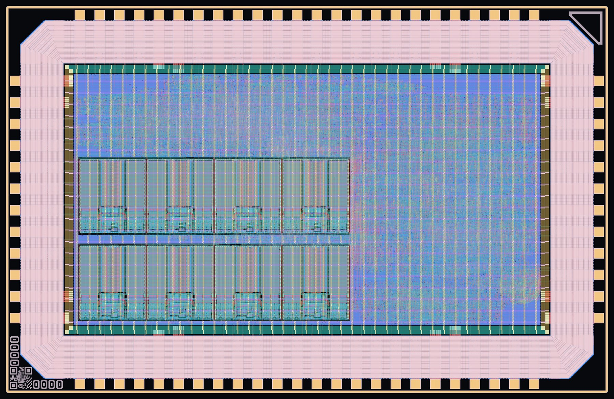
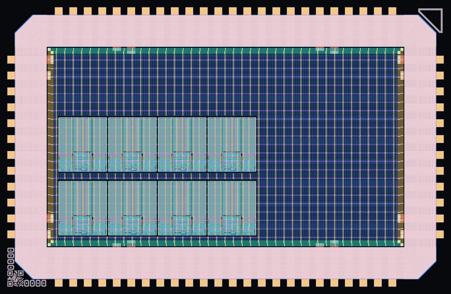
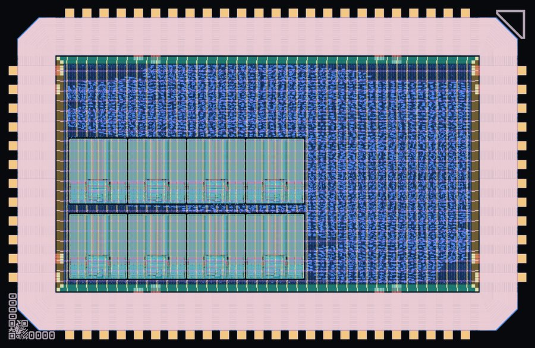
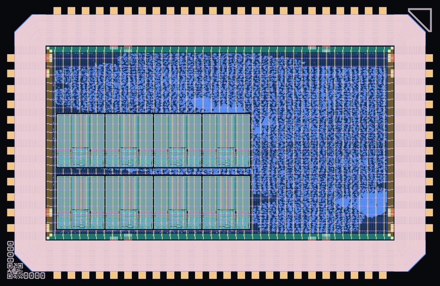
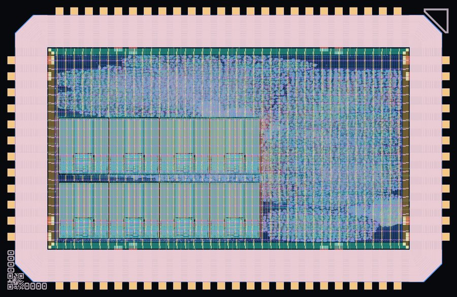

# RV328

A RISC-V microcontroller designed as a functional stand-in for the ATmega328PB: same 32-pin pinout,
same peripheral set, targeted at the open GlobalFoundries GF180MCU process through the wafer.space shuttle.

**Documentation site:** https://jbobrow.github.io/RISC-V-328/ (build log, decisions, cache study,
layout results, datasheet and an interactive layout viewer). Nothing has been measured on silicon yet;
every figure comes from simulation or the layout tools.



<table>
<tr><th>1. Power grid</th><th>2. Cells placed</th><th>3. Clock tree</th><th>4. Routed</th></tr>
<tr>
<td></td>
<td></td>
<td></td>
<td></td>
</tr>
</table>

**Read this first.** The digital chip is designed, passes simulation, and has been placed and routed three
times on GF180MCU (`docs/layout_results.md`). The third layout meets timing at 20 MHz at every corner and
is clean in DRC and LVS; its routed netlist passes three test programs in gate-level simulation. The
analog blocks (ADC front end, comparator, oscillators, reference, power-on reset, brown-out) are designed
at transistor level and simulated against the foundry models over four design rounds
(`analog/README.md`). All eleven are laid out and assembled into one analog macro (`analog/layout/`,
1380 x 927 um, checked and re-simulated from the layout; its plain logic is foundry standard cells). That macro has no supply or guard rings and no
hand-off files yet, and at 1.28 mm2 there is barely room for it beside the digital layout in the
half-height slot: a trial layout with its room reserved routes, but leaves no room to repair timing or
antennas, and one register's fan-out reaches only 17 MHz at the slow corner (`docs/layout_results.md`),
so that layout contains a stub in its place. Measurements against an ATmega328P (`docs/cache_study.md`)
showed that the 2 KB program cache is too small as well, so the chip is moving to the full-height slot:
there, with a 12 KB three-way cache, a faster multiplier and the analog macro in place (its 13 analog
lines drawn by `scripts/analog_straps.py`), the best layout so far (run `tgc2`) routes without violations
and meets 20 MHz at eight of nine corners; at the slowest one it is 0.63 ns short, all on the multiplier.
Rule checks, LVS and gate-level simulation with the macro are still to do (`docs/layout_results.md`,
`docs/build_log.md`). It is *not* ready to send to a foundry as the full chip; `docs/tapeout_checklist.md` lists what is done and what is left.

**To look at the layout,** open `docs/layout_viewer.html` in a browser: geometry with per-layer routing,
functional blocks, pins, clock tree and slowest path, and a 3D cut through the real process stack.
High-resolution pictures of the build stages and the finished layout are made by `make render` into
`layout/renders/` (59 MB, not kept in this repository; web-sized copies are in `docs/images/`).

## What is here

| Path | Contents |
|---|---|
| `rtl/` | the design: `rv328_core.v` (CPU, bus, peripherals, pin mux), `rv328_clkrst.v`, `rv328_xip.v`, `periph/`, `tech/` (process-specific cells), `analog/` (model and stub), `rv328_chip_top.v` (pad ring, generated) |
| `vendor/hazard3/` | Hazard3 CPU and debug (Luke Wren, Apache-2.0), pinned at the commit in `COMMIT` |
| `sw/` | `include/rv328.h`, start-up code, linker script, runtime helpers, test firmware; `bench/` holds the benchmark programs that also build for an ATmega328P |
| `tb/` | chip-level testbench and serial-memory model; `bench_top.v`, a fast bench of the core for Verilator |
| `flow/` | LibreLane configuration for the wafer.space half-height slot (run once end to end) and for the full-height slot (run to static timing); see `docs/layout_results.md` |
| `scripts/` | pad-ring generator, test runner, synthesis estimate, flow report, `layout_viewer/` (builds the viewer from any run), `render_layout.py` (high-resolution pictures), `core_area.py` (what fills the core of a routed layout) |
| `layout/` | outputs of the third layout run: metrics, timing summary, DRC and LVS reports (the GDS, DEF, netlist, SDF and full timing reports are kept outside git; see `layout/README.md`) |
| `analog/` | transistor-level analog blocks (ngspice netlists), their test benches and results; `analog/layout/` holds the device generators and the cells drawn so far, with their checks and pictures |
| `docs/` | the documentation site (`docs/index.html`, built from the markdown files by `make site`; it can be served as it is by GitHub Pages) with the build log and the decisions; datasheet with parity table, analog macro specification, bond-out, verification report, layout results, cache study (speed against an ATmega328P), layout viewer, tapeout checklist |

## Architecture in one paragraph

Hazard3 (RV32IMC) executes in place from a serial memory die inside the package through a cache (2 KB in
the first layout; 12 KB three-way in the full-height layout, see docs/cache_study.md);
2 KB of SRAM holds data. Sixteen peripheral slots provide GPIO with pin-change interrupts, five timers
with ten PWM outputs, two USARTs, two SPIs, two TWIs, an ADC/comparator controller, a watchdog and an NVM
controller. A clock unit switches glitch-free between RC, crystal/external and 128 kHz sources, prescales,
and stops the clock in the sleep modes with asynchronous wake-up. Pins that carry both a digital and an
analog function use two standard foundry pads bonded to one lead, so no custom pad cell is needed.

## Quick start

Tools: Icarus Verilog, Verilator, Yosys, clang/lld with the RISC-V target (LLVM), Python 3, make.
The foundry pad and SRAM simulation models the testbench needs are included under `vendor/gf180mcu/`.

```
make test                 # build firmware and run every chip-level test
scripts/regress.sh        # tests + foundry-SRAM subset + elaboration + synthesis estimate
make lint                 # Verilator lint of the digital core
python3 scripts/gen_padring.py   # regenerate chip top, pad order and bond-out from the pad table
make viewer PDK_DIR=<pdk>/gf180mcuD CROP=2606,1270,2644,1296   # rebuild docs/layout_viewer.html from the newest run
make report               # results table of the newest run
make render PDK_DIR=<pdk>/gf180mcuD      # pictures of the newest run: build stages and the finished layout
make analog-sim PDK_DIR=<pdk>/gf180mcuD  # every analog test bench (ngspice; a few hours)
make analog-layout PDK_DIR=<pdk>/gf180mcuD  # generate and check the analog cells drawn so far (klayout, magic, netgen)
```

The layout flow itself needs the wafer.space template's Nix environment; see `flow/README.md`.

## Licence

RV328 sources are Apache-2.0 (see `LICENSE`). Hazard3 keeps its own Apache-2.0 licence. The flow files
derive from the wafer.space project template (Apache-2.0).
