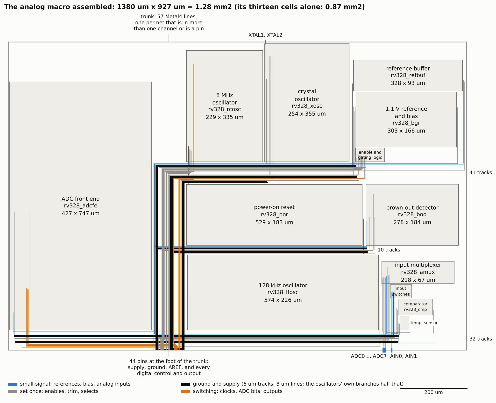
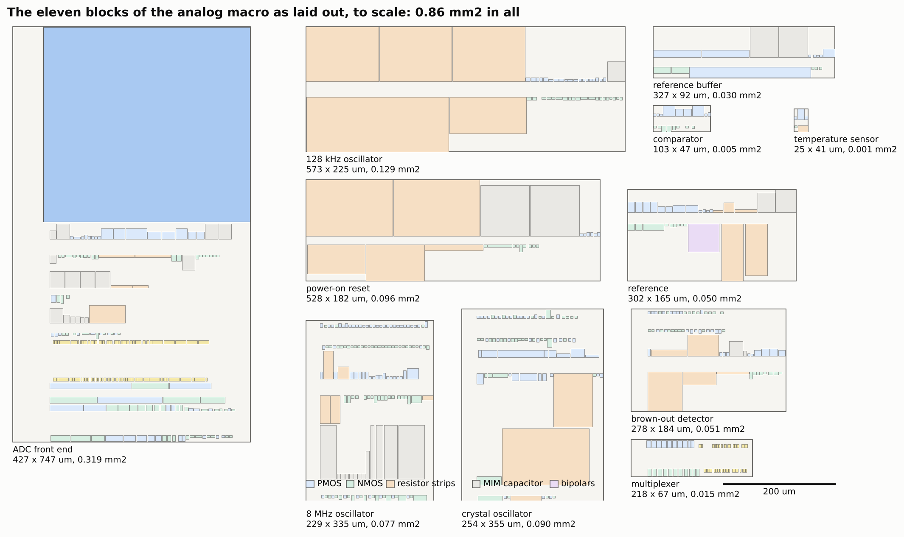
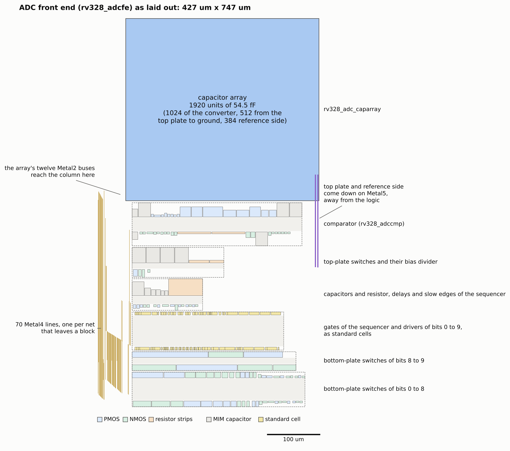
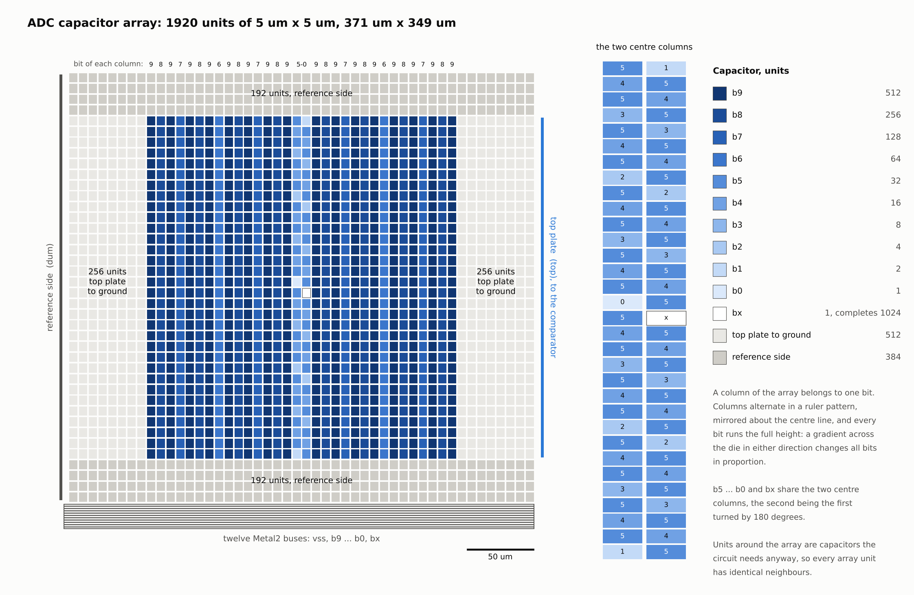
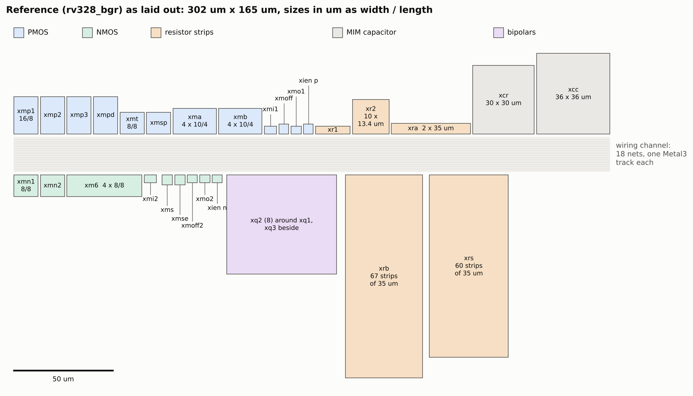
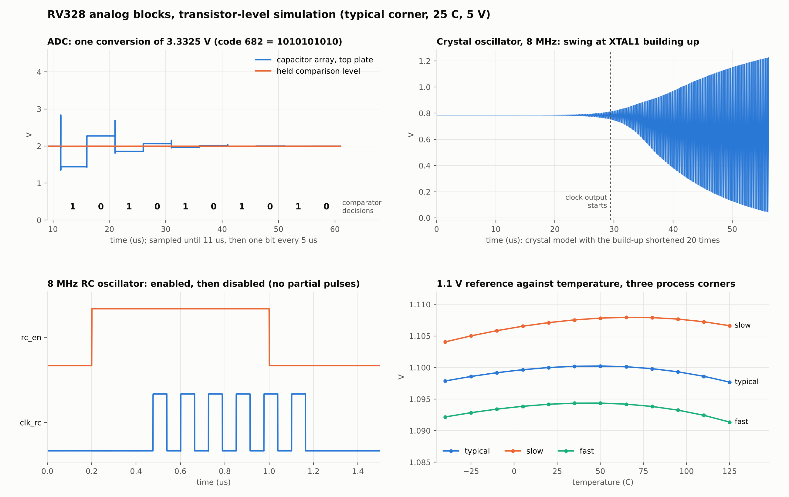
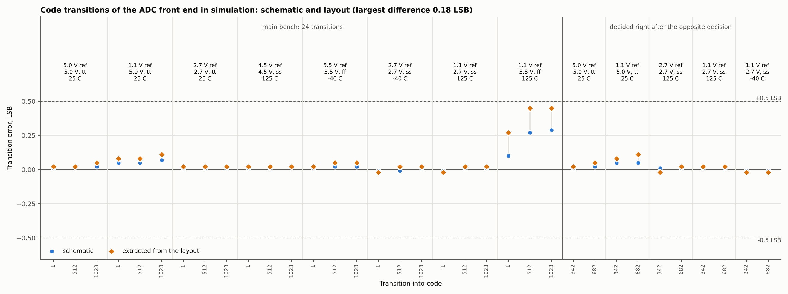
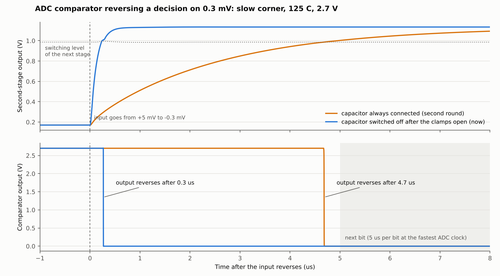
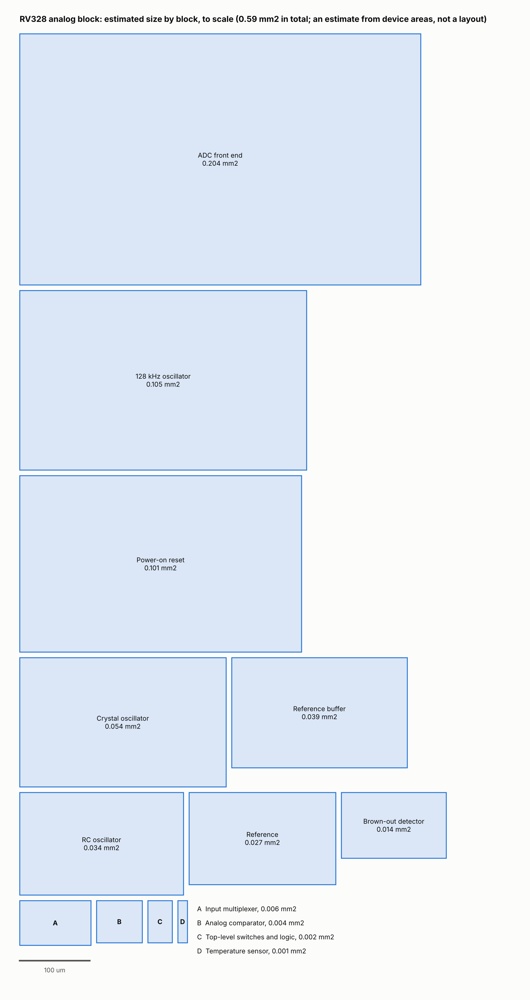

# RV328 analog block: circuits and simulation results

This directory holds the transistor-level design of `rv328_analog`, the block the digital core sees
through the ports in `docs/analog_macros.md`. Every circuit is built from GF180MCU 6 V devices and has
been simulated in ngspice against the foundry's models.

**Status: all eleven blocks are laid out, assembled into one macro layout, and re-simulated from it; the
macro has no supply or guard rings, no hand-off files for the digital flow, and at 1.28 mm2 barely
room beside the digital layout in the half-height slot (a trial layout routes but cannot be repaired;
"Size" below).** All eleven
blocks exist as netlists, each has a test bench that sweeps process corners, supply and temperature, and
the assembled block passes a power-up test that uses every function once. Thirteen cells are drawn, checked
and re-simulated from their layout (`layout/`): the reference, the ADC's capacitor array, its comparator,
the front end that contains those two with the switches, drivers and sequencer, the power-on reset,
the 128 kHz, 8 MHz and crystal oscillators, the brown-out detector, the reference buffer, the input
multiplexer, the analog comparator and the temperature sensor. Each layout sent the
design back to the schematics: the first two started a third round (a comparator too slow at low supply, a
resistor type this process does not have, a reference that changes when its resistors are cut into
strips), the ADC a fourth (a top plate that tracked too slowly, a sampling delay too short for the fix,
and seven places where a wire next to the wrong wire cost a fraction of a millivolt), the 128 kHz
oscillator a retuning (its quarter-microampere comparators are slowed by a few femtofarads of wire), the
8 MHz oscillator another (and its frequency now depends twice as much on the supply), the brown-out
detector two capacitors (its output chattered when the supply crossed a level slowly; a test in time,
written because of the layout, found that in the schematic). All
are corrected or recorded below, and the benches concerned have been run again. The macro's own gates and
switches are drawn as two more cells, and those two and the eleven blocks are placed and wired
(`layout/macro.py`; 1380 x 927 um, clean in both DRC tools, LVS against `blocks/rv328_analog.spice`);
the whole-block test passes from that layout's extraction as it does with ideal wires. The plain
logic of the ADC front end, the multiplexer and the macro itself is drawn as foundry standard cells. There is no LEF
or liberty file of the block and no place for it on the chip, so the chip layout still uses the stub.
The rows below give the schematic's values and say where a value is from a layout.

## Files

| File | Contents |
|---|---|
| `blocks/bgr.spice` | 1.1 V bandgap reference and the bias current for everything else |
| `blocks/por.spice` | power-on reset |
| `blocks/bod.spice` | brown-out detector, three levels |
| `blocks/cmp.spice` | `rv328_cmp`, the continuous-time comparator (brown-out detector, analog comparator) |
| `blocks/adccmp.spice` | `rv328_adccmp`, the ADC's comparator with offset cancellation |
| `blocks/rcosc.spice` | 8 MHz RC oscillator with 8-bit trim and glitch-free enable |
| `blocks/lfosc.spice` | 128 kHz oscillator |
| `blocks/xosc.spice` | crystal oscillator, three drive settings |
| `blocks/adcfe.spice` | ADC front end: sample and hold, the switches of the 10-bit capacitor DAC, comparator |
| `blocks/adccap.spice` | the 1920 unit capacitors of the ADC front end, as one cell because they are one array in layout |
| `blocks/amux.spice` | input multiplexer |
| `blocks/refbuf.spice` | buffer that drives the 1.1 V reference onto AREF, and the AVCC switch |
| `blocks/tsens.spice` | temperature sensor |
| `blocks/logic.spice` | gates, transmission gate, Schmitt trigger and flip-flop used inside the blocks |
| `blocks/rv328_analog.spice` | the assembled block, with the port list of `rtl/analog/rv328_analog_model.v` |
| `sim.py` | ngspice harness: model corners, `.meas` results as a Python dict |
| `tb/*.py` | one test bench per block; `python3 tb/<name>.py` prints the tables stored in `results/`. `tb/adcpat.py` measures the ADC transitions most exposed to a slow comparator, `tb/adcseq.py` a transition after a full-scale step of the input, `tb/revplot.py` draws `results/comparator_reversal.png` |
| `results/*.md` | the full result tables behind the summary below; `results/waveforms.png` is a picture of four of the runs (`tb/plots.py`) |
| `floorplan.py` | size estimate from the netlists: `results/floorplan.md` and `results/floorplan.png` |
| `layout/` | device and block generators, the drawn cells, their checks, extraction and pictures; see `layout/README.md`. `make analog-layout` rebuilds and checks them |

To reproduce: `make analog-sim PDK_DIR=<pdk>/gf180mcuD` (ngspice 42 or newer; about three hours, one
simulation at a time). `make analog-sim-layout` runs the benches of the drawn cells on the netlists
extracted from their layouts (three more hours): `results/bgr_pex.md`, `adccmp_pex.md`, `adcfe_layout.md`,
`adcseq_layout.md`, `por_pex.md`, `lfosc_pex.md`, `rcosc_pex.md`, `rcosc_steps_pex.md`, `xosc_pex.md`,
`bod_pex.md`, `cmp_pex.md`, `aux_pex.md`, `top_pex.md`, and `top_macro.md` (the whole-block test with
the macro's own gates and wiring from its layout as well).

Corners: `tt`, `ss`, `ff`, `sf`, `fs` are the transistor corners, with resistors, capacitors and bipolars
slow with slow and fast with fast; `tt_rcmax` / `tt_rcmin` are typical transistors with the passives at
their extremes. Temperature -40 to 125 C, supply 2.7 to 5.5 V unless a row says otherwise.

## Results against the specification

| Block | Target (docs/analog_macros.md) | Simulated | Verdict |
|---|---|---|---|
| Reference | 1.1 V | 1.102 V typical at 25 C; 1.097 to 1.106 V over corners, supply and temperature; 12 to 20 ppm/K; mismatch sigma about 14 mV (1.3 %); 19 uA; up 30 to 66 us after power; below 1 nA when disabled. The extracted layout gives the same values to 0.1 mV | meets (the ATmega's own limits are 1.0 to 1.2 V); no trim |
| Power-on reset | release about 1.4 V, glitch-free | releases between 1.30 and 1.94 V over corners (1.66 V typical), 0.19 to 0.30 ms after the supply is up; a dip to 1.2 V resets within 6.7 to 9.9 us; 0.9 to 1.5 uA. From its layout: the same thresholds, delay and current; a dip resets within 6.6 to 7.2 us | meets, except the delay: the specification's 1 ms has to come from a counter in the reset controller |
| Brown-out | 1.8 / 2.7 / 4.3 V, 2 % hysteresis, below 25 uA | 2.30 / 2.70 / 4.31 V typical, all within 0.5 % over corners; hysteresis 1.1 to 1.3 / 1.5 to 1.7 / 3.2 to 3.4 %; 20 to 34 uA with the reference; one edge each way when the supply ramps through a level at 0.1 V/ms. From its layout: the same thresholds, hysteresis and current, and the same single edges | **1.8 V level not possible**: the reference needs 2.2 V, so the lowest level is 2.3 V. Current over target when hot |
| RC oscillator | 8 MHz, +/-2 % after trim, 0.5 % steps, start below 10 us, no runt pulses | From its layout, which is what it is tuned on: 7.99 MHz at trim 0x80; trim range 5.5 to 15.8 MHz, monotonic, in steps of 0.38 % at the centre and up to 0.62 % there where a larger bit takes over (0.91 % at 0xE0); -0.8 to -0.3 % over temperature, -6.2 % at 2.7 V, -3.7 % at 3.3 V, +0.8 % at 5.5 V; first clock 0.2 to 0.4 us after enable, clean stop; 9 to 39 nA off. The schematic alone, without the wiring, runs at 8.92 MHz and falls 3.0 % at 2.7 V | meets: after trim within 0.5 % at the supply and temperature it was trimmed at, and -7 to +1 % from there over 2.7 to 5.5 V and -40 to 125 C, against the target's 10 %. A chip trimmed at 5 V is 6 % slow at 2.7 V, twice what the schematic showed. The steps at bit boundaries are larger than 0.5 %. Untrimmed it is -25 % to +36 % over process, so every chip needs its trim value stored. Draws 0.71 mA at 5 V (0.29 mA at 2.7 V) |
| 128 kHz oscillator | +/-10 %, below 2 uA | From its layout, which is what it is tuned on: 129.6 kHz typical; -6.6 % at 2.7 V, -1.1 to +0.3 % over temperature; -22 % to +34 % over the resistor and capacitor corners; 3.8 uA at 5 V, 1.5 uA at 2.7 V. The schematic alone, without the wiring, runs at 152.7 kHz | **does not meet** the accuracy without trim, or the current at 5 V |
| Crystal oscillator | 0.4-16 MHz, to 20 MHz, 32.768 kHz | gain margin (negative resistance over crystal loss) 3.8 to 15.6 in the 0.4-16 MHz setting, 6.3 to 10.8 at 16-20 MHz in the high-drive setting, 5.7 to 11.2 for a 70 kohm watch crystal, over corners and 2.7 to 5.5 V; oscillation builds up and the clock output has 44 to 55 % duty in all six start-up runs; 0.39 to 0.41 mA, 1.2 to 1.3 mA, and 1.7 to 6.8 uA. From its layout: the same margins within 0.3 in the MHz settings and up to 1.1 higher with the watch crystal (5.6 to 11.9), all six runs start, 47 to 57 % duty, 0.40 to 0.42 mA, 1.2 to 1.3 mA, and 2.1 to 9.4 uA | meets the gain target (5 or more) except at 16 MHz in the low setting, where the high-drive setting should be used. No amplitude control: see below |
| ADC front end | 10 bit, +/-2 LSB, DAC settles in one ADC clock | Schematic: 37 code transitions over 5 V, 2.7 V and 1.1 V references and five corners, all within -0.01 to +0.29 LSB of ideal (+0.01 to +0.02 LSB at 5 V, typical); without the fast corner at 125 C on the 1.1 V reference, -0.01 to +0.07 LSB. 46 of 46 complete conversions of mid-code inputs correct. Transistor mismatch moves a transition by 0.03 LSB (sigma). Top plate stays between 0.04 and 0.92 of the supply. **From the layout** (array, switches, drivers, sequencer, comparator, all extracted): 46 of 46 conversions correct; 24 transitions within -0.02 to +0.45 LSB, without that one corner -0.02 to +0.11 LSB; none more than 0.18 LSB from the schematic. The two transitions that are decided right after the opposite decision: -0.01 to +0.05 LSB on the schematic, -0.02 to +0.11 LSB from the layout, over five conditions. After a full-scale step of the input between two conversions (from the layout, three conditions) the transitions are where they are from rest, within 0.03 LSB | meets in simulation, also from the layout. Capacitor matching, which sets the real linearity, is not in the foundry model |
| ADC comparator | (part of the above) | offset left after cancellation +5 to +108 uV over corners, sigma 20 uV with mismatch; reverses a 5 mV decision on 0.3 mV in 0.23 to 0.39 us; 26 to 80 uA. From its layout: -3 to +171 uV, sigma 16 uV, 0.41 to 0.65 us | |
| Input multiplexer | 8 pins, temperature, 1.1 V, ground | channel resistance 110 to 440 ohm at 4.5-5 V; up to 5.3 kohm at 2.7 V, slow corner, mid-scale input. From its layout: the same | fine for the 10 us tracking time with sources up to 10 kohm |
| Reference buffer | 1.1 V onto AREF | within 0.7 mV of the reference; output resistance 2 kohm; settles in 1.6 ms with 100 nF on the pin; stable with no capacitor (6 mV undershoot on a 20 uA step); about 95 uA. From its layout: the same | works; see the ADC limits below |
| Temperature sensor | about 1 mV/K | 319 mV at 25 C, 1.07 mV/K, within 1 mV across corners and supply; the same from its layout | meets (mismatch not simulated) |
| Comparator | offset below 10 mV, delay below 500 ns | delay 39 to 189 ns at 10 mV overdrive; offset sigma 2.0 mV, worst of 40 runs 5.3 mV; 15 uA. From its layout: delay 76 to 354 ns, offset sigma 1.8 mV, worst 3.7 mV, same current | meets, but the inputs only work from 0 V to AVCC - 1.5 V, not rail to rail |
| Whole block | | power-up with every function used once: reset held and then released after 0.24 ms, 128 kHz running, brown-out quiet at 5 V, comparator switching at the 1.1 V reference, AREF at AVCC, one ADC conversion through the multiplexer correct, RC oscillator silent until enabled and then running; 155 uA with reference, brown-out, ADC and comparator on. The same ten checks pass with every one of the eleven blocks replaced by its extracted layout, joined by ideal wires (`results/top_pex.md`; 159 uA, 128 kHz oscillator at 129.6 kHz where the schematic's runs at 154 kHz), and again with the macro's own gates and the wiring between the blocks from the macro's layout (`results/top_macro.md`: the same values; the 8 MHz oscillator inside the macro, at a fine time step, 7.990 MHz with ideal wires and with the drawn ones). With every enable low: 4.5 uA once the reset delay has settled (33 uA in the first half millisecond) | all ten checks pass |

## What making the macro smaller changed

| Found | Cause | Change |
|---|---|---|
| A gate drawn from generated transistors takes ten times the area of the foundry's standard cell | a tap ring per transistor and a 0.9 um track per net | the plain gates of the ADC front end (88), the multiplexer (42) and the macro (24) are cells of the 5 V standard-cell library on the analog supply, `rv328_sinv` to `rv328_snor2` in `blocks/logic.spice`. Front end 0.39 to 0.32 mm2, multiplexer 0.045 to 0.015 mm2, the macro's logic 0.015 to 0.004 mm2. Delay stages, the Schmitt trigger and all switches stay transistors |
| Would the ADC need retiming with standard-cell drivers and sequencer gates? No | the library's inverter pulls up as the drawn one did and pulls down about a half harder (1.83/0.5 and 1.32/0.6 um against 2/0.55 and 1/0.7 um), and the interlock waits on the gate lines themselves | none needed. Schematic: 46 of 46 conversions, 37 transitions within -0.01 to +0.29 LSB, none moved by more than 0.005 LSB. From the layout: 46 of 46, 24 transitions within -0.02 to +0.45 LSB (+0.48 before), four of them 0.03 LSB lower and the rest where they were |
| With the reference and the two fast oscillators in one row, 0.7 to 1.2 mA of oscillator current ran through the ground track and trunk line the reference shares: 7 to 13 mV under the reference, and under the temperature sensor, whose output is 1 mV per kelvin. The first assembly had the same fault in its trunk (10 mV). No simulation showed it, because the extractions have no resistance | one supply net and one ground net for the whole macro | the two oscillators have a supply and a ground branch of their own, joined to the others at the foot of the trunk; the temperature sensor stands in the bottom channel. The reference's ground is now 1 mV from the pin (2.4 mV with the reference buffer on), the sensor's 0.3 mV |
| The comparator's output line ran 70 um beside the line of its positive input, 0.8 um apart: 3.9 fF | cells one above the other have their pin lines side by side all the way down | a small-signal line and a switching one beside the same cell are 4 um apart: 1.2 fF |
| The reference's layout changed without being asked to: its bipolar array stands 1.2 um and two of its resistor blocks 2.7 and 4.9 um further right, inside the same outline | the block generator now rounds track positions to the nanometre, and exact-fit spacings between leads that floating point used to pass are now refused. Found by drawing every unchanged block with the generator as it was and comparing shape for shape | the other nine blocks are identical to before, shape for shape. The reference as it is now is clean in both DRC tools and matches in LVS; its wiring capacitance is 668 fF against 670 fF, no net changed by more than 1.4 fF, and its bench, run again from this layout, prints the same figures as before in every line (`results/bgr_pex.md`) |

## What drawing the last five blocks changed

| Found | Cause | Change |
|---|---|---|
| The brown-out detector's output chattered when the supply rose slowly through the 2.7 V or the 4.3 V level: bursts of 20 ns pulses for 3 us before it cleared. This is the schematic; the bench until then only swept the supply as a DC value, and the test in time was written because of what the layout puts beside the taps | when the output changes, the hysteresis switch injects its charge into the bottom of the divider, and the megohm tap feels that before it feels the divider's new ratio, with the opposite sign | 1 pF from the tap to ground and 50 fF from the output's complement to the tap. `tb/bod.py` now ramps the supply through every level in time, down and up, and counts edges: one each way, in three corners, schematic and layout. A supply dip has to last a microsecond or two to be seen |
| The analog comparator is half as fast from its layout: 76 to 354 ns at 10 mV overdrive against 39 to 189 ns | 14 to 18 fF of wire on each of its three internal nodes, which run on 8 uA | none; it meets its 500 ns. Offset is unchanged |
| The temperature sensor's resistor was 78.5 um in one piece, a ratio of 5.86 to the reference's 13.4 um strip only as long as neither has ends | | six strips of 13.4 um: 319 mV at 25 C and 1.07 mV/K instead of 308 mV and 1.05 mV/K, and the ratio no longer depends on the strips' end resistance |
| The brown-out divider was five pieces of 54 um to 2.6 mm | | 90 strips of 51 to 59 um, the lengths chosen so that every section has nearly the same share of end resistance. Thresholds unchanged |

Reference buffer and multiplexer came out of their layouts as they went in.

## What drawing the 8 MHz and the crystal oscillator changed

| Found | Cause | Change |
|---|---|---|
| The 8 MHz oscillator extracted from its first layout ran at 6.95 MHz against 7.92 | 350 fF of wire on the 10 pF timing node (5 %); the track of the lower threshold beside the timing node's, 5 fF onto 270 kohm, so the threshold followed the ramp (3 %); 7 to 15 fF on each node of the comparators and the latch, which lengthens the delay from a threshold crossing to the driver's edge from 5.7 to 9.3 ns (7 %); the devices as extracted, without any wiring (3 %) | the thresholds' tracks lie between the bias lines; the timing resistor is two strips of 14.4 um instead of 33.4 um, set on the extracted layout: 7.99 MHz. The schematic alone runs at 8.92 MHz |
| From the layout its frequency falls 6.2 % at 2.7 V; the schematic said 3.0 % | the delay is a larger part of the period and grows as the supply falls (12.7 ns at 2.7 V) | none. Twice the comparator current brings 4.9 % for 0.3 mA and was not taken; see deviation 3 |
| Its trim steps are unequal where a larger bit takes over: 0.62 % at 0x80 beside 0.38 % | single capacitors and banks carry different wiring per unit, and bottom plates and switches do not scale with the bit | none; all such steps are positive (0.25 to 0.91 %), so the trim is monotonic |
| The crystal oscillator in the 32 kHz setting drew 10.3 uA from its first layout against 6.8 uA | 133 fF of wire on the output of the amplifier's replica, which runs on a third of a microampere there; the Schmitt trigger behind it draws current for as long as an edge lasts | the replica stands beside the Schmitt trigger: 86 fF, 9.4 uA |
| The clock output's track ran beside that node's, 11 fF | the output is the node's inverse, so its edges pushed the Schmitt trigger's input back by a few tenths of a volt | separated by two static lines: 0.8 fF |
| 1.2 mA through 0.4 um tracks and single vias in the crystal amplifier's path | the generators knew one track width | tracks and column lines of 1.6 um on that path, and up to six leads with two vias each on its transistors |
| Resistors of both blocks in one piece, the trim switches as up to 128 fingers of 2 um | | written as drawn: strips with `s=`, switches as fingers of up to 16 um. Thresholds and gain margins unchanged; the 8 MHz oscillator moved by 1 % |

## What drawing the reset circuit and the 128 kHz oscillator changed

| Found | Cause | Change |
|---|---|---|
| The 128 kHz oscillator extracted from its first layout ran at 106 kHz | not the timing capacitor (the wiring adds 3 % to it): the two comparators and the stages behind them run on a quarter of a microampere, and 12 to 19 fF of wire on each of their six internal nodes doubled their delay. That delay was already a quarter of the period on the schematic | the comparator's devices in the two rows now face each other, which shortens those wires (4 %); the timing resistor is 37 strips of 133.5 um, 1.7 Mohm, instead of 2.05 Mohm, set on the extracted layout. The delay is now a larger part of the period, so the frequency falls 6.6 % at 2.7 V instead of 3.6 % |
| Both blocks' resistors were one piece each, up to 16 mm long | | written as they are drawn, equal strips with `s=` in series (the reset divider's three resistors share one strip length). Thresholds, delays and frequency moved by less than 0.2 % |
| The oscillator's 2 pF was 36 unit capacitors | | one capacitor of 31.1 um, the same value |

## What the fourth round changed

Each of these came out of drawing the ADC front end and simulating it from its layout.

| Found | Cause | Change |
|---|---|---|
| In the slow corner at 125 C, 2.7 V supply and the 1.1 V reference, the ADC's transitions lay on a slope from -0.38 LSB at the bottom of the range to +0.01 LSB at the top (the open item of the third round) | tracking was not finished in 10 us. The top plate follows the input through its switch and the divider that sets its level, and in that corner the pair had a time constant of 1.3 us. Converting twice with a full-scale step of the input in between showed it (`tb/adcseq.py`): +0.38 LSB after a step up, -0.23 LSB after a step down | top-plate switch three times as wide (12 um, its copy on the reference side 3 um), divider 10 kohm instead of 20. After a full-scale step the same transitions are now at +0.02 and -0.02 LSB (from the layout, `results/adcseq_layout.md`). The divider draws 0.5 mA at 5 V while the input is tracked, so a conversion at the full rate averages 72 to 164 uA instead of 55 to 107 |
| With the wider switch every transition was 0.3 LSB high in the fast corner at 5.5 V with the 1.1 V reference | the switch leaves three times the charge when it opens. That step reaches the input through the array, a 10 kohm source restores it with a time constant of 0.3 us, and the comparator froze its offset, which is the moment the input is sampled, 0.25 us after | the delay from releasing the top plate to freezing the offset is 1.4 us instead of 0.3 (0.9 to 2.0 us over corners): a 1.2 Mohm resistor in twenty strips instead of 300 kohm |
| The bottom-plate switches were written as 1023 one-finger devices of each of five kinds: about 9 mm of transistor row | | from bit 3 up they are fingers 8 um wide with the same total width, 1.1 mm of row. Leakage into the input at 125 C in the fast corner went from 4 to 6 nA with the input at 0.55 V |
| Four small capacitors in the sequencer were plain capacitances, which cannot be drawn or compared | | they are MIM capacitors now (5 and 7 um square; 55 fF where the netlist had 30 fF, so those two delays are a few ns longer); the 5 pF that holds the top-plate level is four capacitors of 25 um, to fit a row |
| The comparator extracted from its first layout had -0.2 to -0.45 mV of offset left (schematic: +0.005 to +0.11 mV) and took up to 2.2 us to reverse a decision; the front end extracted from its first layout was up to 1.3 LSB off at a 1.1 V reference | seven couplings of 0.4 to 15 fF between a wire that switches and a node that must not move, each named in `layout/README.md` | arrangement only: which device stands where, which net gets which track, which tracks run the whole length as screens, which line of the wiring column is next to which. No circuit change |

With these, the 37 transitions of the main bench are within -0.01 to +0.29 LSB of ideal on the schematic
(third round: -0.29 to +0.41), and all but those in the fast corner at 125 C with the 1.1 V reference
are within -0.01 to +0.07 LSB. From the layout, 24 of them were measured: -0.02 to +0.45 LSB, and without that corner -0.02 to +0.11 LSB.

## What the third round changed

Each of these came out of drawing the first two cells.

| Found | Cause | Change |
|---|---|---|
| The ADC comparator needed 4 to 7 us to reverse a decision on 0.3 mV, in every corner; the bit time is 5 us. A transition decided right after the opposite decision was displaced by up to half an LSB (-0.52 LSB at 2.7 V, 125 C, slow corner, 1.1 V reference) | its second stage's output carries 1 pF so that both offset-storing clamps see the same thing behind them, and has to slew 0.9 V on the fraction of a microampere a small input gives | the capacitor is now on that node only while the clamps open; a switch takes it off two slow inverter delays later. Reversal takes 0.23 to 0.39 us; the same transition was then at -0.27 LSB and no longer depended on the decision before (what remained there was the slope the fourth round removed). Offset left after cancellation and current are unchanged. A lighter capacitor alone was tried first and tripled the offset |
| 21 resistors used a film the process does not have | `ppolyf_u_3k` is in the foundry's model file, but the gf180mcuD variant (the one the shuttle runs) only has the 1 kohm-per-square film; found when the layout tools had no such device | every one is now `ppolyf_u_1k_6p0` at three times the length (30.7 mm of 1 um strip became 92.1 mm) and all benches were re-run. Dividers are unchanged; the 128 kHz oscillator and the reset delays moved by a per cent or two. The longer strips have three times the capacitance to substrate: the reset circuit now answers a supply dip in 7 to 10 us instead of 3 to 4 |
| Reference drift rose from 14 to 41 ppm/K with the new film | the output divider's current flows through the bandgap resistor, so its temperature coefficient is part of the reference's | bandgap resistor ratio 10.0 instead of 10.26; drift 12 to 20 ppm/K |
| The extracted reference was 5 mV above the schematic | the foundry model gives each resistor strip about 180 ohm of end resistance; ten strips are not one long resistor | resistors in `bgr.spice` are written as they are built, equal strips with `s=` in series; schematic and layout agree to 0.1 mV |

## What the second round changed

The first round left three defects. All three are fixed, and fixing them exposed four more.

| Found | Cause | Change |
|---|---|---|
| Power-down current 0.32 mA instead of about 4 uA | with its bias off, the comparator's internal node floated and drifted to where the next inverter conducts | `rv328_cmp` has an enable that cuts its bias and holds that node |
| ADC wrong for inputs above two thirds of the reference | the top plate of the array was driven below ground when the hold phase began | a fixed capacitor half the size of the array on the top plate (it now moves by two thirds of the DAC step and stays between the rails), top plate rests at 0.4 of the supply, and the reference switches close a few ns before the ground switches |
| ADC 2 LSB out with the 1.1 V reference | comparator offset and the charge left by the top-plate switches, neither cancelled | new comparator `rv328_adccmp`: a low-gain preamplifier coupled through capacitors that store the offset while the input is tracked. The storing ends 0.3 us after the top plate is released, so the switch charge is stored too |
| New comparator's offset only fell to 0.4 mV | its second amplifier sat at a rail while storing, and its swing back coupled onto the storage node; later, the two storage nodes saw unequal steps when the clamps opened | the second amplifier is held at its switching point while storing; the clamps open on a slow edge and both see the same capacitance behind them |
| Errors of a millivolt at 125 C | leakage: 1024 minimum-length ground switches loaded the signal source (90 nA measured in the fast corner) | long-channel reference and ground switches. As a precaution the comparator clamp that ends on a node which sits at ground is now two devices with their middle held at the bias level, and a 5 pF capacitor holds the top-plate bias node |
| 2.7 V, slow corner: array not settled after 10 us | top-plate path too resistive at low supply | 20 kohm divider instead of 40, wider top-plate switch |
| Results moved by 0.4 LSB between runs | ngspice's default tolerances do not conserve the array's charge well enough | the ADC benches run with `reltol=1e-4`; gear integration gives the same answers |

## What does not match the ATmega328PB, or is not done

**Deviations in the circuits as designed**

1. Lowest supply. The reference, and with it the brown-out detector, ADC and comparator, are
   characterised from 2.7 V (the reference itself works from 2.2 V). The ATmega's analog works from
   1.8 V. The lowest brown-out level is 2.3 V instead of 1.8 V.
2. The analog comparator's input range ends 1.5 V below AVCC, and its offset (sigma 2 mV) is not cancelled.
3. Both RC oscillators depend on absolute resistor and capacitor values, which vary by a quarter to a
   third between process corners. The 8 MHz oscillator has the trim range to absorb that, but the chip
   needs a per-die calibration value loaded into `rc_trim` (the AVR stores OSCCAL at the factory). The
   128 kHz oscillator has no trim. Both also depend on the supply, because the delay of their comparators
   does: from their layouts the 8 MHz oscillator is 6.2 % slower at 2.7 V than at 5 V and the 128 kHz
   one 6.6 %. A chip that needs the 8 MHz oscillator within 2 % has to be trimmed at the supply it runs on.
4. Currents are higher than the AVR's in places: RC oscillator 0.71 mA, 128 kHz oscillator 3.8 uA at
   5 V, watch-crystal oscillator 2.1 to 9.4 uA, power-on reset 1.1 uA always on, so about 5 uA in
   power-down rather than below 1 uA. The ADC draws 0.5 mA at 5 V while it tracks the input (nearly all of it in
   the divider that sets the top-plate level) and about 40 uA while it converts: 72 to 164 uA on
   average at the full rate, plus the reference.
5. ADC timing. The input is sampled 0.9 to 2.0 us after `adc_sample` falls, 1.4 us typically (when the comparator stops
   storing its offset), not on the edge, and the first trial code must be on `adc_dac` by then. During
   that interval the signal source has to restore the step the top-plate switch leaves on the array
   (0.7 mV at 5.5 V); a 10 kohm source does so with a time constant of 0.3 us (the transitions above
   were measured with one), a much higher impedance would not finish. The first decision is still
   taken one ADC clock period after the edge, which leaves 3 us at 200 kHz in the slowest corner.
6. ADC inputs. At 125 C in the fast corner the front end's switches draw 6 nA from the selected pin
   with the input at 0.55 V and 17 nA at 5.5 V: up to 0.17 mV across a 10 kohm source. A source of 100 ohm or less pushes the top plate 0.7 V below ground for a
   moment when tracking starts; the conversion is still right, but the layout needs a guard ring there.
7. ADC internal channels (temperature sensor, 1.1 V) have about 80 kohm source resistance and need
   40 us of tracking, four times what the pins need; use the slowest ADC clock for them or add a buffer.
8. Internal reference on AREF: the 100 nF capacitor supplies the DAC's charge during a conversion
   (a droop of up to half an LSB by the last bit); the buffer's 2 kohm output resistance adds a gain
   error of up to 0.1 % at the highest sample rate (the DAC draws up to 0.6 uA on average from a 1.1 V reference).
9. The crystal oscillator has no amplitude control. The crystal dissipates 0.13 to 0.15 mW at 8 MHz
   (80 ohm) and 0.46 to 0.55 mW at 20 MHz (30 ohm); the second is above what small crystals are rated
   for, so check the crystal or add a series resistor. A watch crystal sees 0.1 to 0.4 uW, which is
   fine. The core's crystal-ready counter is 128 cycles, far shorter than a crystal's build-up (the AVR
   waits 258 to 16 K cycles); it should be lengthened in the RTL before the oscillator is used.
10. Every resistor is now written as it is drawn, in strips. A strip gains about 0.3 % of end resistance
    per 60 um, so a ratio is exact only between resistors made of the same strip (the reference, the
    reset divider, the oscillators' threshold dividers, the temperature sensor against the reference);
    the brown-out divider's sections use strips of 51 to 59 um and differ by 0.05 %.
11. The ADC as laid out has more offset than the schematic, in one corner. In the fast corner at
    125 C and 5.5 V its transitions are 0.2 mV higher at the input than the schematic's: 0.2 LSB with
    the 1.1 V reference (+0.27 to +0.45 LSB against +0.10 to +0.29), 0.04 LSB with a 5 V reference.
    In the other seven conditions the difference is 0.04 LSB or less. About half of it is the
    comparator, whose wiring leaves 0.06 mV more offset at its inputs; the rest has not been
    broken down further. It is an offset, the same at the bottom, middle and top of the range.

**Not simulated**

* Capacitor mismatch. The foundry's MIM model has no mismatch term, so the DAC's linearity, which rests
  on the matching of 5 x 5 um units, cannot be put through Monte Carlo with these models. Transistor
  mismatch is covered for the reference, both comparators and one ADC transition.
* Noise, supply rejection as a frequency response, ESD and latch-up behaviour of the pins.
* The ADC together with the digital controller. The conversions here apply the trial codes the
  controller would apply for the known input and check all ten comparator decisions; a wrong decision
  therefore shows as a failed conversion, not as the code the real controller would end on.
* A crystal at its real Q: the start-up runs use a crystal model with the build-up shortened 20 times,
  which leaves the gain condition unchanged but does not predict the start-up time.

**Not started**

* For the macro, which is now placed and wired (`layout/README.md`, "The macro"): supply and guard
  rings, protection on the pins, a supply branch for the ADC like the oscillators', pins where the
  chip wants them. Three tenths of its 1.28 mm2 is wiring and empty corners.
* The macro in the chip layout: the full-height layout reserves a blank block for it ("Size"); its
  pins, supplies and the wires that must pass it are not designed.
* Standard cells for the logic inside the two fast oscillators and the brown-out detector (47 gates),
  which means tuning both oscillators again on their new layouts.
* A faster comparator for the 8 MHz oscillator, which would give back its supply dependence, and a
  remedy for the watch-crystal setting's extra current (`layout/README.md`, "Not covered").
* A still denser ADC front end. It is 0.32 mm2 against 0.20 mm2 estimated, now that its bit drivers
  and the sequencer's gates are standard cells (0.39 mm2 before). Two of its blocks could stand side
  by side, and the switches could go under the capacitor array.
* A denser arrangement of the reference (it is 0.050 mm2 against 0.027 mm2 estimated) with dummy devices
  and an interdigitated mirror, if its spread is to be trimmed.
* LEF, liberty and GDS of the whole block for the flow, and the swap of the stub for the macro in
  `flow/librelane` (macro placement, clock definitions in the SDC).
* A place to keep the calibration values (RC trim, optionally reference and temperature).

## Size

`floorplan.py` adds up the drawn area of every device in the netlists and multiplies it by what a
layout adds around it (the factors are in the script and in `results/floorplan.md`). Its total is
0.59 mm2, an eighth of the chip's 5 mm2 core: an estimate from device areas, not a floorplan.

With all eleven blocks drawn, those made of transistors are one and a half to four times their
estimate (the ADC front end 0.32 mm2 against 0.20, and 0.39 before its gates were standard cells; the
reference 0.050 against 0.027; the 8 MHz oscillator 0.077 against 0.034; the crystal oscillator 0.090
against 0.054; the brown-out detector 0.051 against 0.014; the multiplexer 0.015 against 0.007, and
0.045 before) and those made of resistors or of a few large devices are close to
it (power-on reset 0.096 mm2 against 0.10, 128 kHz oscillator 0.129 against 0.11, reference buffer 0.030
against 0.039, the capacitor array 0.130 against 0.12). What costs area is a tap ring per transistor
and a wiring track per net in place of a dense hand layout. The eleven blocks add up to 0.86 mm2, a
sixth of the core.

**The assembled macro is 1380 x 927 um, 1.28 mm2,** and there is no room for that beside the digital
layout as it is placed. (As first assembled it was 1345 x 1098 um, 1.48 mm2. Standard cells for the
logic took 0.11 mm2 off the cells, 0.98 to 0.87 mm2, and standing cells one above the other within a
row took the rest; the oscillators' own supply lines gave 0.02 mm2 back.) The half-height slot's core is 5.01 mm2. The eight memories take 1.68 mm2 of
it; of the 3.20 mm2 of cell rows the standard cells take 1.48 mm2, 46 %, and the other 1.71 mm2 is
empty rows, spread between the cells. (The flow's own metric says 1.99 mm2 and 62 %: it counts the pad
ring's four corner cells as standard cells. `scripts/core_area.py` adds the cells up from the routed
DEF.) Turned on its side the macro fits the 1.24 mm wide strip to the right of the memories. With it
and a 10 um margin in place, 1.87 mm2 of rows is left for the 1.48 mm2 of standard cells: 79 % full
(89 % with the macro as first assembled). A trial at that density has since been run (below).

The 0.9 to 1.0 mm2 this page hoped for before the standard cells were tried was too low a guess.
What is left to take, each item a piece of work of its own, adds up to perhaps 0.15 mm2, which would
mean about 73 % for the digital rows: two blocks of the ADC front end side by side and its switches
under the array (0.03 to 0.05 mm2); the resistor rows of the reset circuit and the 128 kHz oscillator,
a third of which are empty, drawn again, with the oscillator tuned again (0.05 mm2); standard cells in
the oscillators and the brown-out detector (0.02 mm2); pins on more than one edge, which would halve
the trunk (0.04 mm2). Below that the analog cells would have to be drawn another way than one ring
per transistor and one track per net.

**The trial has been run** (`docs/layout_results.md`, "Trial with the analog block"): the digital flow
with a blank block of the macro's size in the core, cells at 74 % of the rows left. In the third
floorplan tried it places and routes without rule violations, but only with the repair steps after
global routing switched off, because at that density their buffers and antenna diodes cannot be placed.
What that leaves: 2,561 slew entries, one hold violation, 79 antenna nets, and at the slow corner the
fan-out of one register short of 20 MHz by up to 7.8 ns (17.3 MHz) because three weak cells on it drive
long wires; every other path meets, the best of them by 0.02 ns where the layout without the block has
5.9 ns. So the macro and the digital layout fit this slot only with every margin gone and with repair
left to do by hand, which nobody has shown can be done. The 0.15 mm2 that could still be taken off the
macro would buy 2 % of the rows.

The way out taken is the full-height slot: 12.9 mm2 of core against 5.0 mm2. A first layout there, with a
blank block of 1405 x 927 um for this macro (lying down, with a 24 um strip for wires on its east side)
and a cache six times larger, routes cleanly, meets 20 MHz at all nine corners and has its cells at
41 % of their rows (`docs/layout_results.md`, "Full-height layout with the 12 KB cache"). The macro's
pins, supplies and the wires past it are still to do there.

The other way out, not taken:

* a smaller digital layout. The memories are 1.68 mm2: 2 KB of SRAM, which parity with the ATmega
  needs, and the 2 KB instruction cache, four 512 x 8 macros each. A 1 KB cache from the library's
  256 x 8 macros would free 0.25 mm2 and bring the rows to 70 %, at the price of more cache misses.
  That is untried and not far from the 74 % that failed, and measurements have since shown that even
  the 2 KB cache is too small for the chip to keep up with an ATmega (`docs/cache_study.md`).

## Design notes

* **One bias for everything.** The bandgap's PTAT current (about 4 uA per unit) is mirrored to the
  comparators, the reference buffer, the temperature sensor and the MHz crystal settings through one gate
  voltage, `vbp`. The reference turns on when any user is enabled. The power-on reset, the 128 kHz
  oscillator and the watch-crystal setting have their own bias so they run with the reference off.
* **Bandgap.** Voltage-mode (two PNPs at 1:8 and a third for the output), with a two-stage error
  amplifier and a start-up circuit that senses the bias current itself. A current-mode version was tried
  first and dropped: it had a second stable state at low supply in one corner.
* **Oscillators.** Both RC oscillators compare a capacitor with one third and two thirds of the supply,
  so the RC part of the period does not depend on the supply or the transistors. The comparators' delay
  does, and from the layouts it is a seventh of the 8 MHz oscillator's period (deviation 3). The 8 MHz one trims an
  8-bit binary capacitor bank; its enable is re-timed on the oscillator's own falling edge so the output
  never carries a partial pulse.
* **ADC.** Charge redistribution on 1024 unit capacitors (55 pF) with a further 512 from the top plate
  to ground. The input is tracked on the bottom plates with the top plate held at 0.4 of the supply.
  On the falling edge of `adc_sample` the top plate is released; 1.4 us later the comparator freezes
  its stored offset and the bottom plates leave the input and go to the trial code. The comparator
  sees the top plate against a dummy capacitor that was sampled through a scaled copy of the same
  switch. The three switches on each bottom plate are interlocked on their own gate lines, so the
  reference is never shorted to ground or to the input; before that was added the DAC drew eight
  times the charge from the reference.
* **Layout.** Capacitor array: one column per bit, interleaved and mirrored; the capacitors the circuit
  needs around the array anyway serve as its surround; bottom plates wired on Metal3 underneath, top
  plates on Metal5 where no Metal3 runs. Reference: generated devices in two rows facing a wiring
  channel, resistor ratios as strip counts, the unit bipolar inside the eight. ADC front end: drawn
  from its netlist as a stack of such blocks under the array, joined by a column of vertical lines.
  Details, rule interpretations and the extraction methods are in `layout/README.md`.
* **Simulate the extracted layout before believing it.** Every ADC layout problem so far passed DRC
  and LVS: they were wires side by side, a fraction of a femtofarad to a few femtofarads from a
  5 V edge onto a node that stores a millivolt on a picofarad. The way to find which wire: delete
  groups of capacitors from the extracted netlist until the error goes.
* **A cure can need a second cure.** Widening the top-plate switch fixed tracking and tripled the
  charge it leaves on the input; only the bench that converts twice in a row, and then the fast
  corner at the smallest reference, showed both.
* **Check the device list of the process variant, not the model file.** The model file describes every
  option the foundry offers; a given variant has a subset. The LVS decks are the place to look.
* **Off states need their own test.** Two of the defects found so far only exist when a block is
  disabled (the reference drew 0.27 mA "off", the whole block 0.32 mA), and neither showed in corner
  sweeps that run with everything enabled. `tb/off.py` measures every block's off state and, with
  `--whole`, the assembled block.
* **A threshold with hysteresis needs a test in time.** Swept as a DC value, the brown-out detector's
  supply gave two clean thresholds; ramped slowly in a transient run, its output chattered. A DC sweep
  finds where the loop settles and says nothing about the order in which its parts arrive.
* **What the simulator needs.** The RC oscillator's frequency is only right with a time step of 0.2 ns
  or less (7.06 MHz instead of 8.00 MHz at 20 ns); its own bench uses 0.2 ns, the whole-block bench
  runs at 20 ns and only checks that the oscillator starts. The ADC needs tight tolerances (above).
  Run one simulation at a time: on the two-core machine used here, two side by side each ran 25 times
  slower.
* **Foundry model pitfalls** met on the way: the MOS capacitor model stops transient runs, so every
  capacitor is MIM; transistors wider than about 100 um have no model bin, so wide devices are several
  in parallel.
