# RV328 analog layout

All eleven blocks of the analog macro are drawn, as thirteen cells: the reference, the ADC front end
with its two parts (the capacitor array and the comparator), the power-on reset, the three oscillators
(128 kHz, 8 MHz and crystal), the brown-out detector, the reference buffer, the input multiplexer, the
analog comparator and the temperature sensor. All are generated by scripts, pass the foundry DRC deck,
match their netlists in LVS, and have been re-simulated from the layout. They are assembled into the
macro `rv328_analog`: its own gates and switches as two more cells, those two and the eleven blocks
placed, and the wiring between them, 1380 x 927 um; that too passes both DRC tools and LVS and has been simulated
from its extraction ("The macro" below). The plain logic of the ADC front end, the multiplexer and the
macro is drawn as foundry standard cells ("Standard cells for the logic"). The macro has no supply or
guard rings yet, and its pins are where its wires end.

| Cell | Contents | Size | Foundry DRC (KLayout, 162 decks) | DRC (magic) | LVS | Re-simulated from layout |
|---|---|---|---|---|---|---|
| `rv328_adcfe` | the whole ADC front end: the two cells below, and 73 more transistors, 88 standard cells, 3 resistors and 10 capacitors in five blocks | 427 x 747 um, 0.319 mm2 | 0 violations | 0 | matches `blocks/adcfe.spice` | ADC benches: 46 of 46 conversions correct, 24 transitions within -0.02 to +0.45 LSB, none more than 0.18 LSB from the schematic |
| `rv328_adc_caparray` | all 1920 MIM units of the ADC front end | 371 x 349 um, 0.130 mm2 | 0 violations | 0 | matches `blocks/adccap.spice` | as part of the front end |
| `rv328_adccmp` | the ADC comparator: 35 transistors, 2 resistors, 6 capacitors | 327 x 83 um, 0.027 mm2 | 0 violations | 0 | matches `blocks/adccmp.spice` | comparator bench: offset left -3 to +171 uV (schematic +5 to +108) |
| `rv328_bgr` | the reference: 21 transistors, 10 bipolars, 5 resistors in 140 strips, 2 capacitors | 303 x 166 um, 0.050 mm2 | 0 violations | 0 outside the foundry's bipolar cell | matches `blocks/bgr.spice` | reference bench: every value within 0.1 mV of the schematic |
| `rv328_por` | the power-on reset: 14 transistors, 5 resistors in 212 strips, 2 capacitors | 529 x 183 um, 0.096 mm2 | 0 violations | 0 | matches `blocks/por.spice` | reset bench: thresholds, delay and current as on the schematic |
| `rv328_lfosc` | the 128 kHz oscillator: 39 transistors, 5 resistors in 293 strips, 1 capacitor | 574 x 226 um, 0.129 mm2 | 0 violations | 0 | matches `blocks/lfosc.spice` | oscillator bench: 129.6 kHz typical; tuned on the layout (the schematic alone runs at 152.7 kHz) |
| `rv328_rcosc` | the 8 MHz oscillator: 123 transistors, 5 resistors in 106 strips, 328 capacitor units | 229 x 335 um, 0.077 mm2 | 0 violations | 0 | matches `blocks/rcosc.spice` | oscillator bench: 7.99 MHz at the centre of the trim; tuned on the layout (the schematic alone runs at 8.92 MHz); falls 6.2 % at 2.7 V where the schematic falls 3.0 % |
| `rv328_xosc` | the crystal oscillator: 80 transistors, 3 resistors in 138 strips | 254 x 355 um, 0.090 mm2 | 0 violations | 0 | matches `blocks/xosc.spice` | oscillator bench: gain margins and start-up as on the schematic; 9.4 uA instead of 6.8 uA with a watch crystal at 5 V |
| `rv328_bod` | the brown-out detector with its comparator: 57 transistors, 5 resistors in 90 strips, 2 capacitors | 278 x 184 um, 0.051 mm2 | 0 violations | 0 | matches `blocks/bod.spice` | brown-out bench: thresholds and hysteresis as the schematic; one edge each way on a slow supply ramp |
| `rv328_refbuf` | the reference buffer: 13 transistors, 2 capacitors of 5 pF | 328 x 93 um, 0.030 mm2 | 0 violations | 0 | matches `blocks/refbuf.spice` | buffer bench: as the schematic |
| `rv328_amux` | the input multiplexer: 21 transistors and 42 standard cells | 218 x 67 um, 0.015 mm2 | 0 violations | 0 | matches `blocks/amux.spice` | channel resistance as the schematic |
| `rv328_cmp` | the analog comparator: 17 transistors | 104 x 48 um, 0.005 mm2 | 0 violations | 0 | matches `blocks/cmp.spice` | comparator bench: delay 76 to 354 ns (schematic 39 to 189), offset unchanged |
| `rv328_tsens` | the temperature sensor: 4 transistors, 1 resistor in 6 strips | 26 x 42 um, 0.001 mm2 | 0 violations | 0 | matches `blocks/tsens.spice` | as the schematic |
| `rv328_acsw` | the switches at the comparator's inputs: 8 transistors and 2 standard cells (lines of the top netlist) | 64 x 40 um | 0 violations | 0 | matches | as part of the macro |
| `rv328_glue` | the macro's enable and gating logic: 22 standard cells (lines of the top netlist) | 87 x 41 um | 0 violations | 0 | matches | as part of the macro |
| `rv328_analog` | the macro: all cells above, 83 tracks in three channels, a trunk of 57 lines | 1380 x 927 um, 1.279 mm2 | 0 violations | 0 outside the foundry's bipolar cell | matches `blocks/rv328_analog.spice`, block by block and then the top | whole-block test: the same ten checks and values as with ideal wires |
| `devtest` | one of each generated device, and a bank of capacitors | 281 x 50 um | 0 violations | 0 | matches | - |

`reports/checks.md` is the table as the check script wrote it.

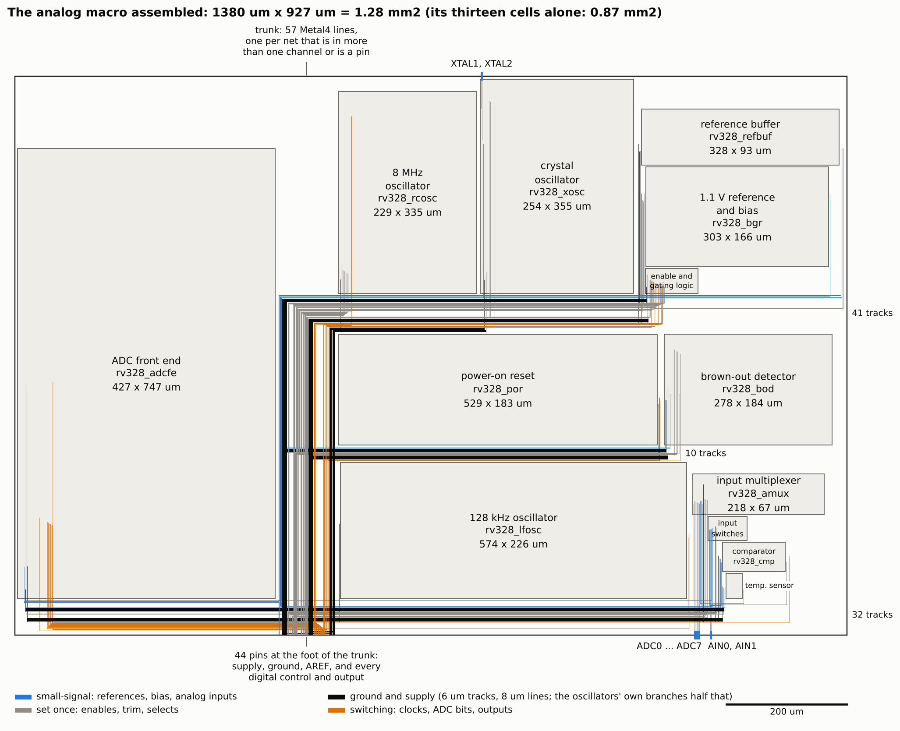

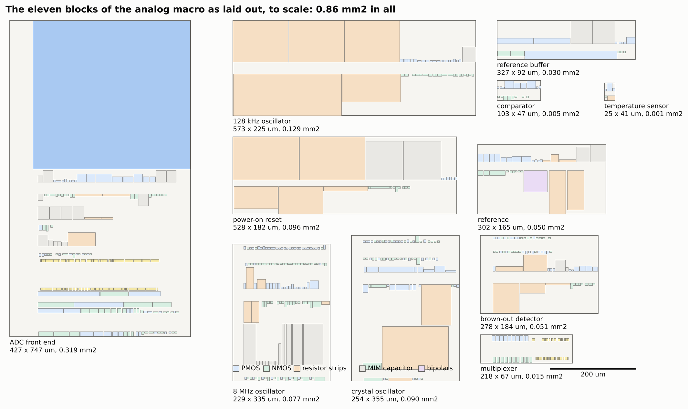

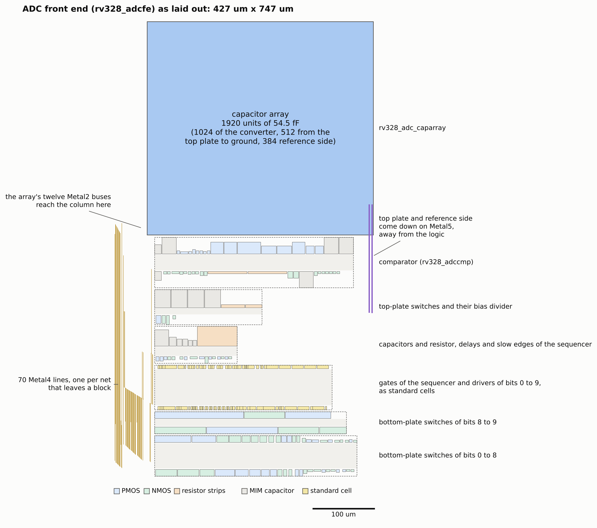

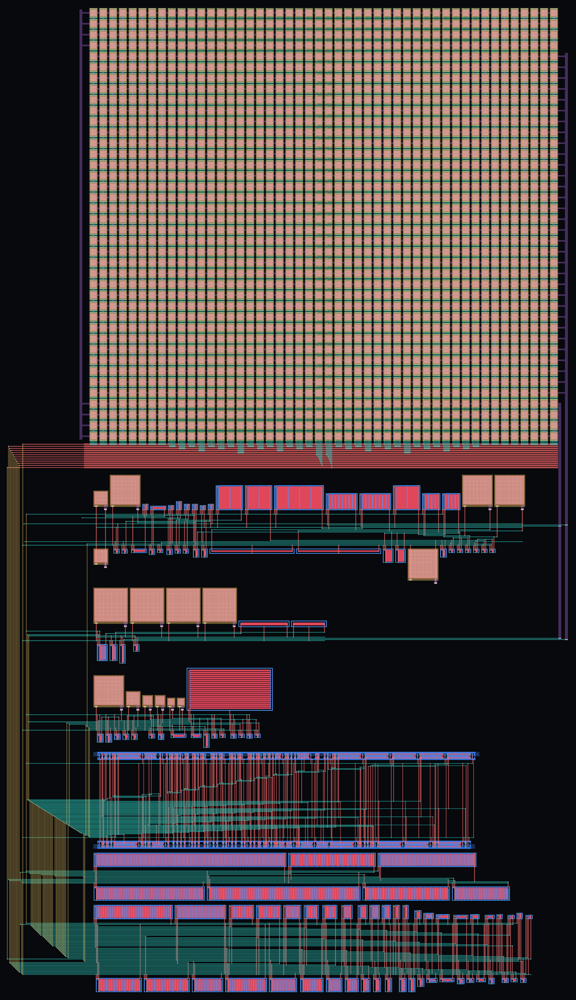

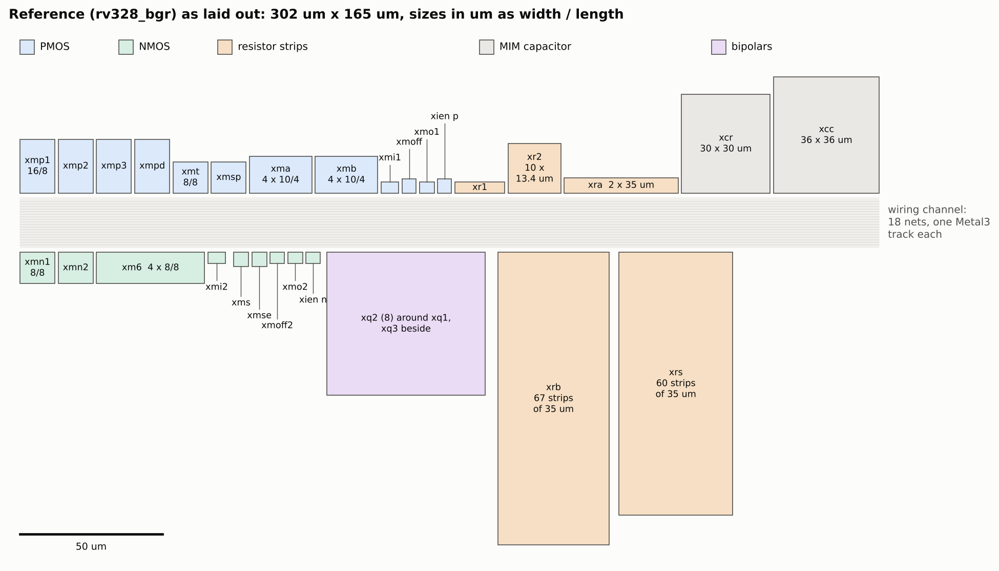

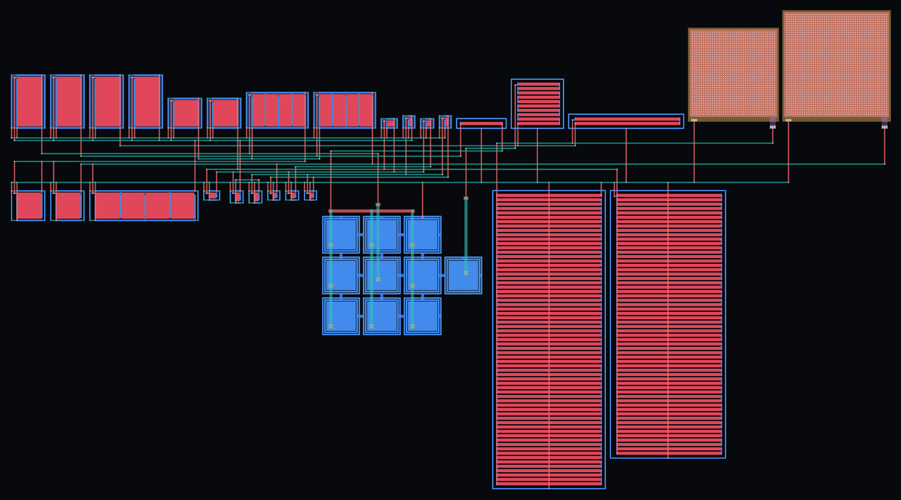

## Files

| File | Contents |
|---|---|
| `devices.py` | device generators: 6 V transistor with tap ring, the two poly resistors as strips in series, MIM capacitor and banks of unit capacitors; the foundry's standard cells, with the places on each pin where a via may stand (needs KLayout's Python module) |
| `block.py` | assembles a block from devices: two rows facing a wiring channel, with strips of standard cells in the rows where the netlist has them; also the bipolar array |
| `autoblock.py` | draws a block straight from its netlist, with a table of where the netlist's order is not good enough; used for the ADC comparator, inside the front end, and for the reset circuit, the 128 kHz oscillator, the reference buffer, the analog comparator and the temperature sensor |
| `stack.py` | draws a cell from its netlist as several blocks stacked, joined by a column of lines, with a table of which devices belong together; used for the 8 MHz and the crystal oscillator, the brown-out detector and the multiplexer |
| `macro.py` | the macro: draws its gates and switches as two cells, places all cells, wires them in channels and a trunk, writes the netlist LVS compares with, extracts the wiring |
| `bgr.py` | the reference: which device goes where and on which net; writes the GDS and the netlist for LVS from `blocks/bgr.spice` |
| `caparray.py` | the ADC capacitor array |
| `adcfe.py` | the ADC front end: cuts the netlist into blocks, stacks them under the array and the comparator, and joins them |
| `drc.sh`, `lvs.sh` | foundry DRC of one cell; magic DRC, extraction and netgen LVS of one cell |
| `pex.py` | capacitor array: wiring capacitance, its effect on linearity, extracted netlist |
| `pex_block.py` | any generated block: devices plus wiring capacitance as a netlist for simulation |
| `drc_inside.py` | tells `check.sh` whether every one of magic's messages lies inside a foundry bipolar cell |
| `check.sh` | everything above for every cell and the macro: `make analog-layout` |
| `rv328_*.gds.gz` | the layouts |
| `rv328_*_pex.spice` | extracted netlists. `RV328_PEX=bgr` (or `adccmp`, `por`, `lfosc`, `rcosc`, `xosc`, `bod`, `refbuf`, `amux`, `cmp`, `tsens`) puts one in place of its schematic in any bench; `macro` puts the macro's own extraction (`rv328_analog_pex.spice`) in place of the top netlist; `tb/adcfe.py --layout` uses the front end and the array (`make analog-sim-layout` runs them all) |
| `figures.py` | the explanatory figures in `renders/` |
| `wirecap.py` | the macro's wiring net by net, from its extraction: `reports/macro_wiring.md` |
| `reports/` | `checks.md`, `macro_wiring.md`, the KLayout DRC databases, the netgen LVS reports, `caparray_pex.md` |
| `renders/` | pictures of the cells |

## Standard cells for the logic

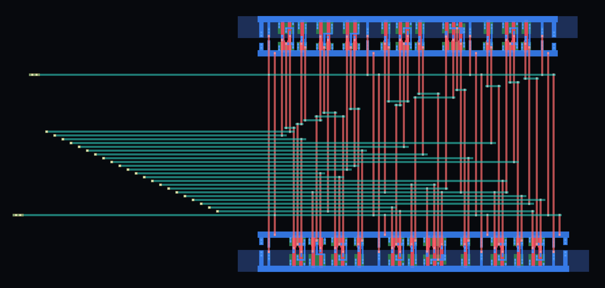

A NAND gate drawn from four generated transistors, each in its own tap ring, takes about 160 um2 of
row. The foundry's own gate is 14 um2. The plain gates of three cells are therefore no longer drawn
from transistors: they are cells of the 9-track 5 V library the digital core uses
(`gf180mcu_fd_sc_mcu9t5v0`), on the analog supply, wired by the same block generator.

| Cell | Gates now standard cells | Was | Is |
|---|---|---|---|
| ADC front end | 88: the bit drivers with their interlock gates, the sequencer's gates and line drivers | 430 x 908 um, 0.391 mm2 | 427 x 747 um, 0.319 mm2 |
| Input multiplexer | 42: decoder, and a gate and an inverter per switch | 294 x 153 um, 0.045 mm2 | 218 x 67 um, 0.015 mm2 |
| The macro's own logic | 22 (and the 2 inverters of the comparator's input switches) | 159 x 91 um, 0.015 mm2 | 87 x 41 um, 0.004 mm2 |

In the netlists they are `rv328_sinv`, `rv328_sinv2` to `rv328_sinv32`, `rv328_snand2`, `rv328_snand3` and
`rv328_snor2` (`blocks/logic.spice`), each one library cell with its wells on its own supply; the number
is the drive strength. What stays transistors is everything sized for a purpose: the delay stages of
the ADC's sequencer with their capacitors, the Schmitt trigger, the slow-edge stages, every switch.
The logic inside the three oscillators and the brown-out detector also stays as it is, because those
cells are tuned on their layouts and would have to be tuned again.

**How they are drawn** (`devices.py`, `block.py`):

* A row of a block can hold a strip of standard cells: the library's end cell, the gates abutted on
  the library's 0.56 um grid so that rails and wells join, a well tap at the start and after every
  12 um of gates, and the end cell again, mirrored. The lower row's strip is upside down, so the
  ground rail is next to the channel in both rows.
* A pin gets a Metal2 lead into the channel like any other terminal, with its Via1 on the cell's own
  Metal1. Where on a pin a via may stand is worked out from the pin's shape and rule V1.3 (metal
  flush with the via on two sides needs 0.06 um beyond it on the other two); for each gate the
  generator picks one place per pin such that no two leads are closer than 0.28 um, and where there is
  no such choice it moves the gate one site to the right and fills the gap with an empty cell.
* The pins of a gate are 0.56 um apart, so a block that holds standard cells is wired at the metals'
  minimum: leads and tracks 0.28 um wide and 0.28 um apart, where the other blocks use 0.4 um and
  0.5 um. The bottom-plate switches of the ADC are kept in blocks of their own for that reason: their
  tracks carry the capacitors' charge.
* A tap's supply lead comes from the tap cell's metal and its ground lead from the rail over an empty
  site beside it, because both cannot stand at the same x.

All four cells were clean in the foundry deck and in magic as first drawn, and matched in LVS, where
netgen compares each library cell with the foundry's netlist of it and then the block.

**What the benches say with the gates as standard cells.** Every bench that contains one of the three
cells was run again, on the schematic and from the layouts. From a layout the cells are the foundry's
own transistors as magic extracts them, with the wiring between them.

| | Gates drawn from transistors | Gates as standard cells |
|---|---|---|
| ADC from its layout: complete conversions, eight conditions | 46 of 46 | 46 of 46 |
| ADC from its layout: 24 transitions, error from ideal | -0.02 to +0.48 LSB | -0.02 to +0.45 LSB |
| Change at any one of them | | none at 20; -0.03 LSB, one step of the search, at 4 |
| ADC schematic: 37 transitions | -0.01 to +0.29 LSB | the same; no transition moved by more than 0.005 LSB |
| ADC from its layout: supply current during a conversion | 73 to 168 uA | 73 to 166 uA |
| Transition after a full-scale step of the input, from the layout, three conditions | +0.05 and +0.02, +0.02 and -0.02, +0.48 and +0.30 LSB | +0.05 and +0.02, +0.02 and -0.02, +0.45 and +0.27 LSB |
| The two ADC transitions decided right after the opposite decision, five conditions, schematic and layout | -0.01 to +0.05 and -0.02 to +0.11 LSB | the same ranges; two schematic values 0.01 LSB lower |
| Multiplexer: resistance of a selected channel, schematic and layout | 109 to 443 ohm at 4.5 to 5 V, 1.2 to 5.3 kohm at 2.7 V | the same in every line of both tables |
| Whole-block test: schematic, blocks from their layouts, and the macro from its layout | ten of ten checks, three times | ten of ten, three times, with the same values (the 128 kHz oscillator reads 129.5 for 129.6 kHz in one of them) |
| 8 MHz oscillator inside the macro, 0.2 ns step, macro wiring ideal and from the layout | 7.990 and 7.991 MHz, 710 and 714 uA | 7.990 and 7.990 MHz, 710 and 713 uA |
| Whole block with every enable low, schematic | 4.5 uA once the reset circuit has settled | 4.5 uA |

The ADC needed no retiming: the library's inverter pulls up as the drawn one did and pulls down
about a half harder (1.83/0.5 um and 1.32/0.6 um against 2/0.55 um and 1/0.7 um), and the interlock between the reference
and ground switches of a bit waits on the gate lines themselves, not on a delay.

**The blocks without standard cells** were drawn again by the changed generator, so each was compared
with what the generator drew before, shape for shape. Nine are identical. The reference is not: its
bipolar array stands 1.2 um and two resistor blocks 2.7 and 4.9 um further right inside the same
outline, because track positions are now rounded to the nanometre and exact-fit spacings between
leads that floating point used to pass are refused. It is clean in both DRC tools and matches in LVS,
its wiring capacitance is 668 fF against 670 fF, and its bench from this layout prints the same
figures as before in every line.

## The macro

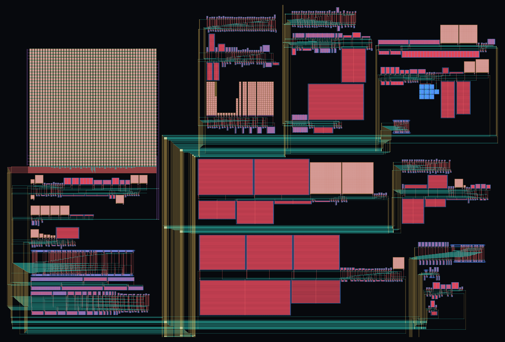

`macro.py` turns `blocks/rv328_analog.spice` into one layout. That netlist names the eleven blocks and
28 gates and switches of its own. The script

1. cuts the gates and switches into two cells and draws them with `stack.py`: `rv328_acsw`, the four
   switches at the comparator's inputs with their two inverters (64 x 40 um), which stands over the
   comparator, and `rv328_glue`, the enable and gating logic (22 standard cells, 87 x 41 um);
2. places thirteen cells (the eleven blocks and these two) in rows, in two bays: the ADC front end in
   one, everything else in three rows in the other. A place in a row can hold several cells one above
   the other; the pin lines of an upper cell then run down beside the cells under it, which stand to
   the right of them. The multiplexer and the comparator stand in the row that shares the ADC's
   channel, with the comparator's switches and the temperature sensor; the two fast oscillators are in
   the row farthest from it, with the reference buffer, the reference and the logic stacked beside them;
3. wires them. Under every row lies a channel of horizontal Metal3 tracks, one per net. Every pin of a
   cell comes down to its track on Metal4. Between the bays stands a trunk of vertical Metal4 lines, one
   for every net that is used in more than one channel or is a pin of the macro, and the tracks of such a
   net run to its line. Nothing is routed over a block.

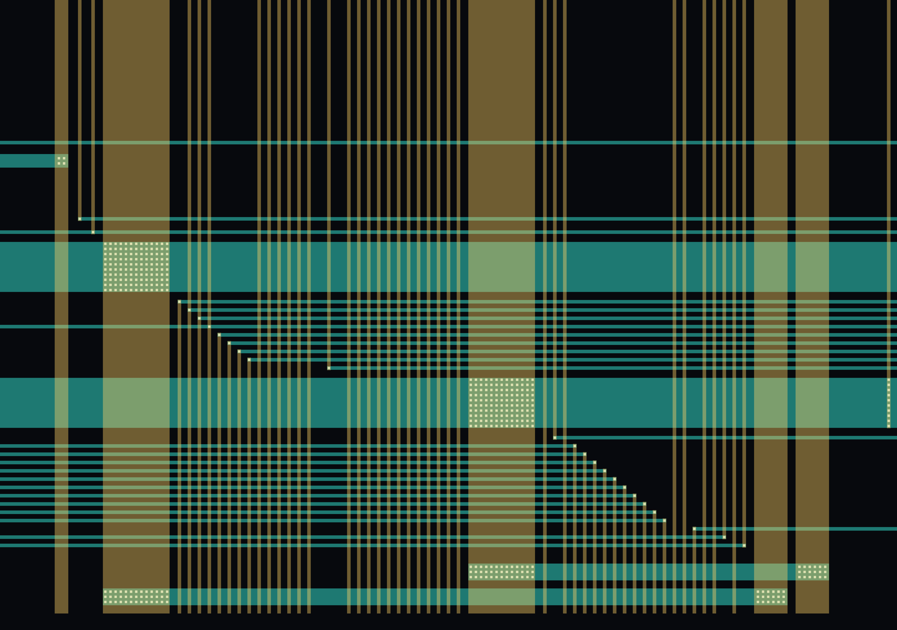

Cells drawn by `stack.py`, and the ADC front end, already have their pins as vertical Metal4 lines at
their left edge; those are made longer. Cells drawn by `autoblock.py`, and the reference, have theirs as
Metal3 tracks in their own channel; each is taken out of the nearer end of the cell to a new Metal4 line
beside it. Before a line or a track extension is drawn, the script tests it against the cell's own metal.

| | |
|---|---|
| Size | 1380 x 927 um, 1.28 mm2; the thirteen cells it places are 0.87 mm2. (As first assembled, before the logic became standard cells and with every cell standing alone in its row: 1345 x 1098 um, 1.48 mm2, cells 0.98 mm2) |
| Channels | three, with 32, 10 and 41 tracks: 83 tracks |
| Trunk | 57 lines, 93 um wide |
| Pin lines | 131: 119 come down to a track, 12 go straight to the edge |
| Wire | 83 mm in all; ground and supply 5.2 and 5.5 mm with the oscillators' branches, the bias line 4.5 mm, the reference 3.6 mm |
| Pins | 44 at the foot of the trunk (supply, ground, AREF, every digital control and output); the eight ADC inputs and AIN0, AIN1 straight down from the multiplexer and the switches; XTAL1, XTAL2 straight up from the crystal oscillator (53 and 104 um of line) |
| Foundry DRC | 0 violations |
| magic DRC | 0 outside the foundry's bipolar cells |
| LVS | matches: netgen compares each of the eleven blocks with its own netlist, then the top with `blocks/rv328_analog.spice`, gates written out |

**Order of the nets.** In every channel, counted from the row down, and in the trunk, counted from the
ADC's bay: first the small-signal nets (multiplexer output, AREF, temperature voltage, the comparator's
two inputs, the reference, the bias line), then ground, then the nets that are set once and stay
(enables, trim, selects), then the supply, and last the nets that switch while a block measures (the
ADC's bits and sampling signal, the comparator outputs, the clocks, reset and brown-out outputs). The
ground and supply tracks are 6 um wide (8 um in the trunk) and lie between the groups. Small-signal
tracks are 1.2 um apart, the others 0.6 um.

**The two fast oscillators have a supply and a ground of their own**: tracks and trunk lines half as
wide as the others', beyond the switching nets, which join the macro's supply and ground only at the
foot of the trunk, under the last channel, where the pins are. The 8 MHz oscillator draws 0.7 mA and
the crystal oscillator up to 1.2 mA; in a ground line shared with them that current lifted the ground
of every cell in their row and of everything above it on the trunk by 7 to 13 mV. The reference stands
in that row, and the temperature sensor's output is 1 mV per kelvin. (The first assembly had one supply
net for everything; this was worked out by hand when the cells were re-placed, since the extraction
has no resistance and no simulation here would have shown it.)

**What the extraction says** (`rv328_analog_pex.spice`: the transistors of the two glue cells, 89
fingers, and 2001 wiring capacitors; the blocks stay cells; every net is in `reports/macro_wiring.md`):

| Net | Wire | Capacitance | Largest part to another net |
|---|---|---|---|
| bias line `vbp` | 4.5 mm | 449 fF | 116 fF to the reference |
| reference `vref` | 3.6 mm | 343 fF | 116 fF to the bias line, 60 fF to `aref` |
| `aref` | 2.2 mm | 217 fF | 60 fF to the reference |
| multiplexer output `amx` | 1.4 mm | 133 fF | 19 fF to `aref` |
| comparator inputs `acp`, `acm` | 0.32 and 0.22 mm | 48 and 51 fF | 12 fF to each other |
| each clock output | 0.8 to 1.2 mm | 57 to 118 fF | |
| ground to supply | | 522 fF | |

The largest capacitance between a small-signal net and one that switches is 1.2 fF, from the
comparator's output `aco` onto its positive input `acp`, where both leave the comparator cell at the same
end; it is in phase with the decision, so it adds to it. With the comparator under two other cells
those two lines run side by side for 70 um, and 0.8 um apart they coupled 3.9 fF; a small-signal line
and a switching one beside the same cell are now 4 um apart. Everything else between the two groups is
0.5 fF or less. The groups never run side by side: a supply track is always between them, and where a line
crosses a track it does so at a right angle.

**The whole-block test from this netlist**, with every block from its own layout as well
(`results/top_macro.md`), passes the same ten checks as with ideal wires between the blocks, with the same values: reset released
after 242 us, 129.6 kHz, the comparator and the brown-out detector deciding as before, the ADC
conversion correct, 159 uA. One line of that table differs, the time the 8 MHz oscillator takes for 16
periods (1.9 us here, 2.2 us with ideal wires, 2.5 us on the schematic), and it is not a measurement:
the run's 20 ns step is too coarse for that oscillator. Run by itself inside the macro at 0.2 ns, with
only the oscillator's own netlist from its layout, it gives 7.990 MHz with ideal wires and 7.990 MHz
with the macro's wiring, and 713 uA against 710 uA (the wire on its output).

With every enable low, block by block from the layouts (`results/off_pex.md`): every disabled block
draws 0.01 uA or less. The whole macro in that state was not simulated from the layouts; 4 ms of it
would take about three hours, and the run was stopped.

**Resistance, by hand** (the extraction has none; Metal3 and Metal4 are 90 mohm per square):

* Supply to the crystal oscillator, on its own branch: 2 ohm in the strap at the foot, 11 ohm of trunk,
  8 ohm of track, 6 ohm in the cell's own pin line, and the same in ground. Its 1.2 mA in the
  high-frequency setting drops 32 mV in each, in lines nothing else but the 8 MHz oscillator uses.
* AREF from the buffer to the ADC: 132 ohm (1.6 um wide over 2.1 mm, then 59 um of the front end's own
  0.4 um pin line). With the 50 pF the array can ask for, 7 ns against a bit time of microseconds. The
  pin itself is 40 ohm from the front end.
* The cells that stand over others have long supply lines of their own. The reference buffer's ground
  is 0.4 um wide over 0.25 mm, 56 ohm, which its 95 uA turn into 5 mV; the buffer compares AREF with
  the reference directly, so that does not reach its output. The reference's ground is 52 ohm from the
  pin, 15 ohm of it shared with the buffer: 1 mV by itself and 2.4 mV with the buffer on, 0.1 to 0.2 %
  of the reference.
* The temperature sensor's ground, in the bottom channel: 20 ohm, and about 25 uA of other cells'
  current in the part it shares, 0.3 mV.
* Crystal pins: 6 ohm in the output's line (1.6 um wide, 104 um) and 12 ohm in the input's (0.4 um, 53 um), which
  carries only the charging current of the amplifier's gate.
* The analog inputs: 39 to 50 ohm from the edge to the multiplexer or the switches, in series with switches of
  kilohms.

**What this assembly is not.** Three tenths of the macro is channels, trunk and empty corners: the
strip above the ADC front end, whose bay is 110 um shorter than the other, is the largest of them. There are no supply or guard rings and no protection on the pins;
the pins end where their wires end, not where the chip's floorplan will want them; and the extraction
leaves out the capacitance between this wiring and the nodes inside a block (the wiring runs beside
blocks, never over them).

## What drawing the ADC found

DRC and LVS were clean at every step below. Each item was found by simulating the extracted netlist
and comparing with the schematic, and each was located by deleting groups of wiring capacitors from
that netlist until the difference went away.

**In the schematic** (details in `analog/README.md`, fourth round):

* The top plate did not follow a full-scale step of the input within the tracking time in the slow
  corner. This was the unexplained slope of the third round; a bench that converts twice in a row found it.
* The cure, a wider top-plate switch, leaves a larger step on the input when it opens, and the offset
  was being frozen before a 10 kohm source had restored it. The delay is now four times longer.
* Unit switches as 1023 single fingers of five kinds would have been 9 mm of transistor row. From
  bit 3 up they are now 8 um fingers with the same total width.

**In the layout.** Seven couplings, none larger than 15 fF, most under 1 fF:

| Where | What was next to what | Effect | Now |
|---|---|---|---|
| comparator | the output inverter's lead beside the lead of a capacitor node, 0.7 fF (devices in netlist order) | -0.3 mV of offset | everything on the two capacitor nodes stands at one end of the cell, the logic at the other; a lead of a small-signal net keeps 3 um from any lead of another device that switches |
| comparator | the track of the clamp control `azn` beside the track of the bias level `vb`, 15 fF | `vb` kicked by 80 mV as the clamps open: +0.5 mV of offset at 5.5 V | the static enable line lies between them over the whole length |
| comparator | the clamp controls' leads running 20 um beside the clamps' other leads, 0.8 fF; on one side that lead is the bias level, on the other the second amplifier's output | +0.1 mV | the clamp controls have the tracks nearest the clamps, so those leads are 4 um long |
| comparator in the ADC | the input tracks, extended to the end of the cell, 200 um beside the second amplifier's output three tracks away, 1.9 fF | a kick on the reference side at every decision | the inputs lie between two bias lines that run the whole length |
| front end | the wiring column's line of bit 0, 3 um from a coupling capacitor's bottom plate in the comparator, 0.6 fF | the last decision shifted by about 0.15 LSB at a 1.1 V reference | the comparator is mirrored: capacitor nodes at the far end from the column |
| front end | every lead of the sequencer crossing the tracks of the top plate and the reference side, 0.25 fF on each; the reference side has a quarter of the capacitance | the two move unequally whenever a sequencer net switches after the offset is frozen | the top-plate switches and their divider are a block of their own, in which nothing moves once the top plate is released |
| front end | the two tracks of the slow clamp control crossing all eleven bottom-plate lines of the column, 0.4 fF | its edge is the sampling instant: input pulled down by 0.1 mV at 5.5 V | column order: logic nearest the blocks, then supplies, then input, reference and bottom plates, so that logic tracks never cross them |

The first extraction of the comparator alone had -0.2 to -0.45 mV of offset left where the schematic
has +0.005 to +0.11 mV, and the first of the whole front end was 1.3 LSB away from the schematic at
a 1.1 V reference. The table is what closed that gap.

## The reset circuit and the 128 kHz oscillator

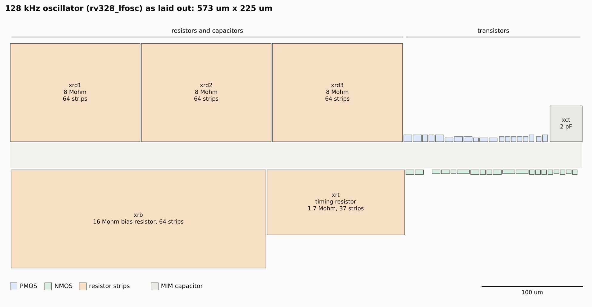

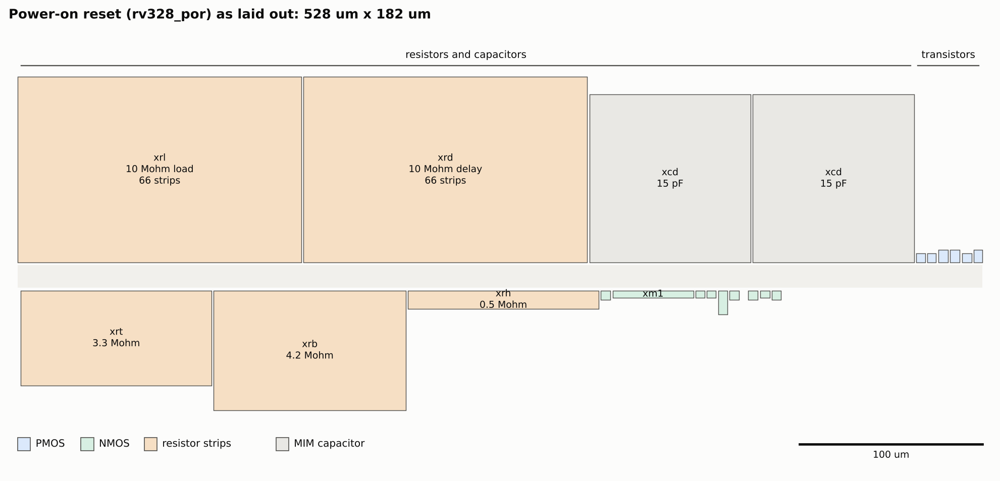

Both are megohms of resistor with a handful of transistors, drawn by `autoblock.py` from the netlist
with one line each in its table: which resistors share a row. Their resistors are now written in the
netlists as strips, 66 strips of 150 um for a 10 Mohm resistor.

| Power-on reset | Schematic | Extracted layout |
|---|---|---|
| Releases at, rising supply, five corners, -40 to 125 C | 1.30 to 1.94 V | 1.30 to 1.94 V |
| Released after the supply is up | 192 to 300 us | 192 to 303 us |
| A dip to 1.2 V resets within | 6.7 to 9.9 us | 6.6 to 7.2 us |
| Current at 5 V | 0.85 to 1.46 uA | the same |

The reset circuit does not care about its layout. The dip response is faster from the layout because
there the 10 Mohm load is 66 resistors with their capacitance spread along them, where the schematic's
model puts half of it on the detector node.

| 128 kHz oscillator | Schematic | Extracted layout |
|---|---|---|
| Frequency, typical | 152.7 kHz | 129.6 kHz |
| At 2.7 V / 5.5 V | -3.8 / +0.9 % | -6.6 / +0.9 % |
| -40 / 125 C | -0.9 / +0.3 % | -1.1 / +0.3 % |
| Slow and fast corners of transistors and passives | -22 to +35 % | -22 to +34 % |
| Current at 5 V / 2.7 V | 3.4 / 1.4 uA | 3.8 / 1.5 uA |

The oscillator does care. Its first layout ran at 106 kHz where the schematic said 130. The timing
node was not the cause (57 fF of wire on 2 pF): the comparators and the two stages behind each run
on a quarter of a microampere, and 12 to 19 fF of wire on each of their internal nodes doubled a
delay that was already a quarter of the period. Removing the wiring capacitance of one such node at
a time from the extracted netlist gave 0.25 to 0.34 us each, of 1.06 us in all. Two changes: the
timing capacitor moved to the end of its row, so that the comparators' PMOS and NMOS face each other
and their wires are short (4 %), and the timing resistor was shortened from 2.05 to 1.7 Mohm on the
extracted netlist. The schematic by itself is therefore 18 % fast, and the layout is the reference.
What it costs: the delay is a larger part of the period, and the delay depends on the supply.

In both blocks the transistors are a strip 10 um tall beside resistors 100 um tall, with a third of the
oscillator's area empty above and below them. Folding the transistor rows or shortening the strips would
give that back.

## The 8 MHz oscillator and the crystal oscillator

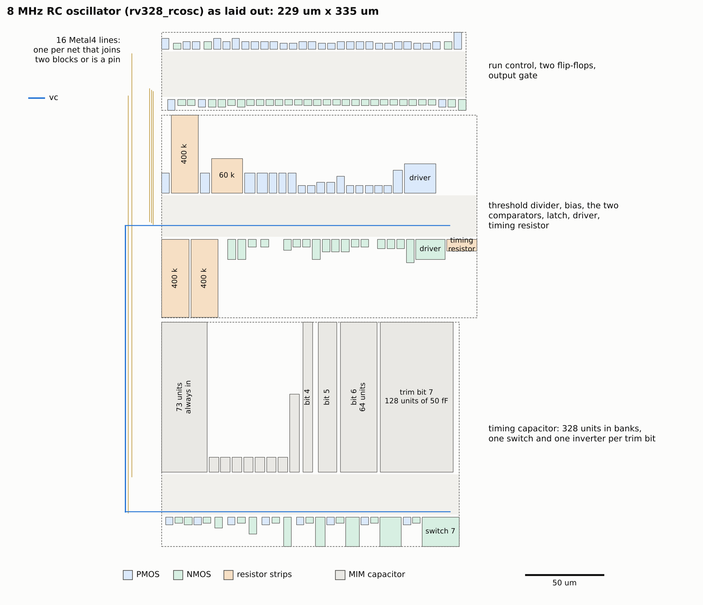

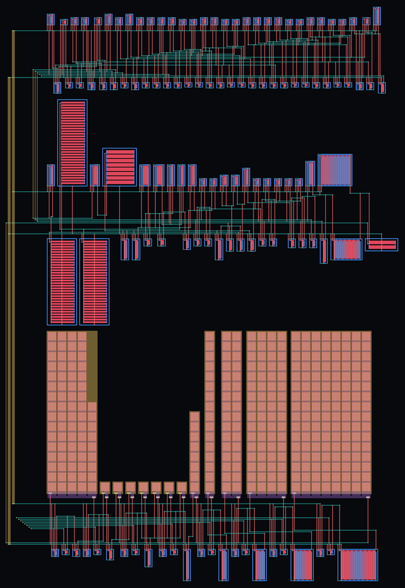

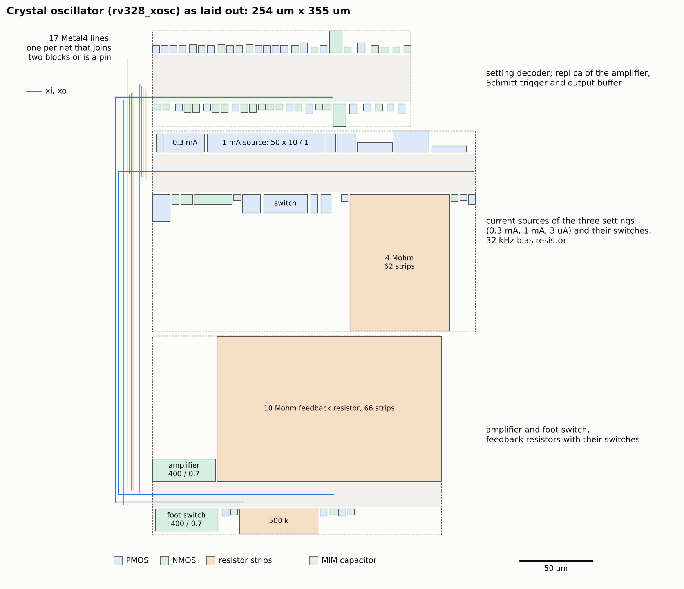

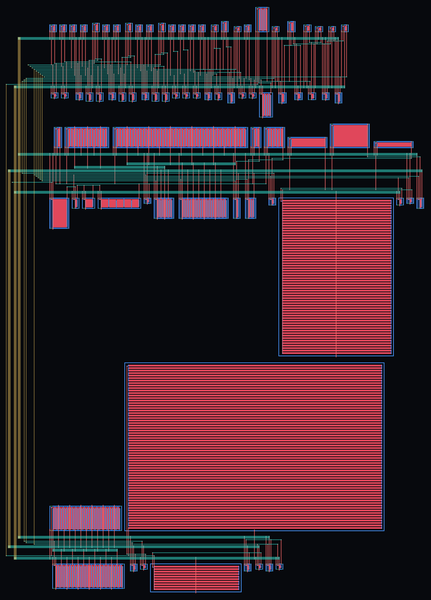

Each has about a hundred transistors. As one block (two rows facing one channel) the 8 MHz oscillator
came out 618 x 268 um. `stack.py` cuts a netlist into groups, draws every group as a block and stacks
the blocks, with one Metal4 line in a column at the left for every net that joins two blocks or is a
pin: the way the ADC front end is built, now as a tool with a table that says which devices belong
together. Three things are new with these two cells:

* **Banks of unit capacitors.** The 8 MHz oscillator's timing capacitor is 328 units of 50 fF, 255 of
  them behind the eight trim switches. `devices.cap(w, l, n)` draws n units on one bottom plate, in
  columns of sixteen, their top plates joined on Metal5; every unit keeps its own top plate, which is
  what defines its value. `autoblock.py` draws a capacitor with `m=8` or more that way.
* **Milliamperes.** The crystal amplifier draws 1.2 mA in its high setting, through two current-source
  devices, the pin XTAL2, the amplifier and its foot switch. A 0.4 um track with one via at each lead
  is not made for that. The nets on that path (`heavy` in the table) have tracks and column lines
  1.6 um wide, and the six transistors on it (`strong`) have a lead for every 60 um of their width on
  source and drain, up to six, each with two vias onto its track, so that no lead carries more than a
  quarter of a milliampere.
* **Rows by type.** In a block of matched pairs, PMOS go in the upper row and NMOS in the lower one,
  so that the two halves of a pair stand side by side and no supply lead crosses the whole channel.

### The 8 MHz oscillator

| 8 MHz oscillator | Schematic | Extracted layout |
|---|---|---|
| Frequency at trim 0x80 | 8.92 MHz | 7.99 MHz |
| Trim range, 0x00 to 0xFF | 5.96 to 19.30 MHz | 5.48 to 15.84 MHz |
| Trim step at the centre | 0.39 % | 0.38 %; 0.62 % where bit 7 takes over |
| At 2.7 V / 3.3 V / 5.5 V | -3.0 / -1.9 / +0.4 % | -6.2 / -3.7 / +0.8 % |
| At -40 C / 125 C | -0.7 / -0.4 % | -0.3 / -0.8 % |
| Slow and fast corners of transistors and passives | -24 to +36 % | -25 to +36 % |
| Current at 5 V / 2.7 V | 0.69 / 0.29 mA | 0.71 / 0.29 mA |
| First clock after enable | 0.18 to 0.33 us | 0.19 to 0.36 us |
| Off | 17 to 37 nA | 9 to 39 nA |

From its first layout it ran at 6.95 MHz where the schematic said 7.92, 12 % slow. Taking groups of
wiring capacitors out of the extracted netlist, one group at a time, gave back: the timing node 4.8 %
(350 fF of wire on 10 pF, a third of it across the capacitors themselves), the two threshold nodes
3.6 %, the comparators' first stages 3.4 %, their second stages and the latch 3.6 %. With no wiring
at all the extracted netlist is still 3 % slower than the schematic: the devices as extracted, with
their drain and source areas as drawn and every strip and unit a device of its own. That part was not
broken down further.

One of these was a mistake of arrangement. The track of the lower threshold ran beside the timing
node's for the length of the block: 5 fF onto a node of 270 kohm, so the threshold followed the ramp
it is compared with and each crossing came late. The thresholds now lie between the bias lines
(7.13 MHz). The rest is what this way of wiring costs, and the timing resistor took it up: two strips
of 14.4 um instead of 33.4 um in one piece, set on the extracted netlist. The schematic alone is
therefore 11 % fast, and the layout is the reference, as for the 128 kHz oscillator.

The cost is also the same. From a threshold crossing to the driver's edge takes 9.3 ns from the
layout where the schematic has 5.7 ns, and 12.7 ns against 7.7 ns at 2.7 V. That delay is a larger
part of the period now and it grows as the supply falls, so the frequency falls 6.2 % at 2.7 V where
the schematic falls 3.0 %. Twice the bias current in the comparators, tried on the extracted netlist,
brings 4.9 % for 0.3 mA more, and was not taken: the wiring is the smaller part of the delay, and a
comparator whose first stage does not swing rail to rail would be the real remedy.

The trim stays monotonic but its steps are not equal. Bits 0 to 2 are single capacitors with 1.8 to
2.8 fF of wire across each unit; a bank has 0.4 to 0.5 fF per unit, and the bottom plates and switch drains
do not scale with the bit either. Where a larger bit takes over from all the smaller ones the step is
therefore about one and a half ordinary steps: 0.62 % from 0x7F to 0x80 where the next step is 0.38 %.
All ten such steps that were simulated are positive, between 0.25 and 0.91 %
(`results/rcosc_steps_pex.md`). The range is narrower at the fast end, 15.8 MHz instead of 19.3,
because the wiring on the timing node is always there; the slowest corner still needs only code 0xC0.

### The crystal oscillator

| Crystal oscillator | Schematic | Extracted layout |
|---|---|---|
| Gain margin, 4 and 8 MHz crystals, low setting | 7.3 to 15.6 | 7.3 to 15.4 |
| 16 MHz crystal, low setting | 3.8 to 5.6 | 3.9 to 5.6 |
| 16 and 20 MHz crystals, high setting | 6.3 to 10.8 | 6.2 to 10.7 |
| 32.768 kHz watch crystal | 5.7 to 11.3 | 5.6 to 11.9 |
| Starts and gives a clock, six runs | all | all |
| Clock duty | 44 to 55 % | 47 to 57 % |
| Current, running: 8 MHz / 20 MHz | 0.39 to 0.41 / 1.17 to 1.26 mA | 0.40 to 0.42 / 1.20 to 1.27 mA |
| Current, running: 32.768 kHz at 5 V / at 2.7 V, slow, 125 C | 6.8 / 1.7 uA | 9.4 / 2.1 uA |

The amplifier itself does not care: its two nodes are the crystal pins, with picofarads on each, and
the layout adds 0.1 pF to the one and 0.17 pF to the other. What does care is the node behind the
replica of the amplifier, which turns the sine at XTAL1 into a clock. In the 32 kHz setting the replica
runs on a third of a microampere, so every femtofarad there makes that node's edges slower, and the
Schmitt trigger behind it draws current for as long as an edge lasts. With the replica beside the
amplifier, as first drawn, that node crossed all three blocks: 133 fF of wire and 10.3 uA where the
schematic has 6.8 uA. The replica now stands in the block of the Schmitt trigger and its three current
switches stand together: 86 fF and 9.4 uA. In the same pass the clock output's track was moved away
from that node's: side by side they coupled 11 fF, and the output is the inverse of the node, so each
edge of the clock pushed the Schmitt trigger's input back by a few tenths of a volt, against its
hysteresis.

Both cells are as loosely filled as the ones before them: a 10 Mohm resistor 100 um tall beside
transistors 15 um tall, and channels as tall as their nets are many.

## The last five blocks

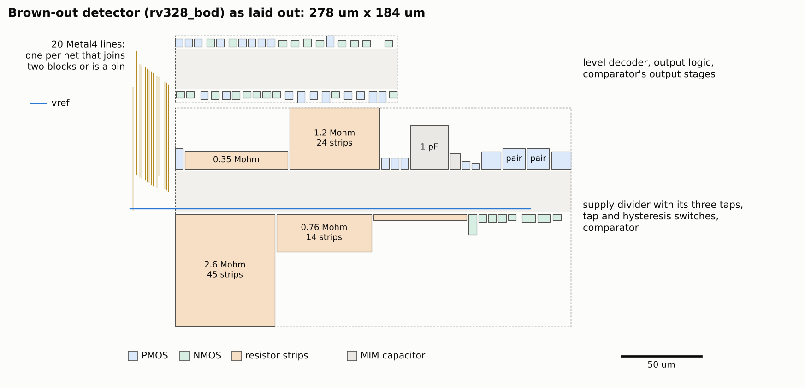

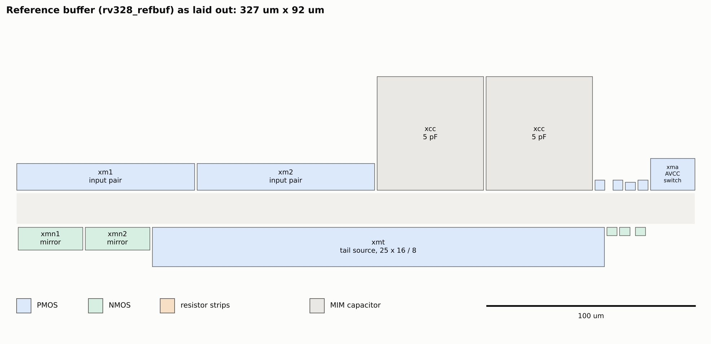

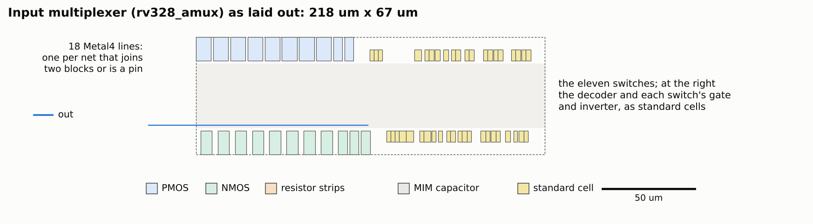

The reference buffer, the analog comparator and the temperature sensor are one block each
(`autoblock.py`); the brown-out detector is a stack of two and the input multiplexer, since its gates are standard cells, one block with its column of lines (`stack.py`).
All five were clean in both DRC tools and matched in LVS as first drawn. What the benches said:

| | Schematic | Extracted layout |
|---|---|---|
| Reference buffer: output minus reference, four conditions | -0.64 to -0.13 mV | the same |
| Change with 20 uA drawn or fed in | 34.8 to 46.8 mV | 34.8 to 47.0 mV |
| Within 1 % with 100 nF on the pin after | 1.50 to 1.57 ms | 1.51 to 1.56 ms |
| Undershoot on a 20 uA step with no capacitor | 4.1 to 5.7 mV | 4.2 to 5.7 mV |
| Multiplexer: resistance of a selected channel, 4.5 to 5 V | 109 to 442 ohm | 109 to 443 ohm |
| At 2.7 V, input at half supply | 1.2 to 5.3 kohm | 1.2 to 5.3 kohm |
| Temperature sensor at 25 C, three corners, 2.7 and 5 V | 318.4 to 319.5 mV | the same |
| Slope | 1.065 to 1.070 mV/K | the same |
| Comparator: delay at 10 mV overdrive, output rising | 39 to 189 ns | 79 to 354 ns |
| Output falling | 39 to 64 ns | 76 to 119 ns |
| Offset from mismatch, 40 runs | sigma 1.95 mV, worst 5.3 mV | sigma 1.77 mV, worst 3.7 mV |
| Offset without mismatch, three corners | -0.06 to -0.02 mV | the same |
| Current | 13.7 to 18.4 uA | the same |
| Brown-out detector: trips at, three levels, seven conditions each | 2.297 to 2.312 / 2.697 to 2.712 / 4.297 to 4.322 V | the same |
| Hysteresis | 1.1 to 1.3 / 1.5 to 1.7 / 3.2 to 3.4 % | the same |
| Supply ramped through each level at 0.1 V/ms, three corners | one rise and one fall of the output | the same |

**The comparator is half as fast from its layout.** Its three internal nodes carry 14 to 18 fF of wire
and are driven by 8 uA: the same story as the oscillators' comparators, without a period to
lengthen. It still meets its 500 ns. The copy inside the brown-out detector runs on a quarter of
that current and will have slowed by as much; there it is behind a filter of more than a microsecond
(below).

**The brown-out detector chattered, on the schematic.** Its bench swept the supply as a DC value
and read two clean thresholds. Laying it out raised the question what its megohm taps do beside a
comparator output that swings 5 V, so the bench got a second part: the supply ramps down through the
level at 0.1 V/ms and back up, in time. On the schematic, before any wiring, the output cleared with
bursts of 20 ns pulses over 3 us at the 2.7 V and 4.3 V levels. The cause is in the circuit: when the output changes, the hysteresis switch injects its charge into
the bottom of the divider, and that reaches the tap before the divider's new ratio does, and with the
opposite sign. Two capacitors cure it: 1 pF from the tap to ground, which swallows that charge, and
50 fF from the complement of the output to the tap, which pushes the tap 0.1 V the right way at once.
The thresholds are unchanged; a dip of the supply now has to last a microsecond or two to be seen
(the tap's 1 Mohm on 1.3 pF).

**The temperature sensor's resistor is six of the reference's strips.** It was 78.5 um in one piece
against the reference's 13.4 um: a ratio of 5.86 on paper, and something else once both are strips
with end resistance. Six strips of 13.4 um make the ratio 6 whatever the ends are. The output is
319 mV at 25 C instead of 308 mV and the slope 1.07 mV/K instead of 1.05; schematic and layout agree
to 0.1 mV.

**A cell with a parameter.** The comparator's bias setting is a parameter of its netlist (`mt`), 2
for the analog comparator and 0.5 inside the brown-out detector. `autoblock.py` now evaluates such
expressions; the cell `rv328_cmp` is drawn and extracted for 2, and the brown-out detector contains
its own for 0.5. `RV328_PEX=cmp` therefore must not be combined with a schematic brown-out detector.

As first drawn the multiplexer was 0.045 mm2 for 151 small transistors, seven times its estimate: 27
column lines and two channels of nearly fifty tracks each. With its decoder and gates as standard
cells it is one block of 0.015 mm2 ("Standard cells for the logic").

## What drawing the reference found in the schematics

Three things, none of them visible in simulation alone:

* **Resistors that cannot be made.** The netlists used `ppolyf_u_3k` for every large resistor. The
  foundry's simulation models include it, but this process variant (gf180mcuD, the one wafer.space
  runs) only has the 1 kohm-per-square film: both LVS decks know nothing else. All 21 such resistors
  are now `ppolyf_u_1k_6p0` at three times the length (30.7 mm of strip became 92.1 mm), every bench has
  been re-run, and the size estimate of the analog block rose from 0.50 to 0.59 mm2.
* **A resistor in ten pieces is not the same resistor.** The foundry model gives every strip about
  180 ohm of end resistance with a large temperature coefficient. The bandgap's two resistors were
  simulated as one piece each, 13.4 and 137.5 um, and would have been drawn as one strip and ten: the
  extracted reference came out 5 mV higher than the schematic. The schematic now describes resistors
  as they are built (equal strips, `s=` strips in series): 1 and 10 strips of 13.4 um for the core,
  2 and 67 strips of 35 um for the output divider. Schematic and layout now agree to 0.1 mV.
* **The divider loads the core.** Its current flows through the bandgap resistor, so its
  temperature coefficient is part of the reference's. With the 1 kohm film the reference's drift
  went from 14 to 41 ppm/K until the ratio was re-centred (10.0 instead of 10.26, which is also what
  makes the ten-equal-strips layout possible).

## How the reference is built

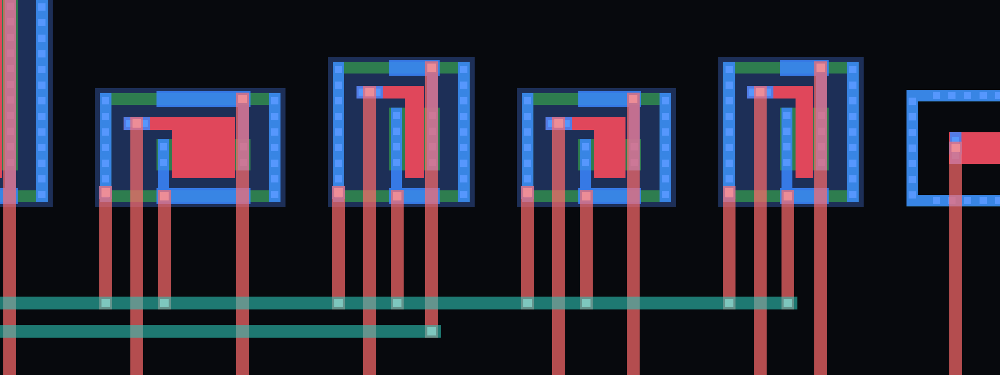

* **Devices.** A transistor is its fingers, a poly strap joining the gates to a contact pad, a
  source bar below and a drain bar above, all inside its own tap ring (substrate ring for NMOS,
  well ring for PMOS). A resistor is equal strips side by side, joined in series on Metal1 at
  alternate ends, inside a substrate ring. The bipolars are the foundry's own 10 x 10 um cell.
* **Matching by construction, as far as it goes.** The three unit-current PMOS are identical cells
  side by side. xq1 sits in the middle of the eight cells of xq2. Resistor ratios are strip counts.
  What is missing: dummy devices at the ends of rows and around resistor arrays, and interdigitation
  of the mirror. Transistor mismatch already dominates the reference's spread (sigma about 1.3 %),
  and these would matter more for a reference that is trimmed.
* **Wiring.** Every terminal has a vertical Metal2 lead into the channel between the two rows, and
  every net one horizontal Metal3 track across it. That wastes area (the block is 0.050 mm2 against
  0.027 mm2 estimated from its devices) but leaves nothing to route by hand.
* **LVS earned its keep.** The first version shorted two emitter nets: a lead from one emitter bar
  crossed another bar on the same layer inside the bipolar array. DRC was clean; LVS was not.

## How the ADC front end is built

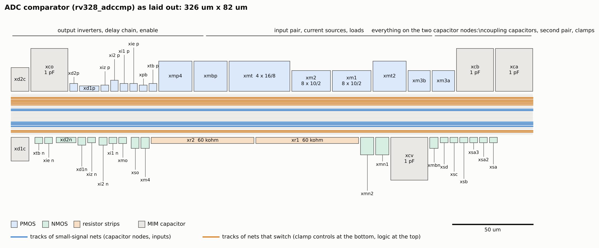

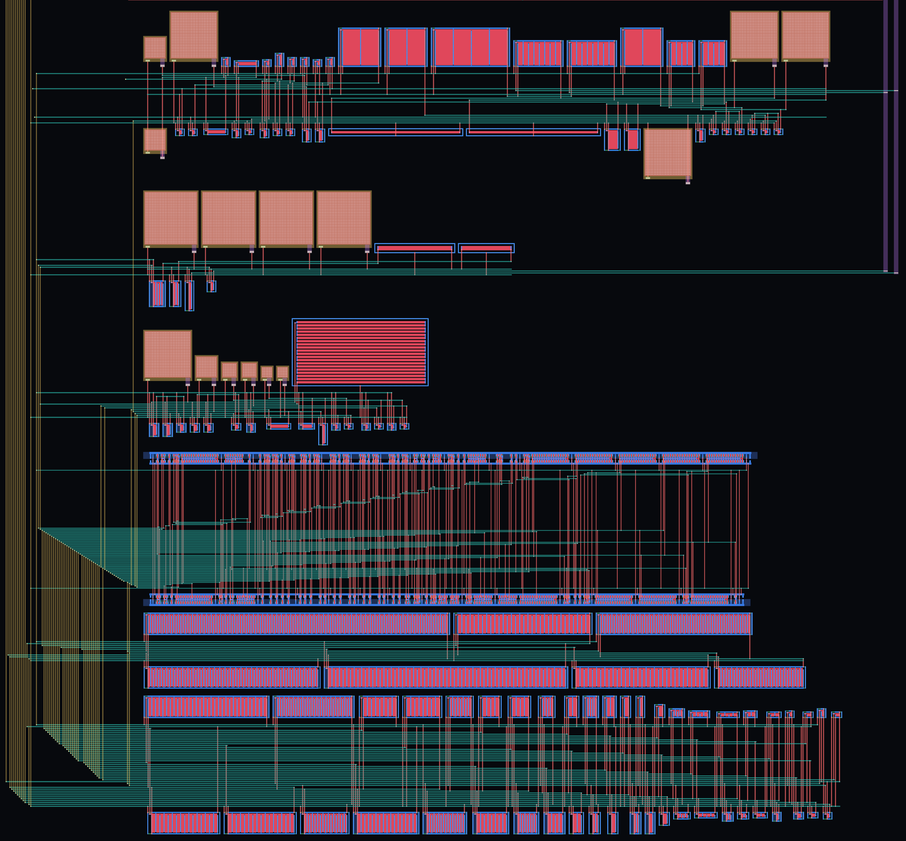

* **From the netlist.** `autoblock.py` flattens a cell to transistors, resistors and capacitors,
  generates each device, places them in two rows and lets `block.py` wire them: a Metal2 lead per
  terminal, a Metal3 track per net. The same flattened list is the LVS netlist, so the layout cannot
  drift from what was simulated. For the comparator a table in that script says what the netlist's
  order cannot: which nets get the tracks next to ground, which are small-signal nets, which devices
  stand at which end.
* **A stack.** `adcfe.py` cuts the rest of the front end into blocks no wider than the array (it
  draws them, measures, and packs shorter until all fit) and stacks them: array on top, comparator
  under it, then the top-plate switches with their divider, the delay stages of the sequencer, one
  block of standard cells with the sequencer's gates and the ten bit drivers, and the bottom-plate
  switches in two blocks.
* **A column.** A net that leaves its block gets a vertical Metal4 line at the left, 70 in all, and each
  block's track of that net is extended to it on Metal3. The array's twelve Metal2 buses reach the
  same lines. An extension longer than 150 um ends in a 2.4 um Metal4 bridge just short of its block
  (56 of them): the foundry's antenna deck, run on the whole chip, found that the bottom-plate switches
  of the low bits see up to 1.37 times the allowed Metal3 ratio while Metal3 is etched, because their
  driver only joins the line on Metal4 at the column. With the bridge the gate meets the long run only
  when the driver does. Top plate and reference side do not go there: they come down from the array on two
  Metal5 lines at the right, to the comparator and the top-plate switches only.
* **Switches.** A bit's five switches are multi-finger devices, 8 um fingers from bit 3 up: bit 9 is
  128, 64, 64, 32 and 32 fingers. Their drivers and the interlock gates were ordinary small devices
  in rows, 256 transistors with those of the sequencer; they are 88 standard cells in two strips now,
  bit 9's three drivers two `inv_16` each ("Standard cells for the logic").
* **Small-signal nets are kept apart by rule, not by eye.** In a block, a lead of a net marked as
  small-signal keeps 3 um from leads of other devices that switch, its track lies between tracks that
  do not move, and where a track is used as a screen it is drawn over the whole length of the block.

## How the capacitor array is built

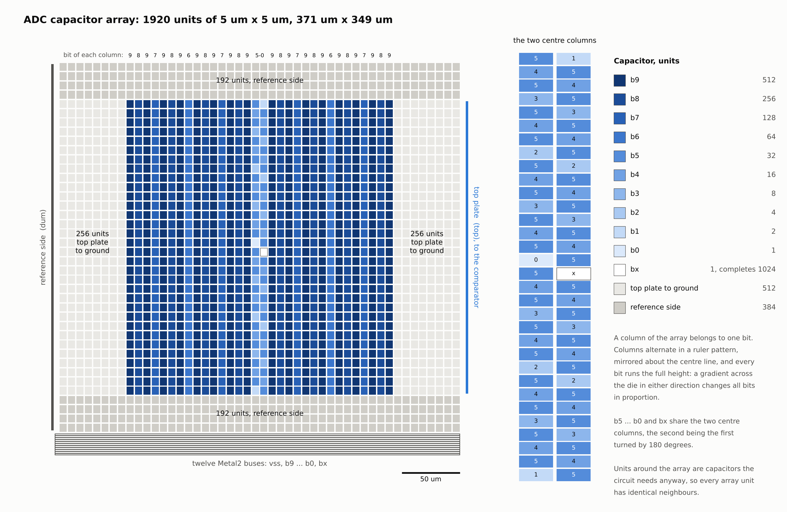

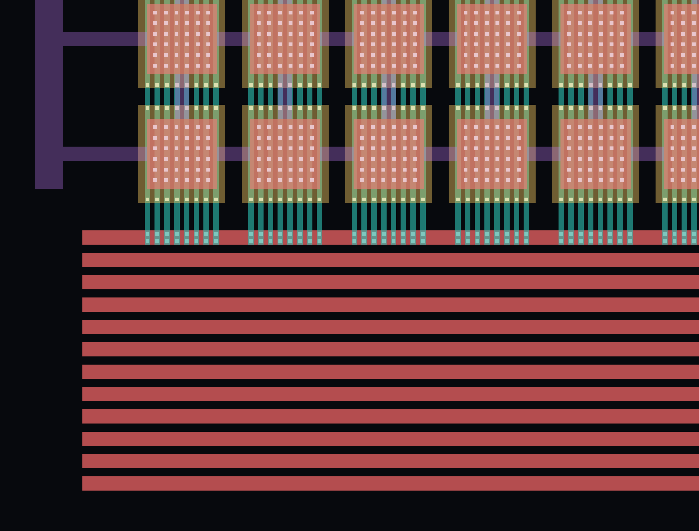

* **One unit, 1920 times.** A unit is a 5 x 5 um top plate (FuseTop) on a Metal4 bottom plate of its own,
  with 36 Via4 up to a Metal5 cover. Units sit on a 7.4 x 8.2 um grid, 48 columns by 40 rows.
* **The surround is not wasted.** The circuit needs 512 units from the top plate to ground and 384 on the
  comparator's reference input anyway. They are placed around the 32 x 32 converter array (eight columns
  either side, four rows above and below), so every array unit has the same neighbours on all four sides.
* **Columns belong to bits.** Sixteen columns are b9, eight b8, four b7, two b6, interleaved in a ruler
  pattern and mirrored about the centre line. Every bit therefore has its centre on the centre line and
  spans the full height, and a linear gradient of oxide thickness across the array in either direction
  changes all bits in proportion. b5 to b0 and the unit that completes 1024 share the two centre
  columns; the second of them is the first turned by 180 degrees.
* **Bottom plates are wired from below.** Eight Metal3 tracks run under every column, directly beneath
  the plates, and reach each plate through Via3 on the plate's margin, two per track. Twelve Metal2
  buses below the array collect them (vss, b9 to b0, bx). The bottom plates are the driven nodes, so
  what this wiring adds is load on the switches, not error.
* **The top plate sees only its own bottom plates.** Metal5 straps join the covers along each row and
  cross only the gaps between columns, where no Metal3 runs. Rows are tied together over the outer
  columns, whose tracks are all ground, and by a collector bar on the right (`top`) and on the left (`dum`).

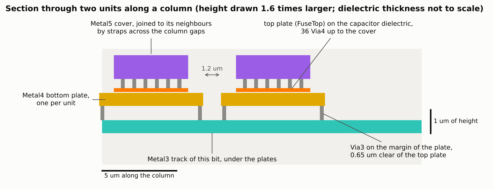

## Rule and tool behaviour worth knowing

* **MIMTM.10** reads "no Via3 touching the MIM bottom plate; connect the bottom plate only through
  Via4". Both rule decks (KLayout and magic) check it as "no Via3 under the top plate", which is the
  physical concern: a via under the capacitor dielectric. The layouts follow that reading: Via3 lands on
  the plate's margin, 0.65 um clear of the top plate. A layout that follows the sentence literally would
  have to bring every bottom plate up to Metal5 and back down, in the same layer as the top-plate
  wiring. If the foundry or the shuttle insists on the literal reading, the capacitor cells have to be
  redrawn.
* **magic's MIMTM.3** does not count a via as bottom-plate metal, so a Via3 closer than 0.6 um to the
  top plate is reported as missing plate overlap. Hence the 0.65 um.
* **Resistor contacts.** KLayout's HRES.8 asks for at least 0.22 um from the salicide block to the
  contact; magic checks 0.22 um as both minimum and maximum. The generator places the contact at
  exactly 0.22 um. (The foundry's own generator uses 0.25 um, which magic rejects.)
* **The bipolar cell in magic.** magic's deck reports five errors inside the foundry's
  `pnp_10p00x10p00` cell, also when that cell is checked by itself; KLayout reports none. For LVS the
  cell has to be taken from magic's library, where it is a primitive (`lvs.sh` does this), and its
  nine pin labels reduced to three, which the script only does when base and collector share a net.
  In a flat extraction magic names the device `pnp_10p00x00p42`; `pex_block.py` corrects the name.
* **Capacitor extraction.** magic extracts MIM capacitors as devices correctly, but for wiring
  capacitance it treats the top plate as Metal4, so tracks under a capacitor appear coupled to the top
  plate (12 fF on a bit of 109 fF in the first attempt at the array). `pex.py` therefore extracts the
  array's wiring from a copy without the capacitor layers and removes the plate-to-cover capacitance
  the device model already contains. The reference and the front end's blocks have nothing under their
  capacitors, so `pex_block.py` extracts them as drawn; the front end is extracted without the array,
  which is put back into the netlist as a cell. Extracted as drawn, the area under a top plate still
  counts as capacitance from the top plate to the substrate (7.6 aF/um2), where in silicon it belongs
  to the bottom plate: 0.19 fF per 5 um unit. On the 8 MHz oscillator's timing node that is 62 fF of
  10.4 pF, so the chip will run about 0.4 % faster than its extraction says, one trim step.
* **Net names in an extraction.** Only labelled nets keep their names, and a label makes a port, which
  LVS then counts. `block.py` therefore writes a second copy of each layout with every net labelled,
  for extraction only; `pex_block.py` uses it and drops the extra ports.
* **Parallel fingers.** magic writes one transistor per finger. `pex_block.py` merges groups of nine
  or more identical parallel ones into one line with `m=`, which takes the front end from 1453
  transistor lines to 615. Smaller groups are left alone: they are the fingers of matched devices, and in a
  Monte Carlo run a line with `m=` gets the mismatch of one finger (the reference's spread read
  21 mV with its mirrors merged, 16 mV finger by finger).
* **The plain poly resistor** (`ppolyf_u`, 350 ohm per square, used in the top-plate divider) wants its
  salicide block to end exactly where the resistor marker ends (PRES.9a) and its contact exactly
  0.22 um from there; the 1 kohm film wants the block 0.1 um longer.

## The reference from its layout

`RV328_PEX=bgr python3 analog/tb/bgr.py` runs the reference bench on the extracted netlist
(`analog/results/bgr_pex.md`, against `bgr.md`). 526 wiring capacitors, no wiring resistance.

| | Schematic | Extracted layout |
|---|---|---|
| Output, typical, -40 / 25 / 125 C at 5 V | 1.1008 / 1.1021 / 1.0993 V | 1.1008 / 1.1021 / 1.0994 V |
| Over five corners, 2.7 to 5.5 V, -40 to 125 C | 1.0973 to 1.1060 V | 1.0974 to 1.1060 V |
| Drift | 12 to 20 ppm/K | 12 to 20 ppm/K |
| Reaches 1.0 V after power-up | 30 to 66 us | 30 to 69 us |
| Current when disabled | 0.05 to 0.73 nA | 0.11 to 0.84 nA |
| Spread from mismatch, sigma | 13 mV and 15 mV in two sets of runs | 17 mV and 13 mV in the same two sets |

The mismatch figures differ between sets of 40 to 80 runs by as much as they differ between
schematic and layout; together they say about 1.3 %.

## The capacitor array's wiring

`reports/caparray_pex.md` has the full table. In short, nominal wiring corner:

* Wiring between the top plate and a bit's bottom plates: 0.66 fF per unit of 54.5 fF for b9 to b6,
  0.63 to 0.95 fF for the bits in the shared columns. The uniform part changes nothing; the rest moves
  transitions by at most 0.03 LSB (0.022 LSB step-width error at mid-scale), in all three wiring corners.
* The cause of that remainder: the edge of a cover sees the Metal3 tracks through the 1.2 um gap
  between rows. In a column of one bit that coupling goes to the right bit; in the two shared columns it
  goes to all seven tracks alike. A Metal3 shield in those gaps with the tracks one layer down would
  remove it; at 0.03 LSB it was not worth the complication.
* Top plate to ground: 0.64 pF on top of 27.9 pF. Reference side to ground: 0.34 pF on top of 20.9 pF.
* Bottom plates to ground: 1.5 pF for b9 (5 % of its capacitor), in proportion below that. The smallest
  bits carry more wiring than capacitor (b0: 55 fF capacitor, about 110 fF of track), which costs
  switching charge, not accuracy.

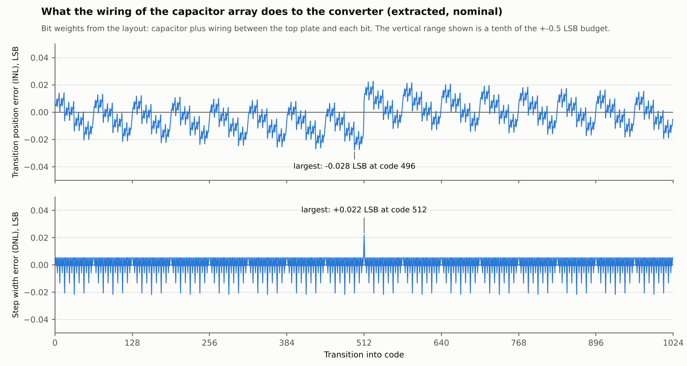

## The ADC from its layout

`python3 analog/tb/adcfe.py --layout` runs the ADC bench on the extracted front end and array
(`analog/results/adcfe_layout.md`, against `adcfe.md` for the schematic). The extracted front end has
1453 transistor fingers and 3963 wiring capacitors; a conversion takes four to five times as long to simulate, so
from the layout the bench measures three transitions per condition instead of up to twelve.

| | Schematic | Extracted layout |
|---|---|---|
| Complete conversions of mid-code inputs correct, eight conditions | 46 of 46 | 46 of 46 |
| Transitions, error from ideal | -0.01 to +0.29 LSB (37 transitions) | -0.02 to +0.45 LSB (24 of them) |
| The same without the fast corner at 125 C, 5.5 V, 1.1 V reference | -0.01 to +0.07 LSB | -0.02 to +0.11 LSB |
| That corner: transitions into 1 / 512 / 1023 | +0.10 / +0.27 / +0.29 LSB | +0.27 / +0.45 / +0.45 LSB |
| Largest difference between schematic and layout at one transition | | 0.18 LSB (0.2 mV at the input), in that corner; 0.04 LSB elsewhere |
| The two transitions decided right after the opposite decision (`tb/adcpat.py`), five conditions | -0.01 to +0.05 LSB | -0.02 to +0.11 LSB |
| Transition after a full-scale step of the input between two conversions (`tb/adcseq.py --layout`), three conditions | | where it is from rest, within 0.03 LSB; slow corner at 125 C, 2.7 V: +0.02 and -0.02 LSB (third round: +0.38 and -0.23) |

In seven of the eight conditions the layout costs the converter 0.04 LSB or less. In the eighth, the
fast corner at 125 C and 5.5 V, everything is 0.2 mV higher at the input, which is 0.2 LSB with the
1.1 V reference. About half of that is the comparator (see below: 0.06 mV more offset left at its
inputs, times 1.5 at the ADC's input); the rest has not been broken down further. It is the same at
the bottom, middle and top of the range, so it is offset, not nonlinearity.

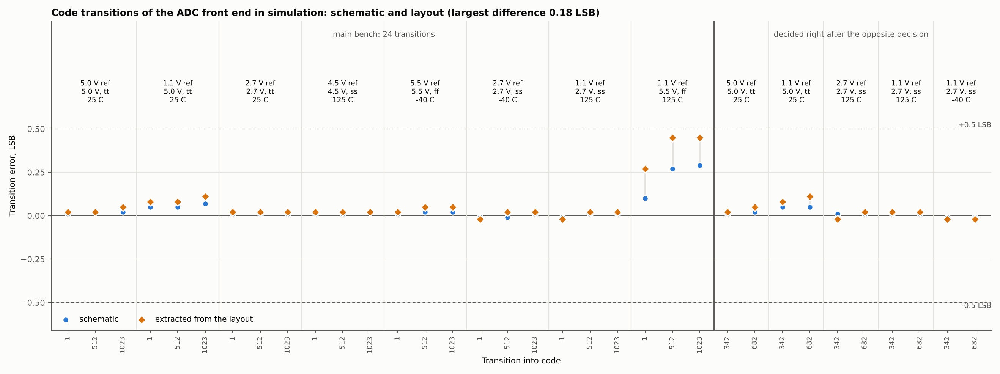

What the wiring adds to the nodes that matter: 98 fF on the top plate (of 84 pF) and 91 fF on the
reference side (of 21 pF), nearly all of it to ground, to each other and to bias lines; 0.47 pF on the
input; 0.34 pF on the bottom plates of bit 9 (the array's own wiring adds 1.5 pF).

The comparator by itself, `RV328_PEX=adccmp python3 analog/tb/adccmp.py` (`adccmp_pex.md`):

| | Schematic | Extracted layout |
|---|---|---|
| Offset left after cancellation, seven corners | +5 to +108 uV | -3 to +171 uV |
| With mismatch, 30 runs at 5 V | mean +47 uV, sigma 20 uV | mean +61 uV, sigma 16 uV |
| Time to reverse a 5 mV decision on 0.3 mV | 0.23 to 0.39 us | 0.41 to 0.65 us |
| Current | 26 to 80 uA | the same |

## Not covered

* Capacitor mismatch, still: the foundry model has no mismatch term. The layout does what layout can do
  (identical units, identical surroundings, common centroid); the random part is unknown until silicon
  or foundry matching data.
* Wiring resistance, in all cells. By hand for the array: a Metal3 track is about 80 ohm over its
  height and a full column has seven in parallel on 1.7 pF, tens of picoseconds against a 5 us bit time.
  For the front end: bit 9 reaches its switches through about 150 ohm of track and column line and
  the switches' own source and drain bars, on 28 pF: 4 ns. In the reference the currents are microamperes.
  The divider of the top-plate level carries 0.5 mA for a sixth of the time on 0.4 um tracks; that
  path should get wider tracks before tapeout.
* The 8 MHz oscillator's delay. From the layout its frequency falls 6.2 % from 5 V to 2.7 V, twice what the
  schematic showed; shorter wires will not give that back, a faster comparator would.
* The watch-crystal setting's 2.6 uA of extra supply current from the layout. A larger replica current
  in that setting, or a weaker first stage of the Schmitt trigger, would remove most of it; neither is
  simulated.
* Wide tracks for milliamperes exist only in the crystal oscillator. The 8 MHz oscillator's driver
  (0.13 mA on average, 0.6 mA at its peaks) and the ADC's divider still use 0.4 um tracks and single vias.
* In the macro: supply rings and guard rings, protection on the pins, pins at the places the chip's
  floorplan wants, a denser placement (three tenths of it is wiring and empty corners), wiring
  resistance in the extraction, and the capacitance between the macro's wiring and nodes inside the
  blocks. The standard cells stand on the common substrate with no ring around their strips.
* More standard cells: the logic inside the 8 MHz oscillator, the crystal oscillator and the brown-out
  detector is still drawn from transistors, 47 gates in all, because the two oscillators would have to
  be tuned again on the new layout.
* The hand-off to the digital flow: LEF, liberty and GDS of the macro, and a place for it on the chip.
  At 1.28 mm2 there is no room for it beside the digital layout as placed
  (`analog/README.md`, "Size").
* Dummy fill inside the macro: none. The chip's fill step did fill it (between the array's units too) until
  the hand-off GDS got the PDK's metal and poly no-fill marker, PMNDMY, over the whole outline
  (`scripts/gen_analog_abstract.py`). Diffusion fill may still go in, at the fill script's distances
  from the devices (its marker, NDMY, is limited to 15,000 um2 by rule DE.3). Whether the foundry's density rules accept the macro without fill is
  checked on the chip (`docs/layout_results.md`).
* Density. The front end is 0.32 mm2 where the device areas suggested 0.20. Its two blocks beside the
  comparator (top-plate switches, delay stages) are 176 and 135 um long in a stack 344 um wide and
  could stand side by side, and the switches could go under the array, where Metal1 and Metal2 are free.
* Coupling between the column and the blocks beside it is in the extraction; coupling between the
  front end's wiring and the array is not, because the array is extracted by itself (`pex.py`). The
  column ends below the array, and the two Metal5 lines leave it at its lower right corner.
* Wiring resistance and dummy strips for the megohm resistors: the strips at the edges of each resistor
  see different surroundings from the rest, which matters for the reset divider's ratio (1 % there is
  1 % of the threshold) and not for the others.
* Latch-up and ESD review of the drawn cells, and a guard ring around the front end's switches (the top plate can dip below ground for a moment with a very low source impedance, see `analog/README.md`).
