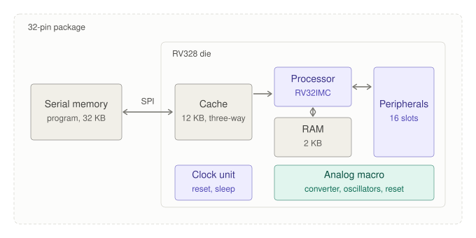
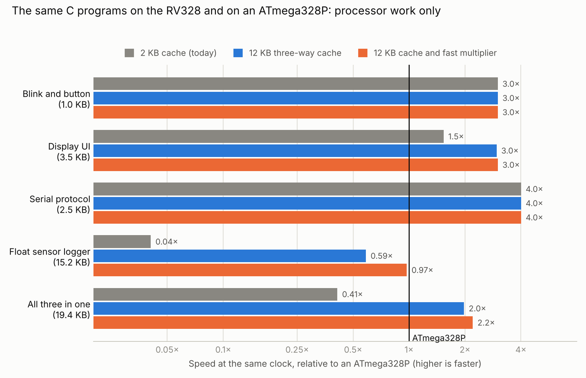
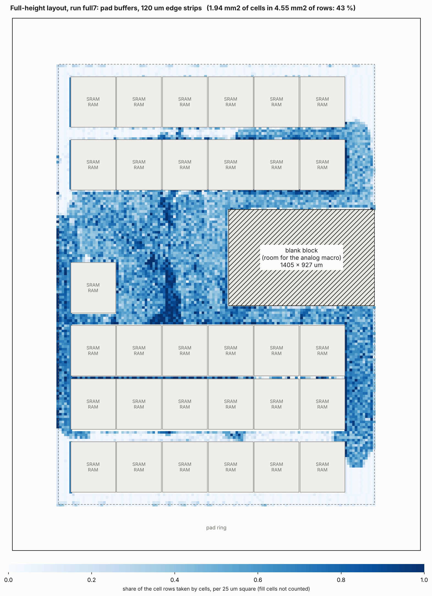
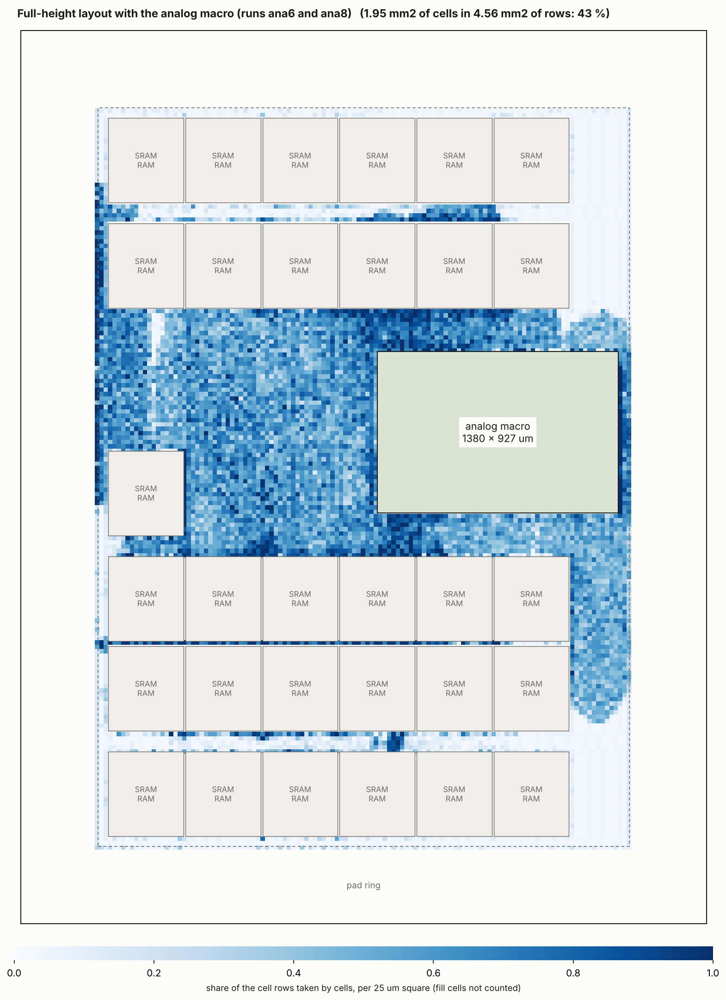
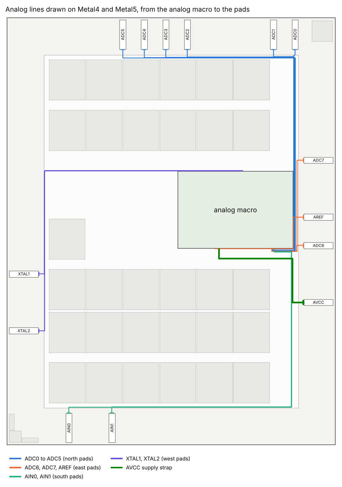
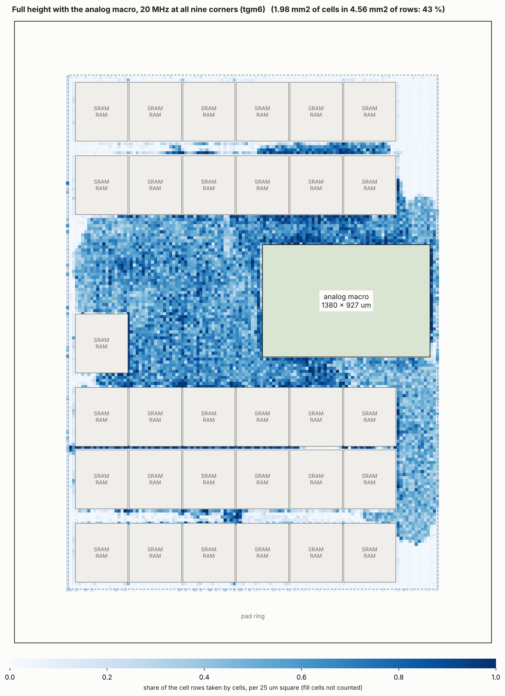

# Build log

How the RV328 got to where it is: what was done at each stage, what it showed, and what was decided
because of it. Newest stage last. The decisions have their own page ([decisions](decisions.md)).

The project started on 15 November 2026. Dates are given where they are known from the design
conversation; the stages in between are in order but not dated. The work is done by Claude with Jon
directing; nothing here has been measured on silicon.

## 1. The goal and the process (15 November)

**Asked for:** a RISC-V chip with feature parity with the ATmega328PB and the same number of pins.

**Done:** chose the Hazard3 processor (RV32IMC, open source), the same 32-pin positions as the
ATmega328PB, and the GlobalFoundries GF180MCU process through the wafer.space shuttle.

**Found:** Tiny Tapeout was considered first, but it runs on a 1.8 V process; an ATmega replacement has
to work at 5 V. GF180MCU has 5 V transistors and pads and an affordable shuttle. Its open kit has no
flash memory, so the program cannot live on the chip the way it does in an AVR.

**Decided:** the program lives in a small serial memory die inside the same package and runs through a
cache on the chip. The package keeps its 32 pins.

## 2. The digital design

**Done:** about 3,000 lines of Verilog around the processor: the bus, the program-memory controller,
2 KB of RAM, sixteen peripheral slots (ports, five timers, two each of serial port, SPI and I2C, the
analog-to-digital converter's controller, watchdog), clocks, reset and sleep modes. The pad ring, the
top-level file and the bond-out table are generated from one table so they cannot drift apart.

**Checked:** ten self-checking test programs run on the whole chip in simulation, through the foundry's
own pad and memory models ([verification](verification.md)).

## 3. First layout: it routes, but slowly

**Done:** the first run through the open place-and-route flow (LibreLane), half-height slot, analog
blocks replaced by a stub.

**Found:** routed without violations, but only 11 MHz at the slowest corner. The flow's repair steps
optimise as far as the target asks and no further, and the target had been loose.

## 4. Second and third layouts: 20 MHz, then clean

**Done:** taller (9-track) standard cells, synthesis for speed, the processor's clock gate moved beside
the system one, timing repair after routing. Then a buffer for the crystal clock and a proper reset
synchroniser in place of a constraint exception.

**Found:** 20 MHz at all nine corners with 5.9 ns to spare. The third layout is clean in routing, in
both design-rule checkers, antenna, density and layout-versus-schematic, and its routed netlist passes
three test programs at gate level ([layout results](layout_results.md)).

**Decided:** this half-height, digital-only layout is the reference. It is the one in the
[layout viewer](layout_viewer.html).

## 5. The analog blocks

**Done:** eleven analog blocks designed at transistor level (voltage reference, power-on reset,
brown-out detector, three oscillators, the converter's front end, comparator, multiplexer, buffer,
temperature sensor), simulated over corners in four rounds. Then each one drawn, checked and simulated
again from its own layout.

**Found:** every layout problem that mattered passed the rule checks; they only showed when the
extracted layout was simulated (wires side by side coupling a 5 V edge onto a node that stores a
millivolt). Two oscillators came out 12 and 18 % slow from their first layouts and were retuned.

**Decided:** simulate the extracted layout before believing it. The blocks are assembled into one
macro.

## 6. A smaller analog macro (19 November)

**Done:** the macro's plain logic (152 gates) moved from hand-drawn transistors to the foundry's
standard cells.

**Found:** 1380 x 927 um, 1.28 mm2, down from 1.48. All checks and the whole-block test repeated.

## 7. Does it fit? The half-height trial (19 and 20 November)

**Done:** the digital layout run again with a blank block of the macro's size in the core. Three
floorplans tried.

**Found:** the third routes without violations, but only with the flow's repair steps switched off:
with the rows 74 % full there is no room to place a buffer where one is needed. One register's fan-out
misses 20 MHz at the slowest corner.

**Decided:** not shown to work and not shown to be impossible; the ways out were a smaller digital
layout or the full-height slot.

## 8. The question that changed the plan (20 November)

**Asked:** "We need feature parity with the ATmega328PB. Does a smaller cache go against that?" and
then: "Speed too. This should feel like a drop-in replacement."

**Done:** instead of estimating, measured. Five test programs that build from the same C source for
both chips, run on the simulated RV328 with different caches and on an ATmega328P in an AVR simulator
([cache study](cache_study.md)).

**Found:**

* The 2 KB cache was far too small: a 19 KB firmware ran 5.9 times slower than with everything cached
  and lost serial bytes.
* A simple cache does not work even at 16 KB. The fix is the organisation, not the size.
* Floating-point code was slower than on the ATmega even with everything cached, until the processor's
  fast multiplier was switched on.
* An earlier estimate of the processor's speed (2 to 3 CoreMark/MHz) was too high: it measures 1.74,
  or 2.37 with the fast multiplier.

**Decided:** speed parity is a requirement. The cache becomes 12 KB, three-way, with interrupt handlers
pinned; the fast multiplier goes in.

## 9. The full-height layout (20 November)

**Done:** a floorplan for the full-height slot with 31 memories, a blank block for the analog macro and
the new cache and multiplier. Two runs.

**Found:** the first run routed cleanly and missed 20 MHz by 1.6 ns at the slowest corner, on the new
multiplier. The second, with more repair margin, meets it at all nine corners (0.64 ns at the slowest)
with the logic at 41 % of its rows. The routed netlist passes the boot test at gate level. Not good
yet: 94 slow signal edges (one at a pad, the rest inside the logic; stage 13 corrects the first reading
that they were mostly pad wires).

## 10. Directions set (20 November)

Looking at the full-height layout raised the question of whether the chip should be more orderly and
dense, the way current commercial processors look. Three arrangements were compared:

**Decided:**

* The half-height, digital-only layout stays ready for a tape-out while the full chip moves ahead.
* The full-height chip is the product: full feature parity and speed.
* The next floorplan keeps the tool's flat placement but puts logic next to the pads and guides where
  each part goes. Separately finished blocks are the goal for the final chip, not a constraint now.
* Denser memory is the lever with the highest payoff, so it gets its own research track.
* This documentation becomes a website kept with the work.

## 11. Memory research, first report (20 November)

**Done:** a separate research pass on denser memory for this process: the foundry block taken apart by
measurement, every alternative in the design kit and in open repositories looked at
([memory research](memory_research.md)).

**Found:**

* Only 26 % of the foundry block is storage cells; the rest is decoders, read and write circuits and a
  guard ring, paid again for each of the 31 blocks.
* The installed kit already holds a 3.3 V memory block that is 2.7 times denser. With it the whole
  32 KB program would fit on the chip in less area than today's memories. It needs a 3.3 V supply
  island and has no trustworthy timing data.
* About 70 % of the benchmark firmware is library code, which could sit in a small read-only block.
* Flip-flop and latch memories are worse than the foundry block, not better.

**Decided:** nothing yet. The report recommends the foundry block for first silicon, the read-only
library as an experiment, and the 3.3 V memory for a second silicon.

## 12. The 3.3 V memory, looked at closely (20 November)

**Asked:** "Do we know how it behaves for 5 V?"

**Done:** the block's own transistor netlist simulated for writes and reads at three corners; its
current measured in the same runs; the boundary to the 5 V logic and the supply it needs worked out.

**Found:**

* It cannot be run at 5 V at all: its transistors are the 3.3 V kind.
* It works in simulation and is fast: 3.2 ns from clock to output at the slow corner without wiring,
  an estimated 5 to 6 ns with it.
* The real cost is its supply: a regulator that needs no external capacitor, and 0.9 to 1.75 mm2 of
  capacitor on the chip, which takes back most of the area the denser memory frees.
* Sleep gets worse or waking gets slower: keep the memory powered and leak, or reload the program in
  about 30 ms.

**Decided:** nothing yet. The verdict is "go, if" three things hold, and not for the first tape-out.
The floorplan run for the full-height chip is on hold until the memory question is settled, because
either answer changes the floorplan.

## 13. A buffer at every pad: a run that did not pay (20 November)

**Done:** the floorplan run recommended after the memory research: every pad signal with its own buffer
set down in front of the pad, edge strips widened from 60 to 120 um to hold them, everything else as in
the full-height layout. (Stage 12 had put this run on hold. It went ahead because the 3.3 V memory is
not for the first tape-out, so a floorplan around the foundry memory is needed whichever way that goes.)

**Found:** three things, none of them the hoped-for one.

1. The run first stalled in hold repair. A stack trace of the tool showed it recomputing the timing of
   the whole design for every buffer it tried; a hold report showed why: the new buffer on the clock pin
   (PB6) delayed the external clock against the copy the oscillator stand-in takes from the same pad.
   The clock pin lost its buffer and the run went through.
2. The layout routes clean and all pad wires are fast, but it misses 20 MHz by 1.73 ns at the slowest
   corner (the reference layout has +0.64 ns) and has 142 slow edges instead of 94.
3. Looking at why: only one of the 94 slow edges had been a pad wire. The others are logic in the
   channels between memory rows, where repeaters cannot be placed where they are needed. And the wider
   strips drew logic out along the edges, which lengthened the tightest paths.

**Decided:** the earlier layout stays the reference; the pad buffers stay in the RTL as an option
(`RV328_PADBUF`, off by default; `gen_floorplan_1x1.py --padbuf`). The next floorplan gives the logic
regions instead of room (decision 11). An environment restart during routing cost half an hour; the run
was resumed from the saved state before routing.

## 14. Both tracks at once (20 and 21 November)

**Asked:** "Let's do them both in parallel": the next floorplan and the 3.3 V memory.

**Done, memory:** a research agent took the 3.3 V block through its three open conditions
([memory research](memory_research.md), "Third pass"). The first agent stopped at its plan's monthly
limit; a second one took over from its files.

**Found, memory:** the block with its own wiring answers in 5.57 ns at the slow corner (8 ns was the
condition) and works down to 1.8 V. A first extracted simulation that failed every read was traced to a
short made by the extraction step, not by the block. The regulator needs 2 nF on chip besides the
blocks' own 2.7 nF, less than half of what was feared. The level shifter adds 1.1 to 1.3 ns. Verdict:
still go, for a second silicon; power-down remains a decision.

**Done, floorplan:** two more runs on the same idea of guiding the placer: lanes kept free for buffers
(`full8`), and the pad buffers alone in the reference floorplan (`full9`).

**Found, floorplan:** neither helped. With lanes kept free the logic packed tighter and part of the
processor moved under the analog block: -3.09 ns at the slowest corner. The pad buffers alone left the
design 8.9 ns short after global routing; its repair was recovering (+2.3 ns) but so slowly that the run
was stopped. The pad buffers also only move PB0's slow edge from the pad to the wire into its buffer.

**Decided:** the reference layout stays. Taking room away from the placer does not guide it; the next
attempt leaves the floorplan alone and asks the repair steps to break long wires instead (stage 15).

## 15. Repeaters on long wires: the first change that helps (21 November)

**Done:** the reference floorplan left as it is; the flow's design-repair steps told to break every
wire longer than 600 um with a repeater (`full10`), then the same with more timing margin after global
routing (`full11`).

**Found:** capacitance overloads fell from 646 to 265 and slow edges from 94 to 79, for 1.4 % more
wire. The first run missed by 34 ps on one path; with more margin setup is met at all nine corners
(+0.17 ns at the slowest). One 9 ps hold miss remains, on the serial-memory data input, where the
constraint assumes the data changes at the clock edge itself.

**Then:** the input constraint was checked against how the memory interface works. The memory changes
its data only after the chip's own memory clock reaches it, which on this layout is at least 7.07 ns
after the clock edge; the constraint had assumed 0 ns. Set to 3 ns, hold is met everywhere (+0.30 ns).

**Decided:** `full11` is the full-height reference; the floorplan generator's defaults reproduce it.
PB0's slow wire still needs a hand fix.

## 16. The analog macro in the layout, first trial (21 November)

**Done:** the analog macro itself in place of the blank block, with AVCC kept as a supply of its own:
hand-off files made from its layout, the top level switched from the stub to the macro, its oscillators
declared as clocks, and a script that draws its supply straps into the layout before placement.

**Found, one problem at a time:**
1. The power-grid tool cannot reach the macro's ground pin under its capacitor plates. The strap script
   joins it instead.
2. The first AVCC strap, on Metal3, congested the corner under the macro (routing overflow 7,332). On
   Metal4 and Metal5, between the power stripes, and with a wider strip beside the macro, the overflow is 0.
3. Four clocks reaching the same flip-flops made the timing repair crawl. Placement and routing now use one
   representative clock; sign-off checks all four.
4. Three constraint errors that the stub build had hidden: pin timing referred only to the external clock;
   the programming pass-through was timed at system speed; and crossings into synchronisers looked like
   same-clock paths. All three corrected.
5. The router never wired the twelve analog lines: the pad-ring step makes them special nets, which routers
   skip. The strap script now hands them to the router.

**Result:** routed without violations, antenna clean, but the multiplier misses 20 MHz by 3.9 ns at the
slowest corner (it meets everywhere else), and the analog lines are not wired yet.

**Next:** rerun with the analog lines routed and the corrected constraints, then work on the multiplier path.

## 17. Analog lines drawn by hand, and the multiplier traced (21 and 22 November)

**Done:** the thirteen analog lines (ADC0 to ADC7, AIN0, AIN1, AREF, XTAL1, XTAL2) are wired. The routers
would not do it: the lines got no global-routing guides and the detailed router crashed on the analog pads'
pins. `scripts/analog_straps.py` now draws them, on Metal4 and Metal5 between the power stripes, from the
macro's pins to a landing bar beside each pad. They run 0.5 to 4.9 mm, with up to 363 ohm and about 1.3 pF.

**Found:**
1. Two more constraint errors: the reset synchronisers' asynchronous reset pins were timed, and the serial
   memory input's minimum delay did not follow the clock tree at the slow corners. Both corrected.
2. The multiplier misses again (-3.5 ns at the slowest corner). Synthesised alone, it is the flow's Booth
   mapping that makes it slow: 53 ns with it, 45 ns without, against a 50 ns clock. A Kogge-Stone final
   adder would bring it to 35 ns.

**Then (22 November):**
1. Without the Booth mapping (run `and`) hold is met everywhere and setup at eight of nine corners; the
   slowest corner misses by 1.48 ns, now mostly on an instruction-fetch path through the cache.
2. The multiplier as a pre-synthesised netlist with the faster adder (run `mks`) did worse in the layout:
   the timing repair stalled on it. Stopped; the option stays.
3. The cache's three tag memories had been up to 2.6 mm apart. Side by side in the middle (run `tgc2`),
   the cache path is gone and the slowest corner misses by 0.63 ns on 10 endpoints, all the multiplier.
4. The flow can now run on a Mac in one command (`flow/run_full.sh`, `flow/README.md`).

5. The same layout with the timing repair after global routing asked for 6 ns of margin instead of 4.5
   (run `tgm6`): **20 MHz met at all nine corners, setup and hold** (+0.84 ns at the slowest corner,
   +0.05 ns hold at the fastest). The first layout with the analog macro and its lines that does.

**Decided:** `tgm6` is the full-height reference (`flow/run_full.sh <tag> --tags-center --grt-margin 6`).

**Next:** sign-off checks on it: DRC, LVS with the analog macro, gate-level simulation.

## 18. LVS with the analog macro (22 and 23 November)

**Done:** the first LVS of the full-height chip with the analog macro, on `tgm6`.

**Found:**
1. VDD, VSS, AVCC, AREF and XTAL2 were one net. Taking the analog lines out one group at a time found the
   cause: the AVCC strap's Metal3 run crossed the power grid's via stacks, which the strap script could not
   see in OpenROAD's database. The script now counts those vias and threads the run between them; the
   layout was rebuilt with the fix (run `sgn`, same settings, timing met again at all nine corners).
2. On `sgn` only XTAL2 was still joined to VSS. Nothing in the drawing touched; Magic's stream-out had put
   a stray Metal4-Via4-Metal5 stack at the centre of every via the script draws, because the script wrote
   them as rectangle lists. One sat under a VSS stripe. The script now writes them as generated vias, like
   the power grid's.

**Result:** `sgnv` (`sgn` with the vias written the new way, geometry unchanged): **LVS passes, circuits
match uniquely** (57,257 devices, 56,258 nets).

**Then:** the foundry's antenna and density decks on `sgnv`. Density passes. Antenna found 12 nets, all at
the analog macro, which the flow's own antenna check cannot see into: nine of its inputs whose trunk lines
inside it are too long for the gates behind them while Metal4 is etched, and three long Metal3 runs inside
the ADC front end. And the fill step had filled the macro, its capacitor array included. Fixed with a diode
on each macro input, Metal4 bridges in the front end, and no-fill markers over the macro; the layout is
being built again with them (run `dio`).

**Next:** on `dio`: timing, LVS, antenna, density, foundry and Magic DRC, equivalence, gate-level simulation.

