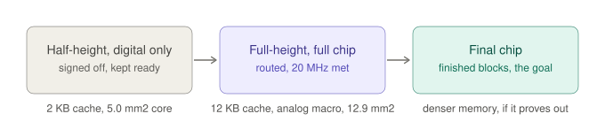
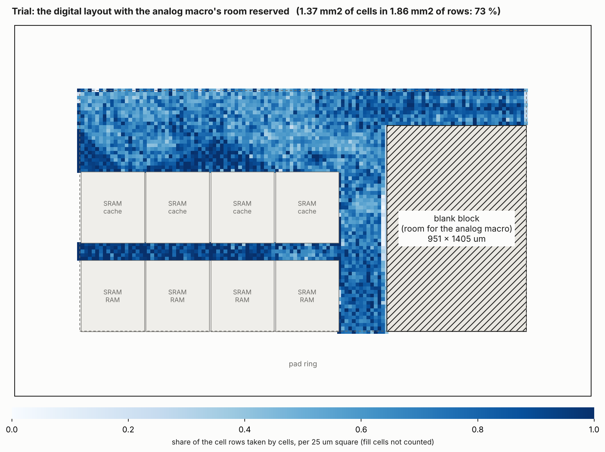
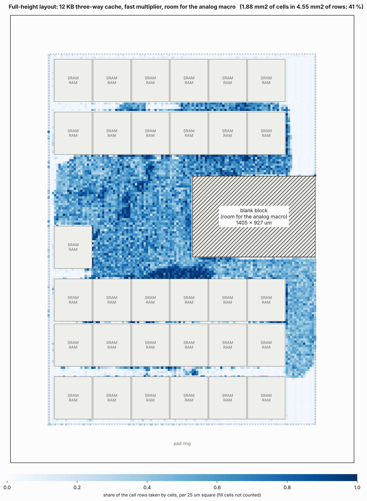
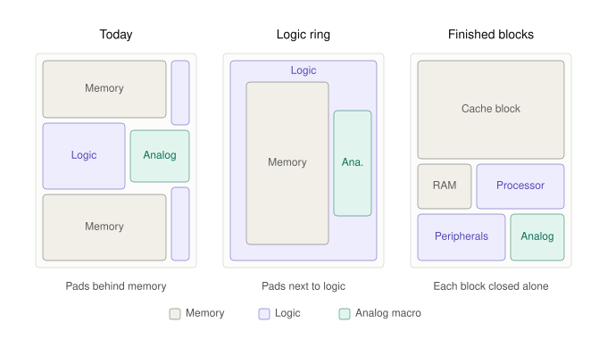

# Build log

How the RV328 got to where it is: what was done at each stage, what it showed, and what was decided
because of it. Newest stage last. The decisions have their own page ([decisions](decisions.md)).

The project started on 15 November 2026. Dates are given where they are known from the design
conversation; the stages in between are in order but not dated. The work is done by Claude with Jon
directing; nothing here has been measured on silicon.

## 1. The goal and the process (15 November)

**Asked for:** a RISC-V chip with feature parity with the ATmega328PB and the same number of pins.

**Done:** chose the Hazard3 processor (RV32IMC, open source), the same 32-pin positions as the
ATmega328PB, and the GlobalFoundries GF180MCU process through the wafer.space shuttle.

**Found:** Tiny Tapeout was considered first, but it runs on a 1.8 V process; an ATmega replacement has
to work at 5 V. GF180MCU has 5 V transistors and pads and an affordable shuttle. Its open kit has no
flash memory, so the program cannot live on the chip the way it does in an AVR.

**Decided:** the program lives in a small serial memory die inside the same package and runs through a
cache on the chip. The package keeps its 32 pins.

## 2. The digital design

**Done:** about 3,000 lines of Verilog around the processor: the bus, the program-memory controller,
2 KB of RAM, sixteen peripheral slots (ports, five timers, two each of serial port, SPI and I2C, the
analog-to-digital converter's controller, watchdog), clocks, reset and sleep modes. The pad ring, the
top-level file and the bond-out table are generated from one table so they cannot drift apart.

**Checked:** ten self-checking test programs run on the whole chip in simulation, through the foundry's
own pad and memory models ([verification](verification.md)).

## 3. First layout: it routes, but slowly

**Done:** the first run through the open place-and-route flow (LibreLane), half-height slot, analog
blocks replaced by a stub.

**Found:** routed without violations, but only 11 MHz at the slowest corner. The flow's repair steps
optimise as far as the target asks and no further, and the target had been loose.

## 4. Second and third layouts: 20 MHz, then clean

**Done:** taller (9-track) standard cells, synthesis for speed, the processor's clock gate moved beside
the system one, timing repair after routing. Then a buffer for the crystal clock and a proper reset
synchroniser in place of a constraint exception.

**Found:** 20 MHz at all nine corners with 5.9 ns to spare. The third layout is clean in routing, in
both design-rule checkers, antenna, density and layout-versus-schematic, and its routed netlist passes
three test programs at gate level ([layout results](layout_results.md)).

**Decided:** this half-height, digital-only layout is the reference. It is the one in the
[layout viewer](layout_viewer.html).

## 5. The analog blocks

**Done:** eleven analog blocks designed at transistor level (voltage reference, power-on reset,
brown-out detector, three oscillators, the converter's front end, comparator, multiplexer, buffer,
temperature sensor), simulated over corners in four rounds. Then each one drawn, checked and simulated
again from its own layout.

**Found:** every layout problem that mattered passed the rule checks; they only showed when the
extracted layout was simulated (wires side by side coupling a 5 V edge onto a node that stores a
millivolt). Two oscillators came out 12 and 18 % slow from their first layouts and were retuned.

**Decided:** simulate the extracted layout before believing it. The blocks are assembled into one
macro.

## 6. A smaller analog macro (19 November)

**Done:** the macro's plain logic (152 gates) moved from hand-drawn transistors to the foundry's
standard cells.

**Found:** 1380 x 927 um, 1.28 mm2, down from 1.48. All checks and the whole-block test repeated.

## 7. Does it fit? The half-height trial (19 and 20 November)

**Done:** the digital layout run again with a blank block of the macro's size in the core. Three
floorplans tried.

**Found:** the third routes without violations, but only with the flow's repair steps switched off:
with the rows 74 % full there is no room to place a buffer where one is needed. One register's fan-out
misses 20 MHz at the slowest corner.

**Decided:** not shown to work and not shown to be impossible; the ways out were a smaller digital
layout or the full-height slot.

## 8. The question that changed the plan (20 November)

**Asked:** "We need feature parity with the ATmega328PB. Does a smaller cache go against that?" and
then: "Speed too. This should feel like a drop-in replacement."

**Done:** instead of estimating, measured. Five test programs that build from the same C source for
both chips, run on the simulated RV328 with different caches and on an ATmega328P in an AVR simulator
([cache study](cache_study.md)).

**Found:**

* The 2 KB cache was far too small: a 19 KB firmware ran 5.9 times slower than with everything cached
  and lost serial bytes.
* A simple cache does not work even at 16 KB. The fix is the organisation, not the size.
* Floating-point code was slower than on the ATmega even with everything cached, until the processor's
  fast multiplier was switched on.
* An earlier estimate of the processor's speed (2 to 3 CoreMark/MHz) was too high: it measures 1.74,
  or 2.37 with the fast multiplier.

**Decided:** speed parity is a requirement. The cache becomes 12 KB, three-way, with interrupt handlers
pinned; the fast multiplier goes in.

## 9. The full-height layout (20 November)

**Done:** a floorplan for the full-height slot with 31 memories, a blank block for the analog macro and
the new cache and multiplier. Two runs.

**Found:** the first run routed cleanly and missed 20 MHz by 1.6 ns at the slowest corner, on the new
multiplier. The second, with more repair margin, meets it at all nine corners (0.64 ns at the slowest)
with the logic at 41 % of its rows. The routed netlist passes the boot test at gate level. Not good
yet: 94 slow signal edges, most on wires to pads that sit behind rows of memory.

## 10. Directions set (20 November)

Looking at the full-height layout raised the question of whether the chip should be more orderly and
dense, the way current commercial processors look. Three arrangements were compared:

**Decided:**

* The half-height, digital-only layout stays ready for a tape-out while the full chip moves ahead.
* The full-height chip is the product: full feature parity and speed.
* The next floorplan keeps the tool's flat placement but puts logic next to the pads and guides where
  each part goes. Separately finished blocks are the goal for the final chip, not a constraint now.
* Denser memory is the lever with the highest payoff, so it gets its own research track.
* This documentation becomes a website kept with the work.

## 11. Memory research, first report (20 November)

**Done:** a separate research pass on denser memory for this process: the foundry block taken apart by
measurement, every alternative in the design kit and in open repositories looked at
([memory research](memory_research.md)).

**Found:**

* Only 26 % of the foundry block is storage cells; the rest is decoders, read and write circuits and a
  guard ring, paid again for each of the 31 blocks.
* The installed kit already holds a 3.3 V memory block that is 2.7 times denser. With it the whole
  32 KB program would fit on the chip in less area than today's memories. It needs a 3.3 V supply
  island and has no trustworthy timing data.
* About 70 % of the benchmark firmware is library code, which could sit in a small read-only block.
* Flip-flop and latch memories are worse than the foundry block, not better.

**Decided:** nothing yet. The report recommends the foundry block for first silicon, the read-only
library as an experiment, and the 3.3 V memory for a second silicon.
