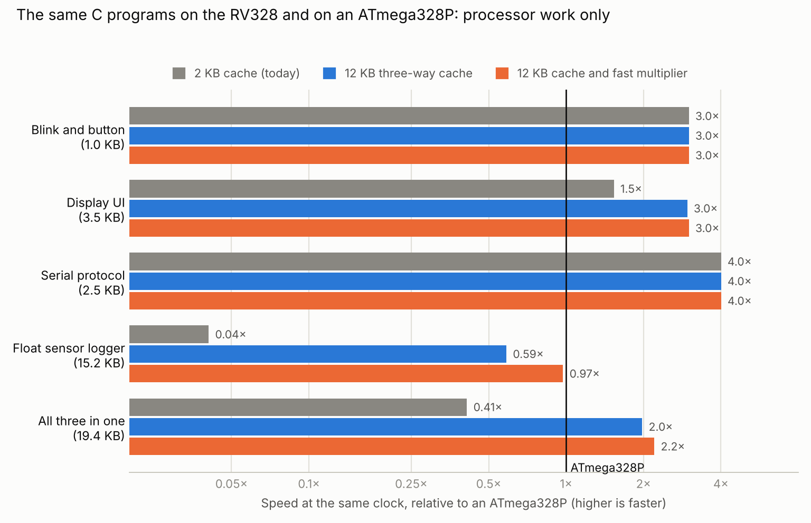
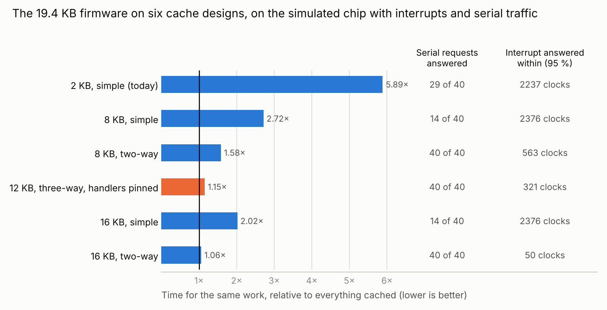

# Program cache: how large, and what kind

The RV328 runs its program from a serial memory in the package through a cache on the chip. This study
measures how that cache has to be built for the chip to keep up with an ATmega328PB, which holds its
whole program on the chip. Everything here is measured in simulation; nothing is estimated.

**Result.** The 2 KB cache of the first layout is far too small. A 12 KB three-way cache that keeps
interrupt handlers pinned, together with the processor's single-cycle multiplier, brings the chip level
with or ahead of an ATmega328P on every program measured, and is the largest design that leaves the
full-height slot comfortably routable. A plain (direct-mapped) cache does not get there even at 16 KB.



## What was run

Five programs written against a small Arduino-style runtime (`sw/bench`), so that the same C source
builds for both chips:

| Program | What it does | RV328 code | ATmega328P code |
|---|---|---|---|
| blink | PWM fade on a time base, button debounce, LED | 1.0 KB | 1.2 KB |
| display | 128x32 frame buffer, text from a glyph table, five screens, frame sent over SPI | 3.5 KB | 4.6 KB |
| comms | Modbus-style slave: receive interrupt, CRC, six request handlers | 2.5 KB | 2.9 KB |
| logger | thermistor with `logf()`, PID loop in `float`, `snprintf("%.2f")` | 15.2 KB | 6.7 KB |
| full | the three above as one firmware | 19.4 KB | 12.0 KB |

Sizes are what is stored in program memory (code and initialised data), with the real runtime on the
RV328 and the runtime without peripherals on the AVR. Integer code is a little smaller on the RV328; code with floating point is more than twice as large,
because avr-libc's float routines are hand-written and its `double` is 32 bits.

- **RV328:** GCC 13.2 `-Os -march=rv32imc`, picolibc 1.8.6. Run on the RTL of the digital core, compiled
  with Verilator (`tb/bench_top.v`). The chip-level testbench under Icarus Verilog gives the same clock
  count between the marks for the same program (300,827 for blink on the chosen cache) but is several
  hundred times slower.
- **ATmega328P:** avr-gcc 7.3 `-Os`, avr-libc 2.0, run in simavr 1.6 at 20 MHz. Clocks are counted with
  the chip's own timer 1.
- **Two runtimes.** `hal.c` uses the RV328's real peripherals: timer tick, interrupt-driven serial
  transmit and receive at 115200 baud, ADC, SPI, and an external interrupt that the testbench fires at
  irregular intervals to time the answer. `hal_null.c` has no peripherals and is the same on both chips;
  it leaves only the processor's work. Every pair of runs ends with the same result values.
- **CoreMark** 1.0 (EEMBC), `-O2`, 10 iterations, with a simulation-only 4 KB RAM because the benchmark's
  rules need more data than the chip's 2 KB.

A miss loads one 32-byte line from the serial memory in about 580 clocks with the memory clock at half
the system clock (the fastest setting, used throughout); that is 29 µs at 20 MHz.

## Cache designs on the full firmware

Real peripherals and interrupts, time for 30 passes of the main loop:



| Cache | Time against all cached | Line loads | Interrupt answered within (median / 95 % / longest, clocks) | Requests answered of 40 |
|---|---|---|---|---|
| everything cached (reference) | 1.00 | 2 | 48 / 49 / 57 | 40 |
| 2 KB direct-mapped (first layout) | 5.89 | 24,602 | 726 / 2237 / 3271 | 29 |
| 8 KB direct-mapped | 2.72 | 8,635 | 353 / 2376 / 2918 | 14 |
| 16 KB direct-mapped | 2.02 | 5,158 | 202 / 2376 / 2910 | 14 |
| 8 KB two-way | 1.58 | 2,918 | 48 / 563 / 1212 | 40 |
| 12 KB three-way | 1.15 | 720 | 48 / 414 / 946 | 40 |
| **12 KB three-way, handlers pinned** | **1.15** | **760** | **48 / 321 / 597** | **40** |
| 16 KB two-way | 1.06 | 302 | 48 / 50 / 430 | 40 |

- The firmware keeps about 13 KB of its 19.4 KB in use from pass to pass. A direct-mapped cache gives
  every address exactly one place, so two pieces of code 8 or 16 KB apart keep replacing each other
  however large the cache is. Giving every address two or three possible places and replacing the one
  unused longest removes most of those reloads.
- When the receive interrupt's own code has been replaced, answering it takes several line loads, longer
  than one byte at 115200 baud (1,760 clocks), and bytes are lost. This happened with every direct-mapped
  cache; which requests fail depends on what else is running.
- **Pinning:** lines from the first 2 KB of the program are loaded once and never replaced. The benchmark
  linker script puts the trap entry and all interrupt handlers there. An interrupt then waits at most
  for a line load already in progress: 597 clocks at worst here, 30 µs at 20 MHz. An AVR answers in a
  few clocks, always.
- The other programs: blink, display and comms run without reloads on every cache of 4 KB or more. On
  the 2 KB cache display takes 1.7 times as long and comms answers 1 request of 60. The logger alone:
  16.2 times as long on 2 KB, 3.8 on 8 KB direct-mapped, 1.14 on the chosen cache.
- A model of the cache on recorded fetch traces (`scripts/cache_model.py`) predicts the line loads of the
  RTL runs exactly where interrupts do not shift (159 and 760 for the chosen cache) and was used to try
  designs before building them.

## Against the ATmega328P

Processor work only, same source, same results, clocks for the measured part of each program:

| Program | ATmega328P | RV328, 2 KB cache | RV328, 12 KB three-way | RV328, 12 KB and fast multiplier |
|---|---|---|---|---|
| blink | 825,982 | 275,146 (3.0x faster) | 275,146 (3.0x) | 275,146 (3.0x) |
| display | 2,989,717 | 1,949,814 (1.5x) | 1,010,273 (3.0x) | 995,753 (3.0x) |
| comms | 1,885,243 | 470,890 (4.0x) | 470,890 (4.0x) | 470,730 (4.0x) |
| logger | 350,670 | 8,608,872 (25x slower) | 598,622 (1.7x slower) | 360,487 (level: 0.97x) |
| full | 4,932,619 | 11,988,882 (2.4x slower) | 2,495,570 (2.0x faster) | 2,239,008 (2.2x faster) |

CoreMark/MHz: 1.17 with the 2 KB cache, 1.74 with the 12 KB cache, 2.37 with the fast multiplier as well.

- On integer code the RV328 is three to four times faster per clock whenever the code is in the cache.
- Floating point is the weak spot. The RV328 has no hardware for it either, its library routines are
  generic C, and `printf` works in 64-bit `double`. With the processor's serial multiplier (two bits per
  clock) the logger is 1.6 times slower than on the AVR even with everything cached. The single-cycle
  multiplier (`MUL_FAST`, `MULH_FAST`) brings it level.

## The design taken to layout

- Three ways of 4 KB (128 sets of three 32-byte lines), true least-recently-used replacement, the first
  2 KB of the program pinned. 24 memory macros for data and 3 for tags; with the 4 of the RAM, 31 macros.
- Single-cycle multiplier.
- In `rtl/rv328_xip.v` the cache is set by `WAY_KB`, `WAYS` and `PIN_KB`; the defaults are still the
  first layout's 2 KB. The regression tests pass in both configurations.
- **In layout:** in the full-height slot, with a blank block for the analog macro, this design is
  placed and routed without violations and meets 20 MHz at all nine corners, with cells at 41 % of their
  rows; the multiplier is the tightest path (+0.17 ns at the slowest corner in the reference `full11`).
  With the analog macro itself in place, run `tgm6` meets 20 MHz at all nine corners, +0.84 ns at the
  slowest (`docs/layout_results.md`).
  Without the fast multiplier for the upper half of the product the float-heavy logger would run at
  0.81 of the ATmega's speed instead of 0.97; that is the fallback if the margin does not hold.
- 16 KB two-way would be 6 % from the reference instead of 15 %, but needs 38 macros. With the analog
  macro that leaves too little room for the logic in the full-height slot; the half-height trial showed
  what a layout without room does (`docs/layout_results.md`).

What firmware has to do: link the interrupt handlers into the first 2 KB (`sw/bench/bench.ld.S` shows
how; a board support package would do it for the user) and set `NVMCFG = 0` at start-up.

## What this does not show

- The programs are mine, written to resemble typical firmware. Third-party firmware has not been run.
- A program whose busy part is larger than 12 KB will still reload lines, and the first use of any code
  after reset costs one load per 32 bytes.
- The AVR figures come from an instruction-level simulator, not from silicon, and from the P, not the
  PB (same processor core).
- Interrupt delays are for one external interrupt source during these programs. An interrupt that
  arrives during a line load waits for it; with interrupts disabled in firmware it waits longer on both
  chips.

## Reproducing

```
make build/bench/full.hex                     # RV328, real runtime
make build/bench/full_null.hex build/bench/avr_full.elf
scripts/cache_bench.sh full 4_3_2             # <KB per way>_<ways>_<pinned KB>[_<fast multiplier>]
scripts/cache_bench.sh full 16_2_0            # reference: everything cached; also writes the fetch trace
python3 scripts/cache_report.py logger,full 16_2_0,2_1_0,4_3_2
simavr -m atmega328p -f 20000000 build/bench/avr_full.elf
python3 scripts/cache_vs_avr.py
python3 scripts/cache_model.py build/bench/run/full.trace
/usr/bin/python3 scripts/cache_figures.py
```
CoreMark needs the EEMBC sources next to the project (`CM=../ext/coremark`, not included in the archive).
