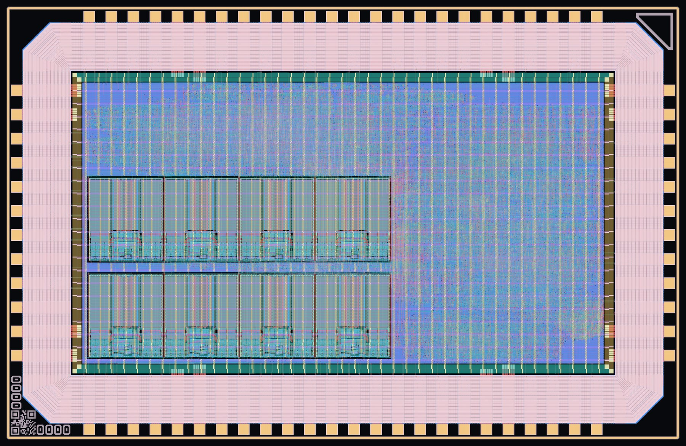
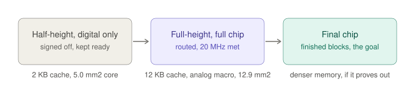
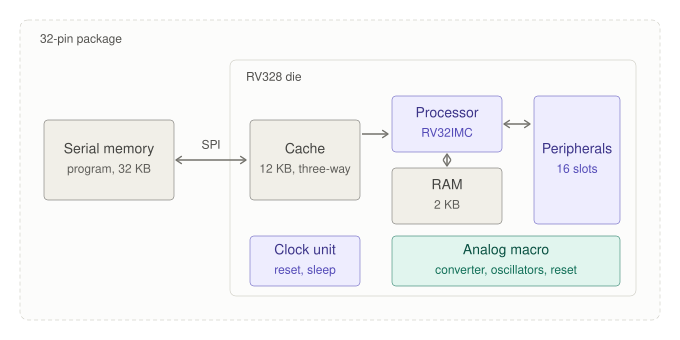

# RV328

A RISC-V microcontroller in the footprint of the ATmega328PB: the same 32 pins, the same peripherals,
5 V, 20 MHz, on the open GF180MCU process. This site is the record of how it is being built: the
results, the decisions and the dead ends.

Nothing here has been measured on silicon. Every figure comes from simulation or from the layout tools.

The source, the test programs and these pages are on [GitHub](https://github.com/jbobrow/RISC-V-328).

## Where it stands

| | Half-height layout | Full-height layout |
|---|---|---|
| What it is | digital part only, 2 KB cache | 12 KB cache, fast multiplier, the analog macro in place with its 13 analog lines wired |
| Layout | signed off: rule checks, layout-versus-schematic, antenna, density | with antenna diodes and supply-strap fixes built in (run `rmb`): layout-versus-schematic, antenna, density and foundry rule checks pass; three tests pass in gate-level simulation with the macro's model |
| 20 MHz | met at all nine corners, 5.9 ns to spare | run `sgn`: met at all nine corners, setup and hold (0.87 ns to spare). Run `rmb`: met at eight, 0.26 ns short at the slowest |
| Against an ATmega328P | too slow on ordinary firmware | level on float code, 2 to 4 times faster on the rest |
| Role | kept ready as a possible test chip | the product |

## Start here

* [Build log](build_log.md): what was done at each stage and what it showed.
* [Decisions](decisions.md): what was chosen, instead of what, and why.
* [Cache study](cache_study.md): the measurements against an ATmega328P that changed the plan.
* [Layout results](layout_results.md): every layout run, with its numbers.
* [Memory research](memory_research.md): can the memory be made denser (first report).

## Reference

* [Datasheet](datasheet.md), [verification](verification.md), [tape-out checklist](tapeout_checklist.md)
* [Analog macro specification](analog_macros.md), [bond-out](bondout.md)
* [Layout viewer](layout_viewer.html) for the half-height layout

