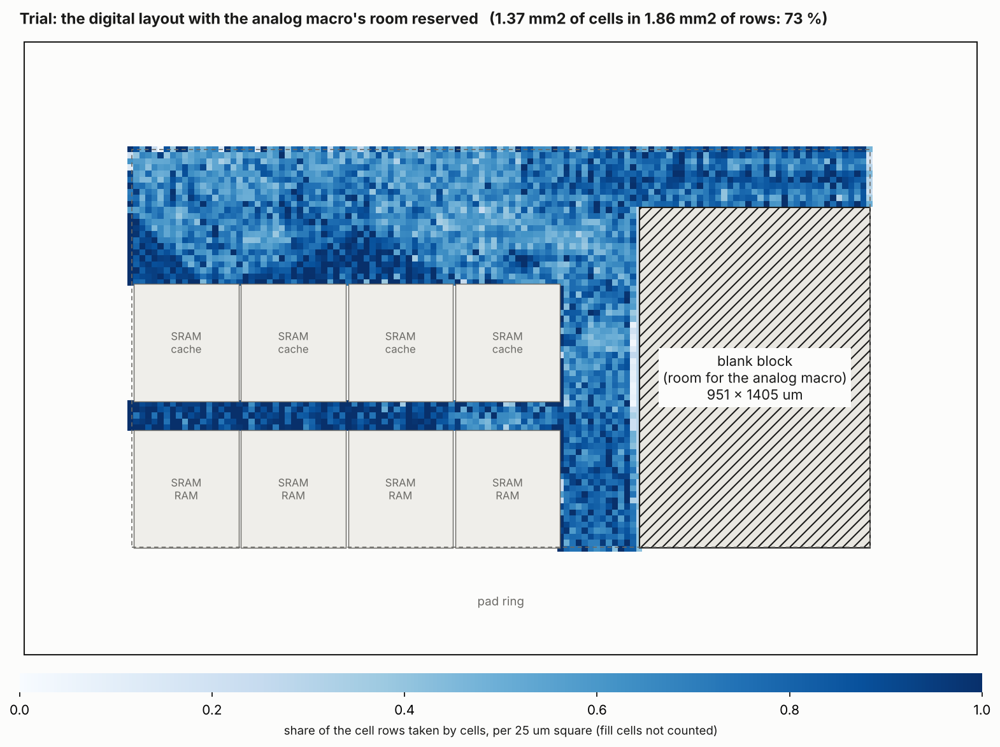

# RV328 layout: results

The digital-first build (analog stub, external clock and reset) has been through the LibreLane flow for
the wafer.space GF180MCU half-height slot three times. This document describes the third layout (`run4`),
which is the one in `layout/` and in the viewer, and compares it with the two before it.

**The third layout meets timing at 20 MHz at all nine corners with the flow's own constraints, is clean
in routing, DRC (Magic and the foundry deck), antenna, density and layout-versus-schematic, and its
routed netlist passes three of the test programs in gate-level simulation at 20 MHz.** Against the
second layout it removes the slow crystal-clock edge, the one constraint exception that covered a real
path, and all but 16 of the 691 slew entries. It is still not ready to submit: the analog blocks are a
stub in this build (they now exist as a macro layout of their own, see `analog/README.md`, which is not
in this layout; a trial with a blank block of its size routes but has no room left for repair, see
"Trial with the analog block"), and formal equivalence and the
wafer.space precheck have not been run.

**The chip is moving to the full-height slot.** Measurements show the 2 KB cache of this layout is too
small (`docs/cache_study.md`). A first full-height layout with a 12 KB three-way cache, a faster
multiplier and room for the analog macro routes cleanly and meets 20 MHz at all nine corners; see
"Full-height layout with the 12 KB cache". It has not been through sign-off checks yet.

Open `docs/layout_viewer.html` in a browser to look at the result. The outputs of the run are in
`layout/` (final GDS, routed DEF, renders, the metrics and timing reports). `make render` reproduces the
pictures: the four build stages and the finished layout at 8000 pixels with zoom-ins.

Tools: LibreLane 3.1.0.dev3 from the wafer.space project template's Nix environment, PDK gf180mcuD at
the template's pinned revision, 9-track 5 V standard cells (`gf180mcu_fd_sc_mcu9t5v0`).

## Numbers

Built and signed off at a 50 ns clock (20 MHz), with extracted parasitics.

| Quantity | Value |
|---|---|
| Die | 3932 x 2531 um |
| Standard cells (incl. buffers and taps, without fill) | 60156 |
| Standard-cell area | 1.48 mm2 (logic 1.38, taps and row ends 0.10) |
| Share of the cell rows (3.20 mm2) | 46 % |
| Memories (eight macros) | 1.68 mm2 |
| Fill and decoupling cells in the empty rows | 1.71 mm2 |
| Routed wire length | 3.61 m |
| Vias | 270022 |
| Routing DRC violations | 0 |
| Antenna violations (nets / pins) | 0 / 0 |
| Clock target | 50 ns (20.0 MHz) |
| Setup violations (endpoints, all corners) | 0 |
| Hold violations (endpoints, all corners) | 0 |
| Max slew / capacitance / fan-out violations | 16 / 275 / 296 |
| Power estimate (default activity) | 19.2 mW |
| Magic DRC errors | 0 |
| KLayout DRC errors (foundry deck) | 0 |
| KLayout antenna / density errors | 0 / 0 |
| LVS | match, 0 errors |

| Corner | Setup slack (ns) | Implied max clock (MHz) | Hold slack (ns) |
|---|---|---|---|
| max_ff_n40C_5v50 | +15.96 | 29.4 | +0.43 |
| max_ss_125C_4v50 | +5.87 | 22.7 | +1.72 |
| max_tt_025C_5v00 | +14.09 | 27.8 | +0.84 |
| min_ff_n40C_5v50 | +16.13 | 29.5 | +0.36 |
| min_ss_125C_4v50 | +9.83 | 24.9 | +1.35 |
| min_tt_025C_5v00 | +14.34 | 28.0 | +0.66 |
| nom_ff_n40C_5v50 | +16.05 | 29.5 | +0.42 |
| nom_ss_125C_4v50 | +8.01 | 23.8 | +1.53 |
| nom_tt_025C_5v00 | +14.22 | 27.9 | +0.77 |

Corner names: `nom/min/max` are the interconnect corners, `tt_025C_5v00` typical silicon at 25 C and 5.0 V,
`ss_125C_4v50` slow silicon at 125 C and 4.5 V, `ff_n40C_5v50` fast silicon at -40 C and 5.5 V.
"Implied max clock" is 1 / (period - slack); pin budgets scale with the period, so treat it as a guide.

## What the numbers say

* **Speed.** 20 MHz, the ATmega328PB's top speed grade, is met with 5.9 ns to spare at the slowest corner
  (slow silicon, 125 C, 4.5 V, worst wiring) and 14 ns on typical silicon. The slowest path is again a
  CPU path that ends in the register file.
* **Hold.** Met at every corner, worst margin 0.36 ns (fast silicon).
* **Physical checks.** Routing 0 violations; Magic DRC 0; foundry KLayout deck 0 (162 rule decks: every deck
  except antenna and density, which have their own steps, and circuit-under-pad, which the wafer.space
  template leaves out); KLayout antenna and density 0; LVS "Circuits match uniquely". The foundry deck
  was run as two halves outside the flow (back-end and front-end rules, commands in `flow/README.md`):
  on this two-core machine a single run of the whole deck did not finish inside the session's limit.
* **Slew and capacitance.** Against the flow's own targets (3 ns transition, 0.2 pF):
  * Slew: 16 pins at the slowest corner (691 in the second layout), 3 at the typical corner and at most 1
    at the fast ones. The worst is 6.0 ns on one ordinary logic net; the rest are between 3 and 3.6 ns
    and include the input of the PB0 pad driver and the root buffer of one gated clock. The crystal
    clock branch, 12.8 ns before, is no longer on the list: it now has its own buffer (14 loads,
    0.34 pF). The 6 ns net is the one item here worth fixing by hand before a submission.
  * Capacitance: 275 entries at the slowest corner. 74 are the bond pads themselves, 68 are clock-tree
    nets that the repair steps do not touch, and 133 are ordinary nets, typically 0.25 pF against the
    0.2 pF target. None of them causes a timing or slew failure.
  * Nearly all of the 296 "fan-out" entries are clock-tree leaf buffers; not a defect.
* **Constraint exceptions** (in `flow/librelane/chip_top.sdc`, with reasons): hold checks from the
  asynchronous GPIO pins; the reset pin; the static crystal-mode bits; PB6 used as data (it is the clock
  pin in this build and only reaches synchronisers and the wake latch). The exception for the reset
  release of the crystal-ready counter is gone: that reset now goes through a two-flop synchroniser and
  the path is timed like any other. (The old exception was still in the file during this run, but it no
  longer matched any net, so the results above were obtained without it; it has since been deleted.)
* **Area and power.** 1.48 mm2 of standard cells with their taps, 46 % of the 3.20 mm2 of cell rows;
  the other 1.71 mm2 is fill. (Earlier versions of this page said 1.99 mm2 and 62 %. That is the flow's
  metric, which counts the four corner cells of the pad ring, 0.50 mm2, as standard cells;
  `scripts/core_area.py` adds the cells up from the DEF.) 3.61 m of
  wire, an estimated 19 mW at 20 MHz with default switching activity.

## Gate-level simulation

The routed netlist was simulated with the cell delays extracted from the layout (typical corner) and a
20 MHz clock, running the same firmware as the RTL tests (`make gl-sdf`, `make gl-basic`; method and
limits in `scripts/gl_prep.py`).

| Test | RTL, digital-first build, 20 MHz | Routed netlist with cell delays, 20 MHz |
|---|---|---|
| basic | PASS at 2,109,426 ns | PASS at 2,109,431 ns |
| timers | PASS at 2,032,376 ns | PASS at 2,032,381 ns |
| spi | PASS at 1,653,276 ns | PASS at 1,653,281 ns |

Each finishes in the same clock cycle as the RTL, 5 ns later. This shows the netlist the layout was
built from boots from an undefined power-up state, runs code from the serial memory through the cache
and SRAM macros, and drives the pads correctly with real gate delays and the real clock tree.

Limits: three of the ten tests (the others need the analog model or take hours at gate level); typical
corner only; cell delays include each cell's wire load, but wire RC delay is not simulated and setup and
hold are not checked, because Icarus Verilog supports neither for this design. Static timing remains
the evidence for speed and hold.

## What changed between the layouts

| | First layout (run2) | Second layout (run3) | Third layout (run4) |
|---|---|---|---|
| Standard cells | 7-track | 9-track | 9-track |
| Synthesis | area | delay (`DELAY 4`, ABC buffering and sizing) | same |
| Clock target in the flow | 80 ns | 55 ns (signed off separately at 50 ns) | 50 ns |
| Timing repair after global routing | off | on | on, with larger slew and capacitance margins |
| CPU clock gate | behind the system clock gate | beside it | beside it |
| Crystal clock branch | unbuffered | unbuffered, 12.8 ns edge | own clock buffer |
| Crystal-ready counter reset | asynchronous | asynchronous, constraint exception | two-flop synchroniser, no exception |
| Slowest corner | fails 12.5 MHz by 12.1 ns (10.9 MHz) | meets 20 MHz, 5.9 ns to spare | meets 20 MHz, 5.9 ns to spare |
| Typical silicon | about 17 MHz | about 28 MHz | about 28 MHz |
| Hold | 12 endpoints fail, up to 0.39 ns | met, 0.33 ns | met, 0.36 ns |
| Slew violations (worst corner) | 7,312 | 691 | 16 |
| Capacitance violations (worst corner) | | 490 | 275 |
| Standard cells | | 57,614 | 60,160 |
| LVS | match only after renaming four nets | match | match |
| Power estimate | 12 mW at 12.5 MHz | 19 mW at 20 MHz | 19 mW at 20 MHz |

Why the first layout was slow: the repair steps only optimise as far as the target asks. They met 80 ns
on wire estimates after resizing 11 gates, nothing re-checked after routing, and almost every gate on the
slowest path was still the weakest size. Synthesising for delay did most of the work; the 9-track cells
are about 15 % faster than the 7-track ones on the same path before layout (68 ns against 79 ns).

What the third layout cost: about 2,500 more cells (4 %), mostly buffers from the stricter slew and
capacitance repair, and no speed. The RTL changes are a clock buffer on the crystal/external clock
(`u_xbuf` in `rv328_core.v`) and a reset synchroniser (`u_xrst` in `rv328_clkrst.v`); the 16 RTL tests
pass unchanged.

## Problems found and fixed on the way

| Problem | Fix |
|---|---|
| Lint error: clock-mux enable flops were bits of one vector clocked by different clocks | one small module per clock source (`rv328_clkmux_en`) |
| `SYNTH_HIERARCHY_MODE: deferred_flatten` silently dropped every cell without ports (power pads, ID macros) | back to the default flatten mode |
| Placement could not legalise repeaters in the 10 um slivers between SRAM macros | macros now abut; wider legalisation range |
| Clock-tree synthesis crashed on a clock rooted at a flip-flop output (the divided low-frequency clock) | dedicated clock buffer `rv328_clkbuf` as the root |
| The repair steps chose `dlyb_1`, a delay cell, as their fan-out buffer and added about 34 ns to the critical path | delay cells excluded with `EXTRA_EXCLUDED_CELLS` |
| A false 20 ns "hold" violation: static crystal-mode bits gating a clock input | `set_false_path` in the SDC |
| LVS mismatch on the four flash pins: pad nets and core nets whose names differed only in case | core-side nets renamed `core_fl_*` |
| CPU clock arrived several ns after the peripheral clock (gate behind gate), costing thousands of hold buffers | CPU gate moved beside the system gate in `rv328_clkrst`; simulations cycle-identical |
| Hold repair padded every GPIO input with buffer chains and still could not close them | hold false path on the asynchronous pins |
| The flow's mid-run timing reports only cover the typical corner | judge speed from the post-route report, not from those |

## Trial with the analog block

The analog macro is 1380 x 927 um. To find out whether the digital layout still fits beside it in the
half-height slot, the flow was run again with a blank block of that size in the core: no pins, no
content, Metal1 to Metal5 blocked (`scripts/gen_analog_blank.py`, `flow/librelane/trial_*.yaml`; same
netlist, clock target and library as the third layout). The cells then fill about 74 % of the rows that
are left, where the third layout fills 46 %.

**Result: it can be placed and routed without rule violations, but only with the flow's repair steps
after global routing switched off. What is then left unrepaired costs 20 MHz at the slow corner, in the
fan-out of one register; every other path still meets, with no margin. Not shown to work, and not
shown to be impossible.**

| | Third layout (no block) | Trial with the block |
|---|---|---|
| Cell rows | 3.20 mm2 | 1.86 mm2 |
| Cells with taps, share of the rows | 1.48 mm2, 46 % | 1.37 mm2, 73.5 % |
| Global routing: usage, overflow | 17 %, none | 27 %, none |
| Detailed routing: violations | 0 | 0 |
| Wire length, vias | 3.61 m, 270,022 | 4.47 m, 281,584 |
| Timing repair after global routing | on | off: its buffers cannot be placed (below) |
| Setup slack, slow silicon 125 C 4.5 V, worst wiring | +5.9 ns | -7.8 ns (17.3 MHz) on 72 endpoints, all reached from one register; the best of the others +0.02 ns |
| The same with nominal wiring | +8.0 ns | -3.6 ns (18.7 MHz), 32 endpoints from the same register |
| Setup slack, typical silicon | +14.1 ns | +10.8 ns |
| Hold slack, worst | +0.36 ns | -0.06 ns (one endpoint, fast corner) |
| Slew / capacitance entries, worst corner | 16 / 275 | 2,561 / 995 |
| Antenna violations left | 0 | 79 nets (jumpers only; no room for diodes) |

Three floorplans were tried. What each showed:

| Floorplan | What happened |
|---|---|
| 1. Block near the south-east corner with 46 um of cell rows between it and the core edge; memories as in the third layout | Global routing did not converge (stopped by hand after 80 minutes; a short stand-alone run of the same placement left an overflow of 58,372). The placer had filled the rows around the block with ordinary logic, whose wires then had to go round the block |
| 2. Block in the corner itself | Overflow down to 3,788 in the short stand-alone run; the flow's own global routing was stopped in the same loop as the first (see the clock-net setting below, which this run did not have yet, so it is not known whether it would have ended). Seven nets of the pads behind the block had no way round it, and the logic in the 38 um strips beside the memories had to cross the memories on the two metal layers they leave free |
| 3. Block in the corner with a 24 um strip without rows, for the wires of the pads behind it; memories against the south-west corner, the lower row turned upside down, so that all memory pins face the one channel between the rows | Global routing clean after 9 iterations. This is the layout in the table and the picture |

Why the repair steps are off. At this density there is no free row space near where a buffer or a diode
is needed. With the repair after global routing on, the third floorplan got 1,600 buffers, the
legaliser moved cells by 33 um on average to seat them (wire length by half-perimeter up 29 %), and
the routing that had been clean came back with an overflow of 56,440; the antenna step then failed
because 25 cells could not be placed at all. So what the table shows is the layout as the clock tree
step left it, and its slew entries, its slow-corner timing and its antenna violations are what the
repair steps would have had to fix. Each repair was tried once, as the flow is configured: a repair that
only makes cells stronger where they stand, or one limited to the nets that fail, was not tried.

The slow-corner failure is of that kind. All 72 failing endpoints are reached from one register, on
the data address bus (`u_core.d_addr[3]`): on the worst path two of the weakest buffers drive 0.7 and
0.3 pF and a weakest AND-OR gate 0.3 pF, with edges of up to 17 ns, and those three stages cost 21 ns.
Stronger cells in those places would probably close it; whether there is room for them is the question
the trial leaves open.

Settings the trial needed besides the floorplan, all in `flow/librelane/trial_blank.yaml`: the
legaliser may move a cell across the whole core (buffers for the pads behind the block have no rows
near them); no double spacing for clock nets (where global routing sees congestion it takes that rule
off one net at a time, fifty iterations each); and the first memory 10 um off the core's edge (on the
edge itself the power grid step fails).

What this does not tell: the block has no pins, so the real macro's control and clock nets and their
timing are not in it; the macro's own power connection is not in it; and no layout between 46 % and 74 % was
tried, so where the limit lies is not known, only that at 74 % this flow has no room left to repair
what it finds after routing.

## Full-height layout with the 12 KB cache

The half-height slot cannot hold the analog macro with any margin (previous section), and the 2 KB
cache it was sized around is too small for firmware of ordinary size (`docs/cache_study.md`). This is the
first layout of what the chip needs instead: the full-height slot (1x1, core 3048 x 4238 um, 12.9 mm2),
the 12 KB three-way cache with pinned interrupt handlers, the processor's single-cycle multiplier, and a
blank block where the analog macro goes.

**It is placed, routed without violations and meets 20 MHz at all nine corners, with the flow's design
and timing repair switched on and cells filling 41 % of their rows.** It has been taken as far as static
timing and one gate-level test; the sign-off checks of the third layout (DRC decks, LVS, density) have not been run on it.

| | Third layout (`run4`, half-height) | Full-height (`full4`) |
|---|---|---|
| Core area | 5.02 mm2 | 12.92 mm2 |
| Memories | 8 (RAM 2 KB, cache 2 KB) | 31 (RAM 2 KB, cache 12 KB, 3 for tags) |
| Analog macro | not in the layout | blank block of 1405 x 927 um, no pins |
| Standard cells with taps | 1.48 mm2, 46 % of 3.20 mm2 of rows | 1.88 mm2, 41 % of 4.55 mm2 of rows |
| Global routing | 16.8 % of capacity, no overflow | 14.0 %, no overflow |
| Detailed routing | 0 violations, 3.61 m of wire, 270,022 vias | 0 violations, 5.68 m, 368,086 vias |
| Antenna | clean | 0 violating nets after 49 diodes |
| Setup, slowest corner (4.5 V, 125 C, worst-case wires) | +5.87 ns | +0.64 ns |
| Setup, slow corner with nominal wires | | +2.50 ns |
| Setup, typical | +14.09 ns | +10.96 ns (25.6 MHz) |
| Hold, worst corner | +0.36 ns | +0.14 ns |
| Slew / capacitance limits exceeded | 16 / 275 | 94 / 646 |

How it got there:

* **Floorplan** (`scripts/gen_floorplan_1x1.py`): two blocks of memory rows, bottom and top, with the
  logic, the analog block and one tag memory in a band between them. Rows of memories stand in pairs
  with their pins facing one 120 um channel. A 60 um strip of cell rows runs along the west, south
  and north edges so the pads there have cells next to them, and a 346 um column on the east side joins
  the channels to the logic. The pad ring is the half-height one, with the east and west pads spread
  over the longer sides.
* **First run (`full3`)**: routed clean, hold met, setup met at eight corners and missed by 1.57 ns at
  the slowest one. Of the 108 failing endpoints 98 start at the operand registers of the new multiplier
  and 10 at a tag memory. The flow repairs timing on the nominal wire model, where that corner had
  +0.45 ns; the worst-case wire model is 2.0 ns slower on these paths.
* **Second run (`full4`)**: the same with more repair margin asked for (4.0 ns instead of 2.0 after
  placement, 3.5 ns instead of 1.0 after global routing). Timing repair after global routing resized 49 cells for 167 endpoints
  inside that margin. Result as in the table. Run time: 74 minutes to extraction and 8 for the nine
  timing corners, on two cores.
* **Gate level:** the routed netlist with typical cell delays from this layout passes the `basic`
  test at 20 MHz (boot through the three-way cache built from the foundry memory models, RAM access,
  multiply and divide, GPIO; `GLDIR=build/gl_full scripts/gl_sim.sh`). The other nine tests have not
  been run on it.
* 2,338 hold buffers after clock-tree synthesis and 625 after global routing. The clock tree has
  8.7 ns of skew between its extremes at the slowest corner; timing is met with it.

What is not good yet:

* **Slow edges.** 94 pins exceed the slew limit, the worst an 8.2 ns edge on the wire to the PB0 pad
  (limit 1 ns at a pad, 3 ns elsewhere). The third layout had 16. One of the 94 is a pad pin; the rest
  are inside the logic, on nets whose repeaters could not be placed where they were wanted (next
  subsection).
* **Margin at the slowest corner is 0.64 ns of 50.** It is the multiplier. If that does not hold with
  the real analog macro in place, the fallback is the multiplier for the low half of the product only:
  the float-heavy benchmark then runs at 0.81 of an ATmega328P's speed instead of 0.97
  (`docs/cache_study.md`); everything else is unchanged.
* The upper clock nets were routed without the double-spacing rule (`CTS_APPLY_NDR: none`), as in the
  trial above.

### A second floorplan with a buffer at every pad (`full7`): not adopted

The next run tried to cure the slow edge at the PB0 pad for all pads at once: every pad signal gets a
buffer of its own (`RV328_PADBUF`, 138 of them) set down by hand in front of its pad, and the strips of
cell rows along the edges were widened from 60 to 120 um to hold them
(`scripts/gen_floorplan_1x1.py --padbuf`).

**It routes clean and no pad wire is slow any more, but it is worse than `full4` where it counts: it
misses 20 MHz by 1.73 ns at the slowest corner, and has more slow edges inside the logic.** `full4`
stays the reference full-height layout, and the generator's default reproduces it.

| | `full4` (reference) | `full7` (pad buffers, 120 um strips) |
|---|---|---|
| Standard cells with taps | 1.88 mm2, 41 % | 1.94 mm2, 43 % |
| Global routing | 14.0 % of capacity | 15.7 % |
| Detailed routing | 0 violations, 5.68 m, 368,086 vias | 0 violations, 6.40 m, 381,978 vias |
| Hold buffers (after clock tree / after global routing) | 2,338 / 625 | 4,991 / 1,252 |
| Setup, slowest corner, worst-case wires | +0.64 ns | **-1.73 ns**, 68 endpoints |
| Setup, slow corner, nominal wires | +2.50 ns | +0.65 ns |
| Setup, typical | +10.96 ns | +12.70 ns |
| Hold, worst corner | +0.14 ns | +0.15 ns |
| Slew / capacitance limits exceeded | 94 / 646 | 142 / 937 |
| Pad pins among the slow edges | 1 (PB0, 8.2 ns) | 0 |

What it showed:

* **The slow edges were never mainly a pad problem.** Of the 94 in `full4` one is a pad pin; the other
  93 are inside the logic. The earlier text here said "long wires to pads were not all buffered", which
  described the worst one and not the rest. The pad buffers take that one off the pad pin (all pad wires are within their 1 ns limit), but the
  slow edge reappears on the wire into PB0's buffer (4.3 ns): see the next run.
* **The slow edges inside come from logic that sits in the channels between memory rows.** The worst
  (14.3 ns) is a gate of the debug port at (1141, 1149) driving a repeater 1.1 mm away at (1715, 1663):
  both are in channels where the rows are full, so the repeater the flow inserted could not be put down
  where it was wanted and was legalised far along the channel. The debug logic runs on the 10 MHz JTAG
  clock, has slack to spare, and is pushed to wherever is left.
* **Wider edge strips pull logic out of the middle.** In `full4` the 60 um strips stayed nearly empty.
  At 120 um the placer filled the west strip beside the lower memory block and more of the east column
  (picture). Wires got longer: 13 % more wire in total, and the two tightest groups of paths both fail,
  28 endpoints from the cache's address register through the tag compare to the register file
  (-1.73 ns) and 40 from the multiplier's operand register (-0.89 ns).
* **One buffer had to go: the clock pin's.** With an input buffer on PB6 the external clock reached the
  core one buffer later than the copy the oscillator stand-in takes from the same pad, the tool saw two
  skewed versions of one clock, and hold repair after clock-tree synthesis stalled (17 minutes on ten
  endpoints, each buffer forcing a full timing update; found with a stack trace of the tool and a hold
  report of the placed design). PB6 now goes to the clock tree straight from the pad
  (`CLOCK_INPUTS` in `scripts/gen_padring.py`); the step then takes 11 minutes as before.
* All ten RTL tests pass with the pad buffers in and the full-height configuration
  (`SIMDEFS="-DRV328_PADBUF -DRV328_CACHE_KB=4 -DRV328_CACHE_WAYS=3 -DRV328_CACHE_PIN=2 -DRV328_MUL_FAST=1"`).
  No gate-level test was run on this layout.

What follows for the next floorplan: the logic needs regions, not more room at the edges. Keep the
channels between memory rows for the cells that talk to those memories, give the debug port a place
near its pads, keep the strips narrow, and keep the pad buffers only where a pad is far from the logic.
That is the "guided regions" step of `docs/decisions.md` (11); this run is the evidence for what the
regions have to do. Timing table: `docs/full_height_padbuf_timing.txt`.

### Lanes kept free for buffers (`full8`): not adopted either

The next run kept the pad buffers and the reference layout's 60 um edge strips, and told the first
placement to leave lanes free for the cells the later steps add: the edge strips, the 30 um gap between
two memory rows, and the middle 60 um of the two channels (soft placement obstructions, which bind the
first placement only; buffers, hold cells and clock buffers may still go there). Target density 52 %
instead of 45 % so the logic fits in what is left (`scripts/gen_floorplan_1x1.py --padbuf --lanes`).

**The lanes stayed free, but timing got worse again: -3.09 ns at the slowest corner, three hold
violations at the fast corner, and 357 slow edges.**

| | `full4` (reference) | `full7` (pad buffers, 120 um strips) | `full8` (pad buffers, lanes) |
|---|---|---|---|
| Standard cells with taps | 1.88 mm2, 41 % | 1.94 mm2, 43 % | 1.93 mm2, 43 % |
| Global routing | 14.0 % | 15.7 % | 16.1 % |
| Detailed routing | 0 violations, 5.68 m | 0 violations, 6.40 m | 0 violations, 6.64 m, 387,956 vias |
| Hold buffers (after clock tree / after global routing) | 2,338 / 625 | 4,991 / 1,252 | 4,847 / 108 |
| Setup, slowest corner, worst-case wires | +0.64 ns | -1.73 ns, 68 endpoints | **-3.09 ns**, 65 endpoints |
| Setup, slow corner, nominal wires | +2.50 ns | +0.65 ns | -0.24 ns, 1 endpoint |
| Setup, typical | +10.96 ns | +12.70 ns | +11.69 ns |
| Hold, worst corner | +0.14 ns | +0.15 ns | **-0.17 ns**, 3 endpoints (fast corners) |
| Slew / capacitance limits exceeded | 94 / 646 | 142 / 937 | 357 / 1102 |

What it showed:

* **The lanes did what they were for:** the channels and the gap stayed nearly empty in the first
  placement, and repair after global routing needed only 108 hold buffers (625 and 1,252 before).
* **The logic paid for it.** With the lanes taken away, the logic was packed tighter in the middle band
  (the dark area in the picture) and part of the processor moved east, under the analog block: 55 of
  the 65 failing paths start at a processor result register placed at (2602, 2293) and 10 at a
  multiplier operand register at (3208, 2328), both in the row just below the block, far from the
  register file and the cache they talk to.
* **The pad buffers move the PB0 problem rather than cure it.** The logic that drives PB0 sits in the
  middle of the chip; with a buffer at the pad, the long wire is now between that logic and the buffer,
  and its edge is 4.3 ns (`full7`) and 7.5 ns (`full8`) instead of 8.2 ns at the pad. The repair steps
  do not break that wire up either.
* The slowest edges are now in the middle band itself (9.5 ns on a debug-port gate at (1586, 2152)
  driving a repeater 263 um away), where the packing is densest.

Timing table: `docs/full_height_lanes_timing.txt`.

### Pad buffers in the reference floorplan (`full9`): stopped

To separate the two changes of `full7`, the next run took the reference floorplan unchanged (60 um
strips, no lanes) and added only the pad buffers. It went through placement and clock tree like the
others (setup +4.07 ns before hold repair, 4,953 hold buffers), but after global routing the timing
repair found **805 endpoints failing, the worst by 8.86 ns** on the nominal wire model, where the
reference had none failing (+0.37 ns, 167 endpoints inside the margin). The repair recovered most of
that: when I stopped it by hand after 100 minutes (the step usually takes 17), the worst slack was
+2.26 ns, still inside the 3.5 ns margin it aims for on all 805 endpoints. So the run might well have
finished and met timing; stopping it was a judgment about time, not a result. Why the design was so
slow after global routing was not found: the run's databases were deleted to free disk space before
they were looked at. With 138 hand-placed buffers in strips only 60 um wide, many will have been moved
far from their pads by the legaliser; that is a guess.

What the three runs together say: in this flow, hand-placed buffers and room taken away from the placer
did not make the full-height layout faster, and twice made it clearly slower. The reference stays. The pad-buffer option stays in the
RTL, off by default.

### Repeaters on long wires (`full10`): nearly level, much cleaner

After three runs that changed the floorplan, this one leaves the reference floorplan exactly as it is
and changes one thing in the flow: the design-repair steps after placement and after global routing
break every wire longer than 600 um with a repeater (`DESIGN_REPAIR_MAX_WIRE_LENGTH` and
`GRT_DESIGN_REPAIR_MAX_WIRE_LENGTH`, which the flow leaves off; `gen_floorplan_1x1.py --wire 600`).

| | `full4` (reference) | `full10` (repeaters every 600 um) |
|---|---|---|
| Buffers inserted by design repair (after placement / after global routing) | 10,064 / not recorded | 11,198 / 1,754 |
| Hold buffers (after clock tree / after global routing) | 2,338 / 625 | 2,537 / 749 |
| Global routing | 14.0 % | 14.0 % |
| Detailed routing | 0 violations, 5.68 m, 368,086 vias | 0 violations, 5.76 m, 376,944 vias |
| Antenna | 0 nets | 0 nets |
| Setup, slowest corner, worst-case wires | +0.64 ns | **-0.03 ns**, 1 endpoint |
| Setup, slow corner, nominal wires | +2.50 ns | +1.89 ns |
| Setup, typical | +10.96 ns | +11.33 ns |
| Hold, worst corner | +0.14 ns | +0.05 ns |
| Slew / capacitance limits exceeded | 94 / 646 | **81 / 264** |

* **Capacitance overloads fell by 59 % and slow edges by 14 %** for 1.4 % more wire. Of the 81 slow
  edges all but 5 are between 3.0 and 4.4 ns; the worst is still the PB0 pad (7.5 ns).
* **One path misses by 34 ps** at the slowest corner: from the cache's address register (at 1530,
  2500) through the tag compare and the processor's fetch buffer to the register file (2005, 2812).
  Every other endpoint at every corner meets. The repair after global routing aimed for 3.5 ns of
  margin on its estimate of the wires and got it (+3.59 ns); the routed layout at the slowest corner
  with worst-case wires came out 3.6 ns below that estimate. A run with 4.5 ns asked for (`full11`, next) meets it.
* **Why PB0 is still slow:** the multiplexer that drives it sits in the middle band at (1348, 2681);
  the pad is at the bottom edge, 2.2 mm away, and the wire crosses three rows of memories, over which
  no repeater can stand. Long-wire repair does not change that. It needs the PB0 output logic placed
  near the south edge, or a repeater placed by hand in the channel between rows B and C.

No picture: the run's layout was deleted for disk space before it was drawn; its floorplan is the
reference's. Timing table: `docs/full_height_wire600_timing.txt`.

### The same with more repair margin (`full11`): the new candidate

`full10` again, with the timing repair after global routing asked for 4.5 ns of margin instead of 3.5
(`gen_floorplan_1x1.py --wire 600 --grt-margin 4.5`). Everything up to global routing is identical
(the flow is deterministic); the repair then resized 187 cells and added 3 buffers instead of 116 and 2.

| | `full4` (reference) | `full11` (repeaters every 600 um, 4.5 ns margin) |
|---|---|---|
| Standard cells with taps | 1.88 mm2, 41 % | 1.94 mm2, 43 % |
| Detailed routing | 0 violations, 5.68 m, 368,086 vias | 0 violations, 5.76 m, 376,752 vias |
| Antenna | 0 nets | 0 nets |
| Setup, slowest corner, worst-case wires | +0.64 ns | **+0.17 ns** |
| Setup, slow corner, nominal wires | +2.50 ns | +2.25 ns |
| Setup, typical | +10.96 ns | +11.23 ns |
| Hold, worst corner | +0.14 ns | **-0.009 ns**, 1 endpoint (below) |
| Slew / capacitance limits exceeded | 94 / 646 | **79 / 265** |

* **Setup is met at all nine corners.** The margin at the slowest corner is smaller than the
  reference's (0.17 against 0.64 ns), in exchange for 59 % fewer capacitance overloads and 16 % fewer
  slow edges.
* **One hold miss of 9 ps**, at the fast corner, from the serial memory's data input `FL_MISO` to its
  first register. Its constraint is the pessimistic one: the data is taken to change at the very edge of
  the external clock (`set_input_delay -min 0`), whereas it really changes only after the chip's own
  memory clock has gone out through a pad, through the bond wire and through the memory's clock-to-output
  time, several nanoseconds later. A realistic minimum delay in `chip_top.sdc`, or one delay cell on that
  input, closes it. Not done yet: the constraint should come from the chosen memory die's data sheet.
* PB0 is unchanged (7.7 ns at the pad), for the reason given under `full10`.

**Recommendation:** make `full11`'s settings the full-height reference once the `FL_MISO` constraint is
set from the memory's data sheet and timing is rerun; until then `full4` remains the reference, since it
is the only full-height layout with nothing failing. Timing table:
`docs/full_height_wire600_margin_timing.txt`.

What this layout does not tell:

* The analog macro is a blank block without pins, and the build still uses the analog stub: its
  connections to the pads and the core, its supply, and the wires that must pass it are untried, as in
  the half-height trial.
* No DRC with the foundry decks, no LVS, no density check, no stream-out, and no equivalence check
  have been run on it.
* The pad ring has the half-height slot's 72 pads. A die twice as tall wants more supply pads on the
  long sides; IR drop has not been analysed.
* The serial-memory timing with the memory clock at half the system clock, which the measured cache
  speeds assume, is constrained like the first layout's and has not been looked at separately.

Files: `flow/librelane/slot_1x1.yaml`, `macros_1x1.yaml`, `full_1x1.yaml`, `pdn/pdn_cfg_1x1.tcl`. The
run directory is not kept in the archive; the timing summary is in `docs/full_height_timing.txt`.

## Not covered

* Formal equivalence of the final netlist against the RTL (`Yosys.EQY`) and the manufacturability
  report: the flow was run in pieces because of the session's time limit, and these were not reached.
* Gate-level simulation beyond the three tests above: wire delays, the slow and fast corners, clock
  switching and sleep modes. That needs a simulator with full SDF support.
* Any analog content in the layout: the analog macro is still the stub here. The macro now exists as a
  layout of 1380 x 927 um (1.28 mm2, `analog/layout/README.md`). A trial with a blank block of that size
  in the core ("Trial with the analog block" above) routes, but leaves no room for the flow's timing
  and antenna repair, and one register's fan-out misses 20 MHz at the slow corner. The full chip needs
  that closed by hand with no margin, or a larger slot, or a smaller digital layout. The full-height
  layout above has the room (cells at 41 % of their rows) but also only a blank block.
* Review of the pad ring against wafer.space's current bonding rules, and the wafer.space precheck.
* IR-drop and electromigration analysis beyond the flow's default report.
* Timing at the ATmega's own limits (105 C): the library has no such corner; 125 C is more pessimistic.

## Before a submission

1. Fix the one 6 ns net by hand (a buffer, or `set_max_transition` on it) and re-run from placement.
2. Run formal equivalence (`Yosys.EQY`) and the wafer.space precheck on the final GDS.
3. Decide what the first silicon is: this digital-first build as it stands (external clock and reset,
   no ADC, comparator, brown-out detector or internal oscillators), or the full chip, which needs the
   analog macro finished (rings, hand-off files) and the full-height layout taken through sign-off
   with the macro in place of the blank block ("Full-height layout with the 12 KB cache").
