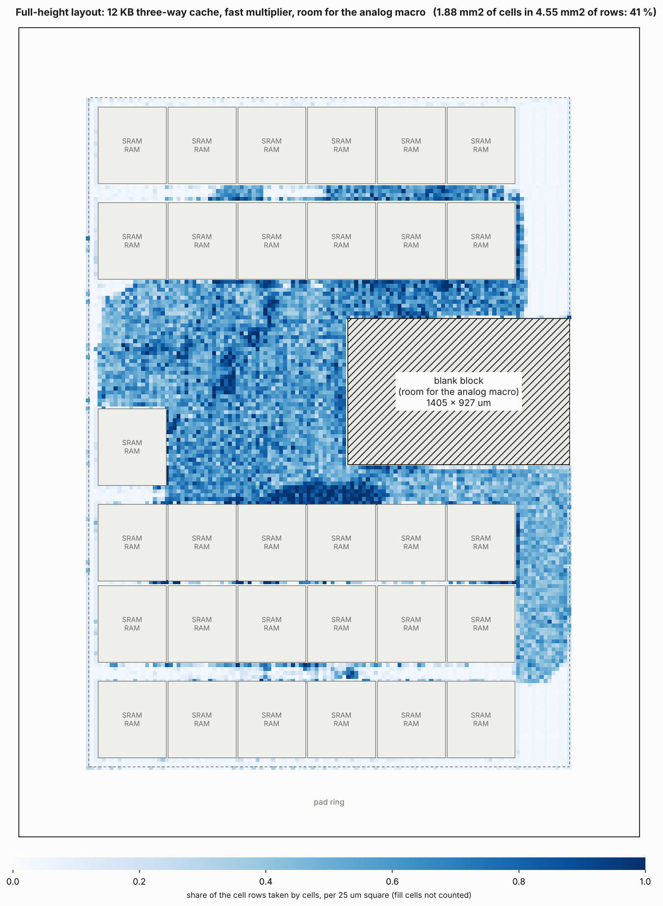
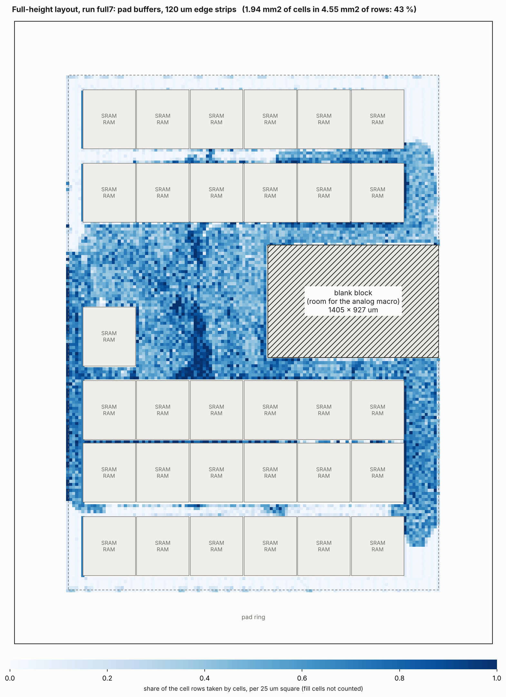
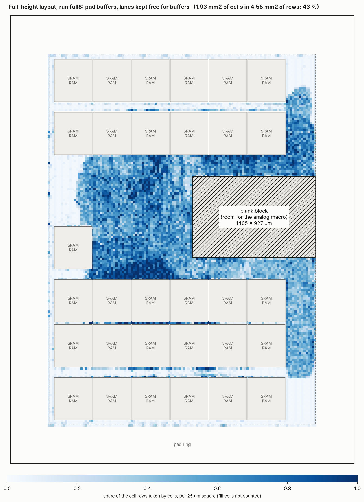
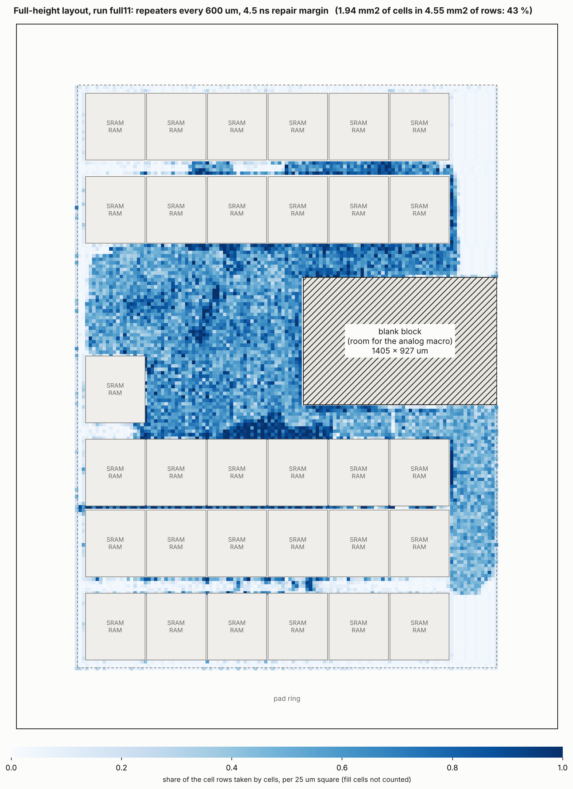
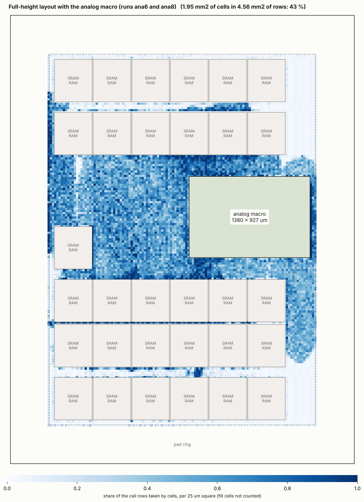
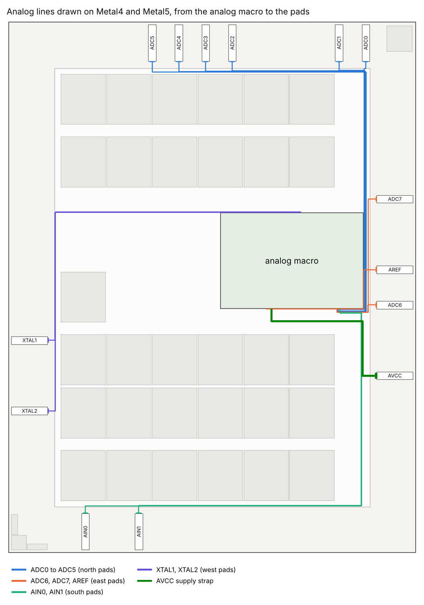
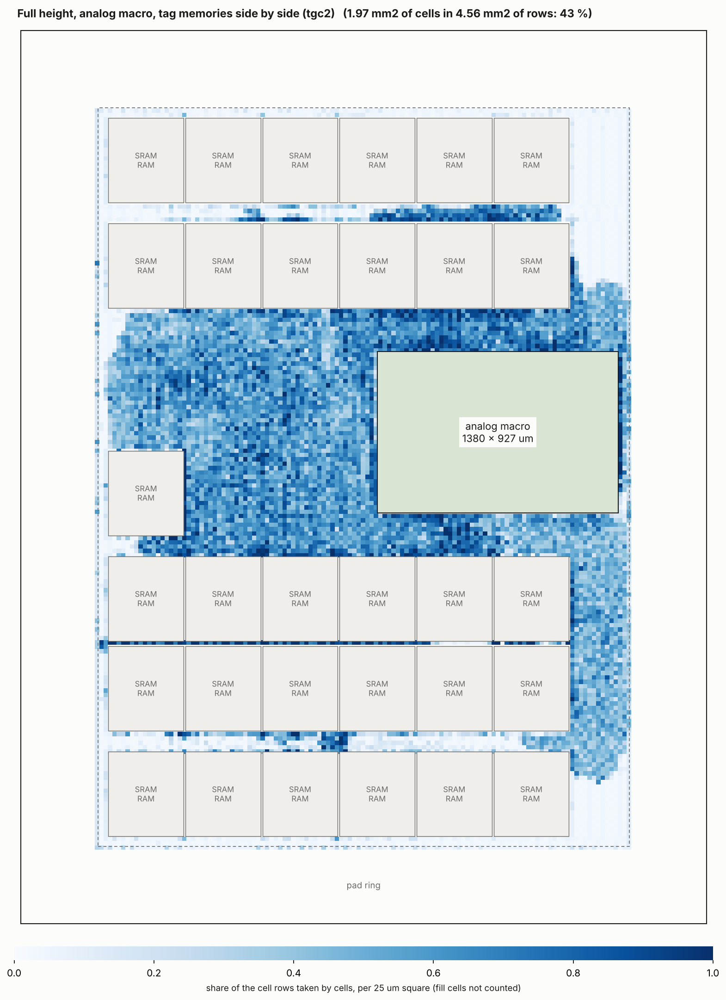

# RV328 layout: results

The digital-first build (analog stub, external clock and reset) has been through the LibreLane flow for
the wafer.space GF180MCU half-height slot three times. This document describes the third layout (`run4`),
which is the one in `layout/` and in the viewer, and compares it with the two before it.

**The third layout meets timing at 20 MHz at all nine corners with the flow's own constraints, is clean
in routing, DRC (Magic and the foundry deck), antenna, density and layout-versus-schematic, and its
routed netlist passes three of the test programs in gate-level simulation at 20 MHz.** Against the
second layout it removes the slow crystal-clock edge, the one constraint exception that covered a real
path, and all but 16 of the 691 slew entries. It is still not ready to submit: the analog blocks are a
stub in this build (they now exist as a macro layout of their own, see `analog/README.md`, which is not
in this layout; a trial with a blank block of its size routes but has no room left for repair, see
"Trial with the analog block"), and formal equivalence and the
wafer.space precheck have not been run.

**The chip is moving to the full-height slot.** Measurements show the 2 KB cache of this layout is too
small (`docs/cache_study.md`). A first full-height layout with a 12 KB three-way cache, a faster
multiplier and room for the analog macro routes cleanly and meets 20 MHz at all nine corners; see
"Full-height layout with the 12 KB cache". Since 21 November the reference full-height layout is `full11`
(same floorplan, repeaters on long wires). Since then the analog macro itself has replaced the blank
block and its analog lines are wired; the best of those layouts, `tgm6` (last section), meets 20 MHz,
setup and hold, at all nine corners. None of the full-height layouts has been through sign-off checks yet.

Open `docs/layout_viewer.html` in a browser to look at the result. The outputs of the run are in
`layout/` (final GDS, routed DEF, renders, the metrics and timing reports). `make render` reproduces the
pictures: the four build stages and the finished layout at 8000 pixels with zoom-ins.

Tools: LibreLane 3.1.0.dev3 from the wafer.space project template's Nix environment, PDK gf180mcuD at
the template's pinned revision, 9-track 5 V standard cells (`gf180mcu_fd_sc_mcu9t5v0`).

## Numbers

Built and signed off at a 50 ns clock (20 MHz), with extracted parasitics.

| Quantity | Value |
|---|---|
| Die | 3932 x 2531 um |
| Standard cells (incl. buffers and taps, without fill) | 60156 |
| Standard-cell area | 1.48 mm2 (logic 1.38, taps and row ends 0.10) |
| Share of the cell rows (3.20 mm2) | 46 % |
| Memories (eight macros) | 1.68 mm2 |
| Fill and decoupling cells in the empty rows | 1.71 mm2 |
| Routed wire length | 3.61 m |
| Vias | 270022 |
| Routing DRC violations | 0 |
| Antenna violations (nets / pins) | 0 / 0 |
| Clock target | 50 ns (20.0 MHz) |
| Setup violations (endpoints, all corners) | 0 |
| Hold violations (endpoints, all corners) | 0 |
| Max slew / capacitance / fan-out violations | 16 / 275 / 296 |
| Power estimate (default activity) | 19.2 mW |
| Magic DRC errors | 0 |
| KLayout DRC errors (foundry deck) | 0 |
| KLayout antenna / density errors | 0 / 0 |
| LVS | match, 0 errors |

| Corner | Setup slack (ns) | Implied max clock (MHz) | Hold slack (ns) |
|---|---|---|---|
| max_ff_n40C_5v50 | +15.96 | 29.4 | +0.43 |
| max_ss_125C_4v50 | +5.87 | 22.7 | +1.72 |
| max_tt_025C_5v00 | +14.09 | 27.8 | +0.84 |
| min_ff_n40C_5v50 | +16.13 | 29.5 | +0.36 |
| min_ss_125C_4v50 | +9.83 | 24.9 | +1.35 |
| min_tt_025C_5v00 | +14.34 | 28.0 | +0.66 |
| nom_ff_n40C_5v50 | +16.05 | 29.5 | +0.42 |
| nom_ss_125C_4v50 | +8.01 | 23.8 | +1.53 |
| nom_tt_025C_5v00 | +14.22 | 27.9 | +0.77 |

Corner names: `nom/min/max` are the interconnect corners, `tt_025C_5v00` typical silicon at 25 C and 5.0 V,
`ss_125C_4v50` slow silicon at 125 C and 4.5 V, `ff_n40C_5v50` fast silicon at -40 C and 5.5 V.
"Implied max clock" is 1 / (period - slack); pin budgets scale with the period, so treat it as a guide.

## What the numbers say

* **Speed.** 20 MHz, the ATmega328PB's top speed grade, is met with 5.9 ns to spare at the slowest corner
  (slow silicon, 125 C, 4.5 V, worst wiring) and 14 ns on typical silicon. The slowest path is again a
  CPU path that ends in the register file.
* **Hold.** Met at every corner, worst margin 0.36 ns (fast silicon).
* **Physical checks.** Routing 0 violations; Magic DRC 0; foundry KLayout deck 0 (162 rule decks: every deck
  except antenna and density, which have their own steps, and circuit-under-pad, which the wafer.space
  template leaves out); KLayout antenna and density 0; LVS "Circuits match uniquely". The foundry deck
  was run as two halves outside the flow (back-end and front-end rules, commands in `flow/README.md`):
  on this two-core machine a single run of the whole deck did not finish inside the session's limit.
* **Slew and capacitance.** Against the flow's own targets (3 ns transition, 0.2 pF):
  * Slew: 16 pins at the slowest corner (691 in the second layout), 3 at the typical corner and at most 1
    at the fast ones. The worst is 6.0 ns on one ordinary logic net; the rest are between 3 and 3.6 ns
    and include the input of the PB0 pad driver and the root buffer of one gated clock. The crystal
    clock branch, 12.8 ns before, is no longer on the list: it now has its own buffer (14 loads,
    0.34 pF). The 6 ns net is the one item here worth fixing by hand before a submission.
  * Capacitance: 275 entries at the slowest corner. 74 are the bond pads themselves, 68 are clock-tree
    nets that the repair steps do not touch, and 133 are ordinary nets, typically 0.25 pF against the
    0.2 pF target. None of them causes a timing or slew failure.
  * Nearly all of the 296 "fan-out" entries are clock-tree leaf buffers; not a defect.
* **Constraint exceptions** (in `flow/librelane/chip_top.sdc`, with reasons): hold checks from the
  asynchronous GPIO pins; the reset pin; the static crystal-mode bits; PB6 used as data (it is the clock
  pin in this build and only reaches synchronisers and the wake latch). The exception for the reset
  release of the crystal-ready counter is gone: that reset now goes through a two-flop synchroniser and
  the path is timed like any other. (The old exception was still in the file during this run, but it no
  longer matched any net, so the results above were obtained without it; it has since been deleted.)
* **Area and power.** 1.48 mm2 of standard cells with their taps, 46 % of the 3.20 mm2 of cell rows;
  the other 1.71 mm2 is fill. (Earlier versions of this page said 1.99 mm2 and 62 %. That is the flow's
  metric, which counts the four corner cells of the pad ring, 0.50 mm2, as standard cells;
  `scripts/core_area.py` adds the cells up from the DEF.) 3.61 m of
  wire, an estimated 19 mW at 20 MHz with default switching activity.

## Gate-level simulation

The routed netlist was simulated with the cell delays extracted from the layout (typical corner) and a
20 MHz clock, running the same firmware as the RTL tests (`make gl-sdf`, `make gl-basic`; method and
limits in `scripts/gl_prep.py`).

| Test | RTL, digital-first build, 20 MHz | Routed netlist with cell delays, 20 MHz |
|---|---|---|
| basic | PASS at 2,109,426 ns | PASS at 2,109,431 ns |
| timers | PASS at 2,032,376 ns | PASS at 2,032,381 ns |
| spi | PASS at 1,653,276 ns | PASS at 1,653,281 ns |

Each finishes in the same clock cycle as the RTL, 5 ns later. This shows the netlist the layout was
built from boots from an undefined power-up state, runs code from the serial memory through the cache
and SRAM macros, and drives the pads correctly with real gate delays and the real clock tree.

Limits: three of the ten tests (the others need the analog model or take hours at gate level); typical
corner only; cell delays include each cell's wire load, but wire RC delay is not simulated and setup and
hold are not checked, because Icarus Verilog supports neither for this design. Static timing remains
the evidence for speed and hold.

## What changed between the layouts

| | First layout (run2) | Second layout (run3) | Third layout (run4) |
|---|---|---|---|
| Standard cells | 7-track | 9-track | 9-track |
| Synthesis | area | delay (`DELAY 4`, ABC buffering and sizing) | same |
| Clock target in the flow | 80 ns | 55 ns (signed off separately at 50 ns) | 50 ns |
| Timing repair after global routing | off | on | on, with larger slew and capacitance margins |
| CPU clock gate | behind the system clock gate | beside it | beside it |
| Crystal clock branch | unbuffered | unbuffered, 12.8 ns edge | own clock buffer |
| Crystal-ready counter reset | asynchronous | asynchronous, constraint exception | two-flop synchroniser, no exception |
| Slowest corner | fails 12.5 MHz by 12.1 ns (10.9 MHz) | meets 20 MHz, 5.9 ns to spare | meets 20 MHz, 5.9 ns to spare |
| Typical silicon | about 17 MHz | about 28 MHz | about 28 MHz |
| Hold | 12 endpoints fail, up to 0.39 ns | met, 0.33 ns | met, 0.36 ns |
| Slew violations (worst corner) | 7,312 | 691 | 16 |
| Capacitance violations (worst corner) | | 490 | 275 |
| Standard cells | | 57,614 | 60,160 |
| LVS | match only after renaming four nets | match | match |
| Power estimate | 12 mW at 12.5 MHz | 19 mW at 20 MHz | 19 mW at 20 MHz |

Why the first layout was slow: the repair steps only optimise as far as the target asks. They met 80 ns
on wire estimates after resizing 11 gates, nothing re-checked after routing, and almost every gate on the
slowest path was still the weakest size. Synthesising for delay did most of the work; the 9-track cells
are about 15 % faster than the 7-track ones on the same path before layout (68 ns against 79 ns).

What the third layout cost: about 2,500 more cells (4 %), mostly buffers from the stricter slew and
capacitance repair, and no speed. The RTL changes are a clock buffer on the crystal/external clock
(`u_xbuf` in `rv328_core.v`) and a reset synchroniser (`u_xrst` in `rv328_clkrst.v`); the 16 RTL tests
pass unchanged.

## Problems found and fixed on the way

| Problem | Fix |
|---|---|
| Lint error: clock-mux enable flops were bits of one vector clocked by different clocks | one small module per clock source (`rv328_clkmux_en`) |
| `SYNTH_HIERARCHY_MODE: deferred_flatten` silently dropped every cell without ports (power pads, ID macros) | back to the default flatten mode |
| Placement could not legalise repeaters in the 10 um slivers between SRAM macros | macros now abut; wider legalisation range |
| Clock-tree synthesis crashed on a clock rooted at a flip-flop output (the divided low-frequency clock) | dedicated clock buffer `rv328_clkbuf` as the root |
| The repair steps chose `dlyb_1`, a delay cell, as their fan-out buffer and added about 34 ns to the critical path | delay cells excluded with `EXTRA_EXCLUDED_CELLS` |
| A false 20 ns "hold" violation: static crystal-mode bits gating a clock input | `set_false_path` in the SDC |
| LVS mismatch on the four flash pins: pad nets and core nets whose names differed only in case | core-side nets renamed `core_fl_*` |
| CPU clock arrived several ns after the peripheral clock (gate behind gate), costing thousands of hold buffers | CPU gate moved beside the system gate in `rv328_clkrst`; simulations cycle-identical |
| Hold repair padded every GPIO input with buffer chains and still could not close them | hold false path on the asynchronous pins |
| The flow's mid-run timing reports only cover the typical corner | judge speed from the post-route report, not from those |

## Trial with the analog block

The analog macro is 1380 x 927 um. To find out whether the digital layout still fits beside it in the
half-height slot, the flow was run again with a blank block of that size in the core: no pins, no
content, Metal1 to Metal5 blocked (`scripts/gen_analog_blank.py`, `flow/librelane/trial_*.yaml`; same
netlist, clock target and library as the third layout). The cells then fill about 74 % of the rows that
are left, where the third layout fills 46 %.

**Result: it can be placed and routed without rule violations, but only with the flow's repair steps
after global routing switched off. What is then left unrepaired costs 20 MHz at the slow corner, in the
fan-out of one register; every other path still meets, with no margin. Not shown to work, and not
shown to be impossible.**

| | Third layout (no block) | Trial with the block |
|---|---|---|
| Cell rows | 3.20 mm2 | 1.86 mm2 |
| Cells with taps, share of the rows | 1.48 mm2, 46 % | 1.37 mm2, 73.5 % |
| Global routing: usage, overflow | 17 %, none | 27 %, none |
| Detailed routing: violations | 0 | 0 |
| Wire length, vias | 3.61 m, 270,022 | 4.47 m, 281,584 |
| Timing repair after global routing | on | off: its buffers cannot be placed (below) |
| Setup slack, slow silicon 125 C 4.5 V, worst wiring | +5.9 ns | -7.8 ns (17.3 MHz) on 72 endpoints, all reached from one register; the best of the others +0.02 ns |
| The same with nominal wiring | +8.0 ns | -3.6 ns (18.7 MHz), 32 endpoints from the same register |
| Setup slack, typical silicon | +14.1 ns | +10.8 ns |
| Hold slack, worst | +0.36 ns | -0.06 ns (one endpoint, fast corner) |
| Slew / capacitance entries, worst corner | 16 / 275 | 2,561 / 995 |
| Antenna violations left | 0 | 79 nets (jumpers only; no room for diodes) |

Three floorplans were tried. What each showed:

| Floorplan | What happened |
|---|---|
| 1. Block near the south-east corner with 46 um of cell rows between it and the core edge; memories as in the third layout | Global routing did not converge (stopped by hand after 80 minutes; a short stand-alone run of the same placement left an overflow of 58,372). The placer had filled the rows around the block with ordinary logic, whose wires then had to go round the block |
| 2. Block in the corner itself | Overflow down to 3,788 in the short stand-alone run; the flow's own global routing was stopped in the same loop as the first (see the clock-net setting below, which this run did not have yet, so it is not known whether it would have ended). Seven nets of the pads behind the block had no way round it, and the logic in the 38 um strips beside the memories had to cross the memories on the two metal layers they leave free |
| 3. Block in the corner with a 24 um strip without rows, for the wires of the pads behind it; memories against the south-west corner, the lower row turned upside down, so that all memory pins face the one channel between the rows | Global routing clean after 9 iterations. This is the layout in the table and the picture |

Why the repair steps are off. At this density there is no free row space near where a buffer or a diode
is needed. With the repair after global routing on, the third floorplan got 1,600 buffers, the
legaliser moved cells by 33 um on average to seat them (wire length by half-perimeter up 29 %), and
the routing that had been clean came back with an overflow of 56,440; the antenna step then failed
because 25 cells could not be placed at all. So what the table shows is the layout as the clock tree
step left it, and its slew entries, its slow-corner timing and its antenna violations are what the
repair steps would have had to fix. Each repair was tried once, as the flow is configured: a repair that
only makes cells stronger where they stand, or one limited to the nets that fail, was not tried.

The slow-corner failure is of that kind. All 72 failing endpoints are reached from one register, on
the data address bus (`u_core.d_addr[3]`): on the worst path two of the weakest buffers drive 0.7 and
0.3 pF and a weakest AND-OR gate 0.3 pF, with edges of up to 17 ns, and those three stages cost 21 ns.
Stronger cells in those places would probably close it; whether there is room for them is the question
the trial leaves open.

Settings the trial needed besides the floorplan, all in `flow/librelane/trial_blank.yaml`: the
legaliser may move a cell across the whole core (buffers for the pads behind the block have no rows
near them); no double spacing for clock nets (where global routing sees congestion it takes that rule
off one net at a time, fifty iterations each); and the first memory 10 um off the core's edge (on the
edge itself the power grid step fails).

What this does not tell: the block has no pins, so the real macro's control and clock nets and their
timing are not in it; the macro's own power connection is not in it; and no layout between 46 % and 74 % was
tried, so where the limit lies is not known, only that at 74 % this flow has no room left to repair
what it finds after routing.

## Full-height layout with the 12 KB cache

The half-height slot cannot hold the analog macro with any margin (previous section), and the 2 KB
cache it was sized around is too small for firmware of ordinary size (`docs/cache_study.md`). This is the
first layout of what the chip needs instead: the full-height slot (1x1, core 3048 x 4238 um, 12.9 mm2),
the 12 KB three-way cache with pinned interrupt handlers, the processor's single-cycle multiplier, and a
blank block where the analog macro goes.

**It is placed, routed without violations and meets 20 MHz at all nine corners, with the flow's design
and timing repair switched on and cells filling 41 % of their rows.** It has been taken as far as static
timing and one gate-level test; the sign-off checks of the third layout (DRC decks, LVS, density) have not been run on it.

| | Third layout (`run4`, half-height) | Full-height (`full4`) |
|---|---|---|
| Core area | 5.02 mm2 | 12.92 mm2 |
| Memories | 8 (RAM 2 KB, cache 2 KB) | 31 (RAM 2 KB, cache 12 KB, 3 for tags) |
| Analog macro | not in the layout | blank block of 1405 x 927 um, no pins |
| Standard cells with taps | 1.48 mm2, 46 % of 3.20 mm2 of rows | 1.88 mm2, 41 % of 4.55 mm2 of rows |
| Global routing | 16.8 % of capacity, no overflow | 14.0 %, no overflow |
| Detailed routing | 0 violations, 3.61 m of wire, 270,022 vias | 0 violations, 5.68 m, 368,086 vias |
| Antenna | clean | 0 violating nets after 49 diodes |
| Setup, slowest corner (4.5 V, 125 C, worst-case wires) | +5.87 ns | +0.64 ns |
| Setup, slow corner with nominal wires | | +2.50 ns |
| Setup, typical | +14.09 ns | +10.96 ns (25.6 MHz) |
| Hold, worst corner | +0.36 ns | +0.14 ns |
| Slew / capacitance limits exceeded | 16 / 275 | 94 / 646 |

How it got there:

* **Floorplan** (`scripts/gen_floorplan_1x1.py`): two blocks of memory rows, bottom and top, with the
  logic, the analog block and one tag memory in a band between them. Rows of memories stand in pairs
  with their pins facing one 120 um channel. A 60 um strip of cell rows runs along the west, south
  and north edges so the pads there have cells next to them, and a 346 um column on the east side joins
  the channels to the logic. The pad ring is the half-height one, with the east and west pads spread
  over the longer sides.
* **First run (`full3`)**: routed clean, hold met, setup met at eight corners and missed by 1.57 ns at
  the slowest one. Of the 108 failing endpoints 98 start at the operand registers of the new multiplier
  and 10 at a tag memory. The flow repairs timing on the nominal wire model, where that corner had
  +0.45 ns; the worst-case wire model is 2.0 ns slower on these paths.
* **Second run (`full4`)**: the same with more repair margin asked for (4.0 ns instead of 2.0 after
  placement, 3.5 ns instead of 1.0 after global routing). Timing repair after global routing resized 49 cells for 167 endpoints
  inside that margin. Result as in the table. Run time: 74 minutes to extraction and 8 for the nine
  timing corners, on two cores.
* **Gate level:** the routed netlist with typical cell delays from this layout passes the `basic`
  test at 20 MHz (boot through the three-way cache built from the foundry memory models, RAM access,
  multiply and divide, GPIO; `GLDIR=build/gl_full scripts/gl_sim.sh`). The other nine tests have not
  been run on it.
* 2,338 hold buffers after clock-tree synthesis and 625 after global routing. The clock tree has
  8.7 ns of skew between its extremes at the slowest corner; timing is met with it.

What is not good yet:

* **Slow edges.** 94 pins exceed the slew limit, the worst an 8.2 ns edge on the wire to the PB0 pad
  (limit 1 ns at a pad, 3 ns elsewhere). The third layout had 16. One of the 94 is a pad pin; the rest
  are inside the logic, on nets whose repeaters could not be placed where they were wanted (next
  subsection).
* **Margin at the slowest corner is 0.64 ns of 50.** It is the multiplier. If that does not hold with
  the real analog macro in place, the fallback is the multiplier for the low half of the product only:
  the float-heavy benchmark then runs at 0.81 of an ATmega328P's speed instead of 0.97
  (`docs/cache_study.md`); everything else is unchanged.
* The upper clock nets were routed without the double-spacing rule (`CTS_APPLY_NDR: none`), as in the
  trial above.

### A second floorplan with a buffer at every pad (`full7`): not adopted

The next run tried to cure the slow edge at the PB0 pad for all pads at once: every pad signal gets a
buffer of its own (`RV328_PADBUF`, 138 of them) set down by hand in front of its pad, and the strips of
cell rows along the edges were widened from 60 to 120 um to hold them
(`scripts/gen_floorplan_1x1.py --padbuf`).

**It routes clean and no pad wire is slow any more, but it is worse than `full4` where it counts: it
misses 20 MHz by 1.73 ns at the slowest corner, and has more slow edges inside the logic.** `full4`
stays the reference full-height layout, and the generator's default reproduces it.

| | `full4` (reference) | `full7` (pad buffers, 120 um strips) |
|---|---|---|
| Standard cells with taps | 1.88 mm2, 41 % | 1.94 mm2, 43 % |
| Global routing | 14.0 % of capacity | 15.7 % |
| Detailed routing | 0 violations, 5.68 m, 368,086 vias | 0 violations, 6.40 m, 381,978 vias |
| Hold buffers (after clock tree / after global routing) | 2,338 / 625 | 4,991 / 1,252 |
| Setup, slowest corner, worst-case wires | +0.64 ns | **-1.73 ns**, 68 endpoints |
| Setup, slow corner, nominal wires | +2.50 ns | +0.65 ns |
| Setup, typical | +10.96 ns | +12.70 ns |
| Hold, worst corner | +0.14 ns | +0.15 ns |
| Slew / capacitance limits exceeded | 94 / 646 | 142 / 937 |
| Pad pins among the slow edges | 1 (PB0, 8.2 ns) | 0 |

What it showed:

* **The slow edges were never mainly a pad problem.** Of the 94 in `full4` one is a pad pin; the other
  93 are inside the logic. The earlier text here said "long wires to pads were not all buffered", which
  described the worst one and not the rest. The pad buffers take that one off the pad pin (all pad wires are within their 1 ns limit), but the
  slow edge reappears on the wire into PB0's buffer (4.3 ns): see the next run.
* **The slow edges inside come from logic that sits in the channels between memory rows.** The worst
  (14.3 ns) is a gate of the debug port at (1141, 1149) driving a repeater 1.1 mm away at (1715, 1663):
  both are in channels where the rows are full, so the repeater the flow inserted could not be put down
  where it was wanted and was legalised far along the channel. The debug logic runs on the 10 MHz JTAG
  clock, has slack to spare, and is pushed to wherever is left.
* **Wider edge strips pull logic out of the middle.** In `full4` the 60 um strips stayed nearly empty.
  At 120 um the placer filled the west strip beside the lower memory block and more of the east column
  (picture). Wires got longer: 13 % more wire in total, and the two tightest groups of paths both fail,
  28 endpoints from the cache's address register through the tag compare to the register file
  (-1.73 ns) and 40 from the multiplier's operand register (-0.89 ns).
* **One buffer had to go: the clock pin's.** With an input buffer on PB6 the external clock reached the
  core one buffer later than the copy the oscillator stand-in takes from the same pad, the tool saw two
  skewed versions of one clock, and hold repair after clock-tree synthesis stalled (17 minutes on ten
  endpoints, each buffer forcing a full timing update; found with a stack trace of the tool and a hold
  report of the placed design). PB6 now goes to the clock tree straight from the pad
  (`CLOCK_INPUTS` in `scripts/gen_padring.py`); the step then takes 11 minutes as before.
* All ten RTL tests pass with the pad buffers in and the full-height configuration
  (`SIMDEFS="-DRV328_PADBUF -DRV328_CACHE_KB=4 -DRV328_CACHE_WAYS=3 -DRV328_CACHE_PIN=2 -DRV328_MUL_FAST=1"`).
  No gate-level test was run on this layout.

What follows for the next floorplan: the logic needs regions, not more room at the edges. Keep the
channels between memory rows for the cells that talk to those memories, give the debug port a place
near its pads, keep the strips narrow, and keep the pad buffers only where a pad is far from the logic.
That is the "guided regions" step of `docs/decisions.md` (11); this run is the evidence for what the
regions have to do. Timing table: `docs/full_height_padbuf_timing.txt`.

### Lanes kept free for buffers (`full8`): not adopted either

The next run kept the pad buffers and the reference layout's 60 um edge strips, and told the first
placement to leave lanes free for the cells the later steps add: the edge strips, the 30 um gap between
two memory rows, and the middle 60 um of the two channels (soft placement obstructions, which bind the
first placement only; buffers, hold cells and clock buffers may still go there). Target density 52 %
instead of 45 % so the logic fits in what is left (`scripts/gen_floorplan_1x1.py --padbuf --lanes`).

**The lanes stayed free, but timing got worse again: -3.09 ns at the slowest corner, three hold
violations at the fast corner, and 357 slow edges.**

| | `full4` (reference) | `full7` (pad buffers, 120 um strips) | `full8` (pad buffers, lanes) |
|---|---|---|---|
| Standard cells with taps | 1.88 mm2, 41 % | 1.94 mm2, 43 % | 1.93 mm2, 43 % |
| Global routing | 14.0 % | 15.7 % | 16.1 % |
| Detailed routing | 0 violations, 5.68 m | 0 violations, 6.40 m | 0 violations, 6.64 m, 387,956 vias |
| Hold buffers (after clock tree / after global routing) | 2,338 / 625 | 4,991 / 1,252 | 4,847 / 108 |
| Setup, slowest corner, worst-case wires | +0.64 ns | -1.73 ns, 68 endpoints | **-3.09 ns**, 65 endpoints |
| Setup, slow corner, nominal wires | +2.50 ns | +0.65 ns | -0.24 ns, 1 endpoint |
| Setup, typical | +10.96 ns | +12.70 ns | +11.69 ns |
| Hold, worst corner | +0.14 ns | +0.15 ns | **-0.17 ns**, 3 endpoints (fast corners) |
| Slew / capacitance limits exceeded | 94 / 646 | 142 / 937 | 357 / 1102 |

What it showed:

* **The lanes did what they were for:** the channels and the gap stayed nearly empty in the first
  placement, and repair after global routing needed only 108 hold buffers (625 and 1,252 before).
* **The logic paid for it.** With the lanes taken away, the logic was packed tighter in the middle band
  (the dark area in the picture) and part of the processor moved east, under the analog block: 55 of
  the 65 failing paths start at a processor result register placed at (2602, 2293) and 10 at a
  multiplier operand register at (3208, 2328), both in the row just below the block, far from the
  register file and the cache they talk to.
* **The pad buffers move the PB0 problem rather than cure it.** The logic that drives PB0 sits in the
  middle of the chip; with a buffer at the pad, the long wire is now between that logic and the buffer,
  and its edge is 4.3 ns (`full7`) and 7.5 ns (`full8`) instead of 8.2 ns at the pad. The repair steps
  do not break that wire up either.
* The slowest edges are now in the middle band itself (9.5 ns on a debug-port gate at (1586, 2152)
  driving a repeater 263 um away), where the packing is densest.

Timing table: `docs/full_height_lanes_timing.txt`.

### Pad buffers in the reference floorplan (`full9`): stopped

To separate the two changes of `full7`, the next run took the reference floorplan unchanged (60 um
strips, no lanes) and added only the pad buffers. It went through placement and clock tree like the
others (setup +4.07 ns before hold repair, 4,953 hold buffers), but after global routing the timing
repair found **805 endpoints failing, the worst by 8.86 ns** on the nominal wire model, where the
reference had none failing (+0.37 ns, 167 endpoints inside the margin). The repair recovered most of
that: when I stopped it by hand after 100 minutes (the step usually takes 17), the worst slack was
+2.26 ns, still inside the 3.5 ns margin it aims for on all 805 endpoints. So the run might well have
finished and met timing; stopping it was a judgment about time, not a result. Why the design was so
slow after global routing was not found: the run's databases were deleted to free disk space before
they were looked at. With 138 hand-placed buffers in strips only 60 um wide, many will have been moved
far from their pads by the legaliser; that is a guess.

What the three runs together say: in this flow, hand-placed buffers and room taken away from the placer
did not make the full-height layout faster, and twice made it clearly slower. The reference stays. The pad-buffer option stays in the
RTL, off by default.

### Repeaters on long wires (`full10`): nearly level, much cleaner

After three runs that changed the floorplan, this one leaves the reference floorplan exactly as it is
and changes one thing in the flow: the design-repair steps after placement and after global routing
break every wire longer than 600 um with a repeater (`DESIGN_REPAIR_MAX_WIRE_LENGTH` and
`GRT_DESIGN_REPAIR_MAX_WIRE_LENGTH`, which the flow leaves off; `gen_floorplan_1x1.py --wire 600`).

| | `full4` (reference) | `full10` (repeaters every 600 um) |
|---|---|---|
| Buffers inserted by design repair (after placement / after global routing) | 10,064 / not recorded | 11,198 / 1,754 |
| Hold buffers (after clock tree / after global routing) | 2,338 / 625 | 2,537 / 749 |
| Global routing | 14.0 % | 14.0 % |
| Detailed routing | 0 violations, 5.68 m, 368,086 vias | 0 violations, 5.76 m, 376,944 vias |
| Antenna | 0 nets | 0 nets |
| Setup, slowest corner, worst-case wires | +0.64 ns | **-0.03 ns**, 1 endpoint |
| Setup, slow corner, nominal wires | +2.50 ns | +1.89 ns |
| Setup, typical | +10.96 ns | +11.33 ns |
| Hold, worst corner | +0.14 ns | +0.05 ns |
| Slew / capacitance limits exceeded | 94 / 646 | **81 / 264** |

* **Capacitance overloads fell by 59 % and slow edges by 14 %** for 1.4 % more wire. Of the 81 slow
  edges all but 5 are between 3.0 and 4.4 ns; the worst is still the PB0 pad (7.5 ns).
* **One path misses by 34 ps** at the slowest corner: from the cache's address register (at 1530,
  2500) through the tag compare and the processor's fetch buffer to the register file (2005, 2812).
  Every other endpoint at every corner meets. The repair after global routing aimed for 3.5 ns of
  margin on its estimate of the wires and got it (+3.59 ns); the routed layout at the slowest corner
  with worst-case wires came out 3.6 ns below that estimate. A run with 4.5 ns asked for (`full11`, next) meets it.
* **Why PB0 is still slow:** the multiplexer that drives it sits in the middle band at (1348, 2681);
  the pad is at the bottom edge, 2.2 mm away, and the wire crosses three rows of memories, over which
  no repeater can stand. Long-wire repair does not change that. It needs the PB0 output logic placed
  near the south edge, or a repeater placed by hand in the channel between rows B and C.

No picture: the run's layout was deleted for disk space before it was drawn; its floorplan is the
reference's. Timing table: `docs/full_height_wire600_timing.txt`.

### The same with more repair margin (`full11`): the new reference

`full10` again, with the timing repair after global routing asked for 4.5 ns of margin instead of 3.5
(`gen_floorplan_1x1.py --wire 600 --grt-margin 4.5`). Everything up to global routing is identical
(the flow is deterministic); the repair then resized 187 cells and added 3 buffers instead of 116 and 2.

| | `full4` (reference) | `full11` (repeaters every 600 um, 4.5 ns margin) |
|---|---|---|
| Standard cells with taps | 1.88 mm2, 41 % | 1.94 mm2, 43 % |
| Detailed routing | 0 violations, 5.68 m, 368,086 vias | 0 violations, 5.76 m, 376,752 vias |
| Antenna | 0 nets | 0 nets |
| Setup, slowest corner, worst-case wires | +0.64 ns | **+0.17 ns** |
| Setup, slow corner, nominal wires | +2.50 ns | +2.25 ns |
| Setup, typical | +10.96 ns | +11.23 ns |
| Hold, worst corner | +0.14 ns | **+0.30 ns** (-0.009 ns before the constraint fix, below) |
| Slew / capacitance limits exceeded | 94 / 646 | **79 / 265** |

* **Setup is met at all nine corners.** The margin at the slowest corner is smaller than the
  reference's (0.17 against 0.64 ns), in exchange for 59 % fewer capacitance overloads and 16 % fewer
  slow edges.
* **Hold: a 9 ps miss that came from the constraint, now corrected.** The first timing run found one
  miss at the fast corner, from the serial memory's data input `FL_MISO` to its first register. The
  constraint took the data to change at the very edge of the system clock (`set_input_delay -min 0`).
  In SPI mode 0 the memory changes its data only after the falling memory clock reaches it, and the chip
  captures the data on the same system-clock edge that drives that clock low, so the data cannot change
  before the memory clock has left the chip. Measured on this layout at the fastest corner: 7.07 ns from
  the clock edge to the falling edge at the `FL_SCK` pin. Memory data sheets give 0 ns minimum output
  hold. `chip_top.sdc` now says 3 ns (under half the measured figure, with the reasoning in the file).
  With it, hold is met everywhere: **+0.30 ns** at the worst corner.
* PB0 is unchanged (7.7 ns at the pad), for the reason given under `full10`.
* **Gate level:** the routed netlist with typical cell delays from this layout passes `basic`, `timers`
  and `spi` at 20 MHz (`GLDIR=build/gl_full11 scripts/gl_sim.sh ...`; 0 SDF errors). `basic` finishes in
  the same clock cycle as on `full4`'s netlist.

**Adopted as the full-height reference** (21 November): setup and hold met at all nine corners
(+0.17 ns and +0.30 ns), routing and antenna clean, fewest overloads of any full-height run. The
floorplan generator's defaults now reproduce it; `--wire 0 --grt-margin 3.5` gives `full4` back.
Timing tables: `docs/full_height_wire600_margin_timing.txt` (first run, old constraint) and
`docs/full_height_reference_timing.txt` (corrected constraint).

What this layout does not tell:

* The analog macro is a blank block without pins, and the build still uses the analog stub: its
  connections to the pads and the core, its supply, and the wires that must pass it are untried, as in
  the half-height trial.
* No DRC with the foundry decks, no LVS, no density check, no stream-out, and no equivalence check
  have been run on it.
* The pad ring has the half-height slot's 72 pads. A die twice as tall wants more supply pads on the
  long sides; IR drop has not been analysed.
* The serial-memory timing with the memory clock at half the system clock, which the measured cache
  speeds assume, is constrained like the first layout's and has not been looked at separately.

Files: `flow/librelane/slot_1x1.yaml`, `macros_1x1.yaml`, `full_1x1.yaml`, `pdn/pdn_cfg_1x1.tcl`. The
run directory is not kept in the archive; the timing summary is in `docs/full_height_timing.txt`.

## First layout with the analog macro (trial, runs `ana1` to `ana8`)

The analog macro itself took the blank block's place (`gen_floorplan_1x1.py --analog`; procedure in
`flow/README.md`). It is a trial: it found what the integration needs, and one of those findings means its
analog lines are not yet wired (below).

**What it took:**
* **Hand-off files from the macro's layout** (`scripts/gen_analog_abstract.py`): 1380 x 927 um, 59 pins on
  Metal4 (57 on the bottom edge at a 1.2 um pitch, the crystal pins on the top), Metal1 to Metal5
  obstructed except where the pin lines reach the edge.
* **Supply.** The macro's supply is two 8 um pins on its bottom edge. The power-grid tool cannot join its
  ground pin (the pin lies under the Metal5 capacitor plates, which are obstructed), and AVCC is a supply of
  its own. `scripts/analog_straps.py` draws both between the power grid and placement: ground on Metal4 down
  to three VSS stripes, and AVCC from the AVCC pad's fingers under the core ring, north on Metal4 in a gap
  between grid stripes, west on Metal5 under the macro and up to the pin: 1.66 mm, 10 um wide, about 15 ohm,
  so about 30 mV at the macro's 2 mA.
* **The first AVCC strap ran on Metal3 and congested the corner under the macro** (global-routing overflow
  7,332 against none in `full11`). Moved to Metal4 and Metal5, and with the strip east of the macro widened
  from 24 to 64 um, the overflow is 0.
* **Clocks.** The macro's three oscillators are clocks (`chip_top.sdc`, macro branch). With four clocks
  reaching the system flip-flops, the timing repair took over half an hour on margins alone; placement and
  routing now use `chip_top_pnr.sdc`, which fixes the multiplexers on the crystal input. Sign-off uses all.
* **Three constraint errors this build exposed, all corrected in `chip_top.sdc`:** every GPIO and
  serial-memory pin was timed against the external clock only (unchecked when the chip runs from the crystal
  or the RC oscillator); the in-system-programming pass-through (PB2..PB5 wired straight to the memory) was
  timed at system speed and cost the repair two hours; and clock-domain crossings into synchronisers looked
  like same-clock paths once the 128 kHz and crystal clocks can also be the system clock (hold misses of up to
  8.8 ns). The serial-memory input's minimum delay is now 6 ns (7.57 ns measured on this layout).

| | `full11` (reference, blank block) | Trial with the macro (`ana8`) |
|---|---|---|
| Standard cells with taps | 1.94 mm2, 43 % | 1.95 mm2, 43 % |
| Global routing | 15.7 %, no overflow | 15.6 %, no overflow |
| Detailed routing | 0 violations, 5.76 m | 0 violations, 6.31 m, 385,356 vias |
| Antenna | 0 nets | 0 nets |
| Setup, slowest corner, worst-case wires | +0.17 ns | **-3.94 ns**, 398 endpoints: the multiplier into the register file |
| Setup, slow corner, nominal wires | +2.25 ns | -1.23 ns |
| Setup, typical | +11.23 ns | +16.45 ns |
| Hold | +0.30 ns | met after the constraint corrections, except two reset-release checks 0.2 ns short (fast corner) |
| Slew / capacitance limits exceeded | 79 / 265 | 153 / 334 |

**Not wired in this trial: the analog lines.** The pad-ring step makes the net of every analog pad a
special net that joins the pad and the macro pin by name only, and the routers do not route special nets.
So ADC0 to ADC7, AIN0, AIN1, XTAL1, XTAL2 and AREF had no wire in `ana8`. Drawn by hand in `anc5` (next
section). Timing table: `docs/full_height_analog_timing.txt`.

## The analog lines drawn (run `anc5`)

Made ordinary nets, the analog lines still got no wire: global routing gave them no guides without a
message (in every variant tried: pad pin connected or not, the pin's bond shapes kept or replaced), and the
detailed router crashed on the pads' pins (runs `anb3`, `anc2`). So `scripts/analog_straps.py` now draws
them itself, like the AVCC strap: each pad's Metal2 fingers carried out to a Metal3 landing bar, then lines
on Metal4 (vertical) and Metal5 (horizontal) in corridors between the power stripes, every segment checked
against the existing wiring before it is drawn. The nets stay special, so the routers leave them alone.

| Line | Pad side | Length | Width | Resistance | Capacitance (estimate) |
|---|---|---|---|---|---|
| ADC0 | north | 2.71 mm | 1 um | 233 ohm | about 1.0 pF |
| ADC1 | north | 2.96 mm | 1 um | 248 ohm | about 1.1 pF |
| ADC2 | north | 4.03 mm | 1 um | 313 ohm | about 1.2 pF |
| ADC3 | north | 4.30 mm | 1 um | 330 ohm | about 1.2 pF |
| ADC4 | north | 4.57 mm | 1 um | 346 ohm | about 1.3 pF |
| ADC5 | north | 4.85 mm | 1 um | 363 ohm | about 1.3 pF |
| ADC6 | east | 0.53 mm | 1 um | 36 ohm | about 0.3 pF |
| ADC7 | east | 1.56 mm | 1 um | 129 ohm | about 0.6 pF |
| AIN0 | south | 4.90 mm | 1 um | 352 ohm | about 1.2 pF |
| AIN1 | south | 4.38 mm | 1 um | 321 ohm | about 1.1 pF |
| AREF | east | 1.50 mm | 2 um | 52 ohm | about 0.6 pF |
| XTAL1 | west | 3.73 mm | 2 um | 131 ohm | about 1.4 pF |
| XTAL2 | west | 4.42 mm | 2 um | 162 ohm | about 1.8 pF |

Resistance from the PDK's sheet values (0.09 ohm/sq on Metal3 and Metal4, 0.06 on Metal5); capacitance from
its area and an assumed fringe of 0.04 fF/um per edge, landing bars included, so only a guide.

* **ADC inputs:** up to 363 ohm in series and about 1.3 pF. The ATmega asks for a source below 10 kohm; the
  line adds under 4 % to that, and its capacitance is a fraction of the sampling capacitor's charge path.
* **Crystal:** 131 and 162 ohm in series with each crystal pin, and 1.4 and 1.8 pF to add to the load
  capacitors. The crystal lines are 2 um wide to halve their resistance. Simulated with the extracted
  oscillator (`analog/tb/xosc_lines.py`, `analog/results/xosc_lines.md`): the lines take up to 0.6 off the
  gain margin; the high-drive setting keeps 5.7 or more up to 20 MHz at the worst corner (target 5), the
  watch-crystal setting 5.1.
* **Why so long:** the macro sits at the east edge of the middle band, and the ADC0 to ADC5 and AIN pads are
  on the north and south edges far to the west. Placing the macro nearer those pads would shorten them.

The run also exposed two more constraint errors, both corrected in `chip_top.sdc`:

* The reset synchronisers' own reset pins were timed (recovery and removal). Their reset is asynchronous by
  design, and the post-clock-tree hold repair spent its effort on a 1.08 ns removal miss there.
* The serial memory input's minimum delay was a constant 6 ns, but the time SCK takes to leave the chip
  follows the clock tree: measured 6.97 ns at the fast corner and 17.95 ns at the slow one. With 6 ns the
  slow corners showed a 1.15 ns hold miss that cannot happen. The minimum delay is now 14 ns at the slow
  corners and 6 ns elsewhere.

| | `ana8` (lines not wired) | `anc5` (lines drawn) |
|---|---|---|
| Detailed routing | 0 violations, 6.31 m | 0 violations, 6.32 m |
| Antenna | 0 nets | 0 nets |
| Setup, slowest corner, worst-case wires | -3.94 ns | -3.53 ns, 145 endpoints |
| Setup, slow corner, nominal wires | -1.23 ns | -1.65 ns |
| Setup, typical | +16.45 ns | +16.46 ns |
| Hold | met except the cases since corrected | met, except FL_MISO at the slow corners (constraint since corrected: +6.85 ns) |

Timing table: `docs/full_height_analog_lines_timing.txt`.

### The multiplier: Yosys's Booth mapping

The setup miss at the slowest corner is the multiplier into the register file again. Synthesised alone
(slow corner, no wires, registers to result), the processor's fast multiplier takes:

| Synthesis | Delay | Area |
|---|---|---|
| The flow's default: Booth encoding and an adder tree (`SYNTH_MUL_BOOTH`) | 53.3 ns | 0.118 mm2 |
| Without Booth | 45.1 ns | 0.172 mm2 |
| Without Booth, with a Kogge-Stone final adder | 35.2 ns | 0.177 mm2 |
| Low half of the product only (`MULH_FAST` off, the documented fallback) | 29.2 ns | 0.074 mm2 |

With Booth the multiplier alone is longer than the 50 ns clock period; the layout's resizing pulls it back
in, but with little to spare, and every floorplan change moved the result by a few ns. The flow's Booth
mapping ends in a slow final adder. The full-height build now turns it off (`gen_floorplan_1x1.py`, option
`--booth` to keep it).

### Without the Booth mapping (run `and`)

| | `anc5` (Booth) | `and` (no Booth) |
|---|---|---|
| Cell area after synthesis | | 0.03 mm2 more |
| Slack after clock-tree synthesis, before repair | -2.82 ns | +0.54 ns |
| Slack after global routing, after repair | +0.75 ns | +3.46 ns |
| Detailed routing | 0 violations, 6.32 m | 0 violations, 6.41 m |
| Setup, slowest corner, worst-case wires | -3.53 ns, 145 endpoints | **-1.48 ns, 21 endpoints** (TNS -11.5 ns) |
| Setup, slow corner, nominal wires | -1.65 ns | **+0.70 ns** |
| Setup, slow corner, best-case wires | -0.06 ns | +2.44 ns |
| Setup, typical | +16.46 ns | +17.34 ns |
| Hold, all corners | FL_MISO at the slow corners only | **met** (worst +0.06 ns, fast corner) |

Every corner now meets timing except the most pessimistic one (slow silicon at 125 C and 4.5 V with
worst-case wires), and there the multiplier is no longer the worst path: it is 0.29 ns short, while a path in
the cache's control logic (the request address through a tree of multiplexers) is 1.48 ns short. Timing
table: `docs/full_height_nobooth_timing.txt`.

### A pre-synthesised multiplier (run `mks`): stopped, not better

The multiplier as a netlist synthesised on its own with a Kogge-Stone final adder (`scripts/gen_mul_fast.py`,
`rtl/tech/hazard3_mul_fast_gf180.v`, option `--mulks`) takes 35 ns alone against 45 ns, and matches the RTL
on 20,000 random and corner-case products (MUL, MULH, MULHSU, MULHU). In the layout it did worse: after
global routing the repair stopped at +1.78 ns (against +3.46 ns in `and`) on a multiplier-to-register-file
path and spent over two hours undoing and redoing the same changes, so the run was stopped there. The
netlist and the option stay for later; the build uses the RTL multiplier without Booth mapping.

### The cache's tag memories in the middle (run `tgc`)

The slowest path left in `and` starts at the cache's request address at the west edge of the chip and ends
at the processor's register-file read data, 1.8 mm away: an instruction fetch through the cache's hit
logic. Two of the three tag memories sat at the two ends of the cache row and the third in the middle band's
west slot, up to 2.6 mm apart. Option `--tags-center` puts the three side by side in the middle of the row
(the last data-memory block takes the west slot). Run `tgc2` (a first run, `tgc`, lost its routed database
when the disk filled during fill insertion; the rerun is identical up to that point, the flow being
deterministic).

| | `and` | `tgc2` (`--tags-center`) |
|---|---|---|
| Slack after clock-tree synthesis, before repair | +0.54 ns | +1.18 ns |
| Slack after global routing, before / after repair | -3.27 / +3.46 ns | -1.48 / **+4.44 ns** |
| Detailed routing | 0 violations, 6.41 m | 0 violations, **6.28 m** |
| Setup, slowest corner, worst-case wires | -1.48 ns, 21 endpoints, TNS -11.5 ns | **-0.63 ns, 10 endpoints, TNS -4.4 ns** |
| Setup, slow corner, nominal wires | +0.70 ns | **+1.47 ns** |
| Setup, slow corner, best-case wires | +2.44 ns | +3.24 ns |
| Setup, typical | +17.34 ns | +17.26 ns |
| Hold, all corners | met (worst +0.06 ns) | met (worst +0.15 ns) |

**The best layout with the analog macro so far.** The cache path is gone from the list (its worst endpoint
is now -0.02 ns); what is left is the multiplier into the register file, 0.63 ns short at the one most
pessimistic corner (slow silicon, 125 C, 4.5 V, worst-case wires), which is 19.75 MHz there. Every other
corner meets 20 MHz, and hold is met everywhere. Timing table: `docs/full_height_tags_center_timing.txt`.

### Timing met at all nine corners (run `tgm6`)

`tgc2` again, with the timing repair after global routing aiming for 6 ns of margin instead of 4.5
(`gen_floorplan_1x1.py --analog --tags-center --grt-margin 6`; `flow/run_full.sh <tag> --tags-center
--grt-margin 6`). Up to global routing the run is identical to `tgc2`; the repair then went on to +5.32 ns
on its estimate of the wires (`tgc2` stopped at +4.44 ns).

| | `tgc2` | `tgm6` |
|---|---|---|
| Slack after global routing, after repair | +4.44 ns | +5.32 ns |
| Detailed routing | 0 violations, 6.28 m | 0 violations, 6.28 m |
| Setup, slowest corner (ss, 125 C, 4.5 V, worst-case wires) | -0.63 ns, 10 endpoints | **+0.84 ns** |
| Setup, slow corner, nominal wires | +1.47 ns | **+2.76 ns** |
| Setup, slow corner, best-case wires | +3.24 ns | +4.36 ns |
| Setup, typical | +17.26 ns | +17.08 ns |
| Hold, worst corner | +0.15 ns | +0.05 ns (fast silicon, worst-case wires) |
| Slew / capacitance limits exceeded, slowest corner | | 91 / 352 |

**The first layout with the analog macro and its lines that meets 20 MHz, setup and hold, at all nine
corners**, with the corrected constraints (all clocks, all pins, synchronisers, per-corner serial-memory
input). It is now the full-height reference. Timing table: `docs/full_height_analog_signoff_timing.txt`.

Not yet run on it: DRC with the foundry decks and Magic, LVS with the analog macro, density and antenna
sign-off checks, gate-level simulation of its netlist, and the equivalence check. The hold margin at the fast
corner (+0.05 ns) is thin but met. The 91 slow edges and 352 capacitance overloads are of the kinds
described under `full10`/`full11` (no timing failure follows from them).

### LVS on `tgm6`: a short from the strap script, fixed (run `sgn`)

The first LVS of a full-height layout with the macro (stream-out, Magic extraction, Netgen; DRC not yet run)
failed: in the layout VDD, VSS, AVCC, AREF and XTAL2 were one net. Taking the analog lines out of the layout
one group at a time and re-extracting found the cause: the AVCC strap's 10 um Metal3 run crosses the core's
Metal4 stripes near the east edge, where via stacks come up from every standard-cell rail (5.04 um apart),
and it lay across one VDD and one VSS stack. The XTAL2 tail touched a VSS stack the same way, and the AREF
tail passed within 0.3 um of one. The strap script's own overlap check had not seen the stacks: OpenROAD's
database does not give the metal of those generated vias as shapes.

`scripts/analog_straps.py` now counts every via on both its layers (grown by 0.3 um), threads the AVCC run
through the gaps as three 3 um lines (15.4 ohm in all instead of 15.2), and picks each Metal3 tail's height
along its pad landing so that it passes between the stacks. Checked on the database: the old drawing shows
these 8 contacts, the new one none. Run `sgn` is `tgm6` rebuilt with the fix (same options), with LVS after
sign-off timing.

### LVS passes (run `sgn`, written out as `sgnv`)

`sgn` routed with 0 violations and meets 20 MHz at all nine corners, setup and hold, as `tgm6` did (+0.87 ns
at the slowest corner, +0.05 ns hold at the fastest; table: `docs/full_height_lvs_fix_timing.txt`).

Its first LVS was one net off: VDD, AVCC and AREF were now separate, but XTAL2 was still joined to VSS.
Nothing in the drawing touched: a check of the streamed-out GDS around every XTAL2 shape found only the
pad's fingers and the macro's pin. The join was in a via cut. At the centre of every via the strap script
draws, Magic's stream-out had added a small Metal4-Via4-Metal5 stack that is not in the design. The script
wrote its vias into the DEF as lists of rectangles (`+ RECT`); the power grid's vias, written as generated
vias (`+ VIARULE ... + ROWCOL`), come out right. One of those stray stacks sat under a VSS Metal5 stripe at
the foot of the XTAL2 column (452.4, 1367.5 um) and joined the two.

The fix is one line in `scripts/analog_straps.py`: each via it makes now names its generate rule
(`Via2_GEN_HH` and so on), so the DEF carries it in the same form as the power grid's. The geometry is
unchanged. `sgnv` is the final database of `sgn` with only that change (`scripts/via_rules.py` set the rule on the 14 via
definitions, nothing moved), streamed out again:

| Check on `sgnv` | Result |
|---|---|
| LVS (Magic extraction, Netgen) | **Circuits match uniquely**: 57,257 devices and 56,258 nets on both sides, 0 errors |
| Illegal overlaps (Magic) | 0 |
| Stray Via4 cuts at the strap vias' centres, both GDS files | 0 (were at all 175) |

**The full-height chip with the analog macro and its thirteen lines now passes LVS and meets 20 MHz at all
nine corners.** The macro is still the abstract (pins and blockages) in this check; its own LVS is
separate (`analog/layout/README.md`). Still to run on `sgnv`: DRC with the foundry decks and Magic,
density, antenna, equivalence and gate-level simulation.

### Antenna, density and fill on `sgnv`

Next in the sign-off order: the foundry antenna deck, the seal ring, the fill step and the density deck
(LibreLane's `KLayout.Antenna`, `SealRing`, `Filler`, `Density`), then the foundry DRC.

| Check on `sgnv` | Result |
|---|---|
| Density (foundry deck, after fill) | 0 errors |
| Antenna (foundry deck) | **49 errors on 12 nets**, none in the flow's own antenna check |
| Fill | **put inside the analog macro**: about 500,000 fill shapes in its outline, Metal1 to Metal5, diffusion and poly |

**Antenna.** Two kinds, both from the analog macro, which the flow's own check cannot see into (its LEF
says nothing about the gates behind its pins):

* Nine of the macro's digital inputs (`rc_trim1..4`, `rc_trim6`, `rc_trim7`, `bod_level1`, `bod_level2`,
  `adc_sample`) reach gates inside it over a Metal4 trunk line of up to 0.6 mm. The route to the pin
  arrives on Metal5, so while Metal4 is etched the trunk line, the last stretch of route and the gates
  are one piece with no diffusion on it: up to 1.45 times the allowed ratio. The macro alone shows two of
  them. Fix: `scripts/analog_straps.py` now puts an antenna diode cell (`gf180mcu_fd_sc_mcu9t5v0__antenna`)
  on each of the macro's 37 inputs, fixed in the row under the macro beside its pin, before placement;
  the router joins it like any other sink.
* Three lines inside the ADC front end (`hsg`, `sg0`, `sr0`, gates of the low bits' bottom-plate
  switches) run 340 um on Metal3 from the front end's column of Metal4 lines to a single gate: 1.37 times
  the ratio while Metal3 is etched. Fix in `analog/layout/adcfe.py`: a Metal3 run longer than 150 um now
  ends in a 2.4 um Metal4 bridge just short of its block (56 bridges). Front end and macro rechecked:
  foundry DRC 0, Magic DRC 0 (outside the foundry bipolar cells, as before), LVS match, the front end's
  antenna check 0; the extraction of the macro's wiring is unchanged.

**Fill.** The fill step fills every empty place in the chip, the macro included: between the capacitor
array's units (where it would undo the matching the array is drawn for) and over the blocks. The PDK's fill
scripts leave out areas marked PMNDMY (152/5, metal and poly fill) and NDMY (111/5, diffusion and poly fill);
`scripts/gen_analog_abstract.py` now puts PMNDMY over the macro's outline. (Not NDMY as well: the foundry
caps an NDMY area at 15,000 um2 unless it is under 80 um wide, rule DE.3, so diffusion fill may still go
into the macro, keeping the fill script's distances from its devices.) Whether the chip still meets the
density rules without metal fill there is to be seen on the next run.

**Foundry DRC, back-end decks** (metal, via, MIM, geometry; 20 minutes, run outside the flow on `sgnv`
streamed out without fill): 792 errors of two kinds, none in the routing or the analog lines.

* V4.2a, Via4 spacing (784): the VSS strap from the macro's ground pin lies over a VSS stripe of the power
  grid's Metal4, and at each of the three Metal5 stripes the strap's own Via4 array sat on the grid's,
  cuts 0.05 um apart. The strap script now leaves its via out where the grid already has one (the strap
  joins the grid through the Metal4 it overlaps).
* DE.3 (8): the NDMY marker above, before it was taken out.

The macro's LEF is unchanged by these; its GDS and the chip's netlist (37 diodes) are not, so the layout is
being built again (run `dio`), followed by sign-off timing, LVS, antenna, density and foundry DRC.

### Diodes and strap fixes built in (run `dio`): clean, but slow

`flow/run_full.sh dio --tags-center --grt-margin 6`, with the antenna diodes, the ADC front end's bridges,
the strap script's via changes and the fill marker above; then LibreLane's sign-off steps from
`Magic.StreamOut` to `Checker.LVS` (Magic DRC left out). Synthesis, floorplan and options are those of `sgn`;
the netlist differs only by the 37 diodes, fixed in the row under the macro before placement.

| Check on `dio` | Result |
|---|---|
| Detailed routing | 0 violations, 6.40 m; antenna 0 nets |
| LVS (Magic extraction, Netgen) | **Circuits match uniquely**, 0 differences |
| Magic / KLayout stream-out XOR, illegal overlaps | 0, 0 |
| Antenna (foundry deck) | **0** (`sgnv`: 49 on 12 nets) |
| Density (foundry deck, after fill) | **0** |
| Foundry DRC, `decks=all,-antenna,-density,-cup` (162 decks) | **0** (`sgnv`, back-end decks: 792) |
| Setup, slowest corner (ss, 125 C, 4.5 V, worst-case wires) | **-4.94 ns, 311 endpoints**, TNS -351 ns |
| Setup, slow corner, nominal / best-case wires | -2.33 ns (28 endpoints) / -0.08 ns (1) |
| Setup, typical | +16.17 ns |
| Hold, worst corner | +0.14 ns (fast silicon, worst-case wires) |

Every sign-off check is clean, but timing fell back from `sgn` (+0.87 ns at the slowest corner) by 5.8 ns.
Timing table: `docs/full_height_diodes_timing.txt`.

**Where the time went.** The diodes are on none of the failing paths (they sit about 1 mm from the nearest
cell of the worst one). The failures at the slowest corner have three sources: the multiplier (240
endpoints, -2.03 ns), the decoder into the register file (30, -3.80 ns) and, worst, the cache's request
address into the register file (40, -4.94 ns), which is also most of the 28 at nominal wires. That address
bit (`u_xip.addr_q[11]`) drives about 40 loads in two groups 3 mm apart: multiplexer selects beside the lower
row of cache memories (y about 1080 um) and gates beside the upper row (y about 4030 um). Synthesis
buffered the net as a chain (`SYNTH_ABC_BUFFERING`), and placement put each buffer of the chain beside its own
loads, so the chain runs up, down, up and down again: the worst path covers 24.9 mm on a die 5.1 mm tall.
The repair after global routing spent its last thousand iterations on that endpoint at +0.72 ns on its wire
estimate (against +5.32 ns in `tgm6`) and gave up; resizing and buffering cannot reorder a chain. The path was
already close in earlier runs (`tgc2`: its worst endpoint -0.02 ns); the 37 extra cells changed where global
placement put things, and that was enough to tip it.

**Fill.** Metal and poly fill now stay out of the macro (none inside its outline). Diffusion fill does not:
16,117 dummy diffusion shapes lie inside the outline, as expected without the NDMY marker; DRC passes with them.

### Synthesis buffers removed before repair (run `rmb`): clean, 0.26 ns short at one corner

`dio` with `DESIGN_REPAIR_REMOVE_BUFFERS` (new option `--remove-buffers` of `gen_floorplan_1x1.py`;
`flow/run_full.sh rmb --tags-center --grt-margin 6 --remove-buffers`): the repair after global placement
first removes the buffers synthesis put in (2,463 here), then builds the trees again from where the cells are.

| | `dio` | `rmb` |
|---|---|---|
| Slack after global routing, before / after repair | -3.85 / +0.72 ns | -1.93 / **+4.73 ns** |
| Detailed routing | 0 violations, 6.40 m | 0 violations, **5.65 m** |
| Setup, slowest corner, worst-case wires | -4.94 ns, 311 endpoints | **-0.26 ns, 3 endpoints**, TNS -0.59 ns |
| Setup, slow corner, nominal wires | -2.33 ns | **+1.84 ns** |
| Setup, slow corner, best-case wires | -0.08 ns | +3.63 ns |
| Setup, typical | +16.17 ns | +17.02 ns |
| Hold, worst corner | +0.14 ns | +0.26 ns (fast silicon, worst-case wires) |
| LVS | match | **match** (56,047 devices, 55,013 nets) |
| Antenna, density, foundry DRC (162 decks), XOR, illegal overlaps | 0 each | **0 each** |

The cache path and the multiplier are gone from the failures, and routing is 12 % shorter. What is left is
one path at the one most pessimistic corner: from the decoder's `d_instr[6]` to the register file's read data
(`rdata1[18]`, `rdata2[28]`, `rdata2[31]`), 9.4 mm, much of it in the band just above the analog macro, 0.26 ns
short (19.9 MHz there). Every other corner meets 20 MHz, and hold is met everywhere. Fill in the macro as
in `dio`. Timing table: `docs/full_height_remove_buffers_timing.txt`.

**The full-height chip with the analog macro, its lines and its antenna diodes is clean in LVS, antenna,
density and foundry DRC** (`rmb`). Not yet run on it: Magic DRC, equivalence, gate-level simulation and the
wafer.space precheck.

### More repair margin (run `rm7`): no gain, the repair hits its iteration cap

`rmb` from the repair after global routing onwards with `GRT_RESIZER_SETUP_SLACK_MARGIN` 7 instead of 6 (up to
that step the flow is deterministic, so the run starts from `rmb`'s database). The repair made exactly the same
changes (1,018 cells resized, 69 buffers): in `dio`, `rmb` and `rm7` alike it stops at OpenROAD's limit of 1,200
iterations, in `rmb` and `rm7` stuck on the output path to pad PE[2] at +4.73 ns on its estimate (PE[2] meets
timing at every corner at sign-off, +19.7 ns typical). A higher margin therefore buys nothing. Sign-off: -0.19 ns
on 13 endpoints at the slowest corner (`rmb`: -0.26 ns on 3), the same decoder path; every other corner as in
`rmb`. `rmb` stays the reference. LibreLane does not pass `repair_timing`'s `-max_passes` or
`-max_iterations`; more repair would mean running that step by hand, as `analog_straps.py` is run.

### Magic DRC, equivalence and gate-level simulation on `rmb`

**Magic DRC**: 138 entries, which are 94 errors (Magic lists each box twice), all inside foundry cells:

| Errors | Rule | Where |
|---|---|---|
| 36 | CO.3, poly overlap of contact | `gf180mcu_fd_sc_mcu9t5v0__dffrnq_4`: one in each of its 36 instances |
| 8 | CO.3 | `gf180mcu_fd_sc_mcu9t5v0__mux4_4`: one in each of its 8 instances |
| 50 | P-diffusion and N-ohmic over N-well | the bandgap's foundry bipolar cell (`rv328_bgr > pnp_array > pnp_10p00x10p00`), x 3202..3255, y 3020..3059 um |

The CO.3 errors are part of the two cells as the PDK supplies them (one per instance), and the foundry's own
deck finds none in the same GDS; the bipolar ones are the exception the macro already records. None is in the
routing or the analog lines.

**Equivalence**: not run. LibreLane's `Yosys.EQY` step skips gf180mcuD ("PDK gf180mcuD is not supported by the
EQY step"); it needs a hand-written EQY script for this PDK.

**Gate-level simulation** (`make gl-sdf`, `gl-basic`, `gl-timers`, `gl-spi`; typical corner, cell delays from
the layout). `scripts/gl_sim.sh` now recognises a netlist with the analog macro itself and puts the
behavioural model (`rtl/analog/rv328_analog_model.v`) behind a wrapper with the layout's pin names. With the
test programs as they are, all three ran to their 200 ms timeout with the verdict unknown. Traced: the run
matches RTL access for access until 1.538 ms, where `lui a2, 0x52333` in `CHECK(1)` writes an unknown result.
Its encoding puts register x6 in the source field, x6 has not been written yet, and in the synthesised gates
that unknown is not masked as RTL simulation masks it (X-pessimism; in silicon the register holds 0s and 1s
and `lui` is unaffected). The branch on that value makes the fetch address unknown, and the next writes spread
it everywhere. `sw/crt0.S` now clears the registers at start-up (all but sp and gp, which it loads next),
and with it all three pass, within 2.1 us of RTL (the ten RTL tests pass with the new start-up code too):

| Test | Gate level (`rmb`) | RTL |
|---|---|---|
| basic | PASS, 5.532 ms | 5.534 ms |
| timers | PASS, 5.321 ms | 5.323 ms |
| spi | PASS, 4.250 ms | 4.250 ms |

The chip with the analog macro runs its first three test programs from the routed netlist, on the internal
8 MHz RC oscillator.

## Not covered

* Formal equivalence of the final netlist against the RTL (`Yosys.EQY`): LibreLane skips it for gf180mcuD
  and needs a hand-written EQY script. The manufacturability report has not been run either.
* Gate-level simulation beyond the three tests above: wire delays, the slow and fast corners, clock
  switching and sleep modes. That needs a simulator with full SDF support.
* Any analog content in the layout: the analog macro is still the stub here. The macro now exists as a
  layout of 1380 x 927 um (1.28 mm2, `analog/layout/README.md`). A trial with a blank block of that size
  in the core ("Trial with the analog block" above) routes, but leaves no room for the flow's timing
  and antenna repair, and one register's fan-out misses 20 MHz at the slow corner. The full-height
  layouts have the room, and since 21 November they carry the macro itself ("First layout with the analog
  macro" onwards). Run `rmb` with the macro passes LVS, antenna, density and foundry DRC; Magic DRC finds
  only errors inside foundry cells, and its netlist passes three gate-level tests (see above).
* Review of the pad ring against wafer.space's current bonding rules, and the wafer.space precheck.
* IR-drop and electromigration analysis beyond the flow's default report.
* Timing at the ATmega's own limits (105 C): the library has no such corner; 125 C is more pessimistic.

## Before a submission

1. Fix the one 6 ns net by hand (a buffer, or `set_max_transition` on it) and re-run from placement.
2. Run formal equivalence (`Yosys.EQY`) and the wafer.space precheck on the final GDS.
3. Decide what the first silicon is: this digital-first build as it stands (external clock and reset,
   no ADC, comparator, brown-out detector or internal oscillators), or the full chip, which needs the
   analog macro finished (rings, hand-off files) and the full-height layout taken through sign-off
   with the macro in place of the blank block ("Full-height layout with the 12 KB cache").
